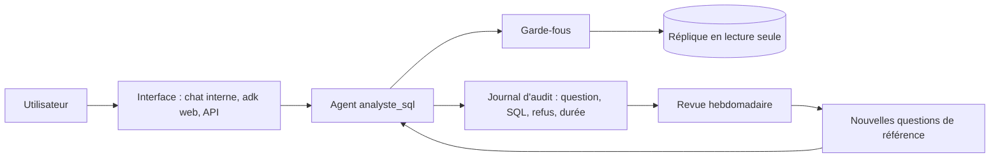

# Exploiter en confiance

> [!NOTE]
> Dans cette leçon, vous allez préparer l'agent pour un usage réel : communiquer les limites d'un résultat, garder une trace auditable, transposer les garde-fous à une base de production (PostgreSQL) et décider quand relancer l'évaluation.

## Du lab à l'équipe commerciale



Trois principes pour passer en production :

1. **Ne jamais brancher l'agent sur la base de production principale** : utilisez une réplique en lecture ou un entrepôt dédié. Un garde-fou qui échoue ne doit pas pouvoir ralentir les ventes.
2. **Tout tracer** : question, requêtes proposées, refus, résultat, durée. L'état de session contient déjà `requetes`, `refus` et `dernier_resultat`.
3. **Faire grandir le jeu de référence** : chaque question mal comprise en production devient une question de référence.

## Dire les limites du résultat

Un résultat tronqué présenté comme complet est une **erreur silencieuse**. Le champ `tronque` et la consigne « Explication : ... et ses limites » obligent l'agent à le dire. Dans la trace ci-dessous (Résultat obtenu), l'agent annonce de lui-même : « L'affichage des résultats ci-dessus est tronqué aux 50 premières commandes. »

> [!TIP]
> Pour une liste longue, la bonne réponse n'est pas d'augmenter `LIMITE_LIGNES` : proposez un **export** (fichier CSV généré par le code, hors du modèle) ou une agrégation (« par mois », « top 10 »).

```quiz
question: "Un utilisateur demande « toutes les commandes livrées » (315 lignes). Quel comportement est le bon ?"
options:
  - "Relever la limite à 1 000 lignes pour tout envoyer au modèle"
  - "Renvoyer 50 lignes, dire clairement que le résultat est tronqué, et proposer un export ou une agrégation"
  - "Refuser la question"
answer: 1
explanation: "Envoyer 315 lignes au modèle coûte des tokens et augmente le risque d'erreur de recopie. Mieux vaut un aperçu honnête, puis un export fait par le code ou une question agrégée."
```

## Transposer les garde-fous à PostgreSQL

SQLite a servi de terrain d'entraînement. Sur une base serveur, chaque couche a son équivalent, souvent **plus solide** car appliqué par le serveur et par les droits :

| Couche du lab (SQLite) | Équivalent PostgreSQL | Commentaire |
| --- | --- | --- |
| `mode=ro` | rôle avec seulement `GRANT SELECT`, `default_transaction_read_only = on` | le serveur refuse l'écriture, même avec un pilote mal configuré |
| autorisateur + liste blanche | `GRANT SELECT` sur un **schéma de vues** dédié (`reporting.*`) | l'agent ne voit que des vues, sans colonnes sensibles |
| `SQLITE_IGNORE` sur une colonne | vue qui omet ou masque la colonne | même idée, côté base |
| progress handler (2 s) | `SET statement_timeout = '5s'` sur le rôle | coupe les requêtes trop longues |
| LIMIT forcé | toujours dans le code (enveloppe `SELECT * FROM (...) LIMIT n`) | identique |
| `EXPLAIN` avant exécution | `EXPLAIN` (sans `ANALYZE`) pour valider et estimer le coût | refuser au-delà d'un coût estimé |

> [!WARNING]
> Ne laissez jamais le modèle choisir le rôle ou la chaîne de connexion. Les identifiants de la base viennent de l'environnement (un `.env` hors Git, ou un gestionnaire de secrets), exactement comme la clé d'API.

```quiz
question: "Sur PostgreSQL, quelle mesure remplace le mieux la liste blanche de tables de l'autorisateur SQLite ?"
options:
  - "Une regex sur le SQL qui refuse les noms de tables sensibles"
  - "Un rôle qui n'a le droit SELECT que sur un schéma de vues de reporting"
  - "Une consigne dans l'instruction de l'agent"
answer: 1
explanation: "Les droits du rôle sont vérifiés par le serveur pour chaque requête, comme l'autorisateur l'était par SQLite. Une regex se contourne, une consigne n'est qu'une préférence."
```

## Quand relancer l'évaluation ?

| Changement | Relancer `pytest` | Relancer `evaluer.py` |
| --- | --- | --- |
| modification de `garde_fous.py` | oui | conseillé |
| nouvelle formulation de l'instruction | oui | **oui** |
| changement de modèle (`MODEL`) | non | **oui**, 2 ou 3 passages |
| nouvelle table autorisée | oui (ajoutez des cas) | oui, avec de nouvelles questions |

Pour réduire le coût, essayez `MODEL=gemini-3.5-flash-lite` et comparez son score à celui de `gemini-3.5-flash` : si l'exactitude tient sur vos questions, le modèle le plus léger suffit.

## Exercice : un journal d'audit en JSON Lines

Ajoutez à `agent.py` une fonction qui, après chaque question, écrit une ligne JSON dans `audit.jsonl` : date, question, requêtes proposées, nombre de refus, nombre de lignes renvoyées. Le fichier ne doit contenir **aucune** donnée de résultat.

<details>
<summary>Voir la solution</summary>

```python title="files/agent.py (ajout)"
import json
from datetime import datetime, timezone

def auditer(question: str, etat: dict, chemin: str = "audit.jsonl") -> None:
    ligne = {
        "date": datetime.now(timezone.utc).isoformat(timespec="seconds"),
        "question": question,
        "requetes": etat.get("requetes", []),
        "refus": etat.get("refus", 0),
        "nb_lignes": etat.get("dernier_resultat", {}).get("nb_lignes", 0),
    }
    with open(chemin, "a", encoding="utf-8") as f:
        f.write(json.dumps(ligne, ensure_ascii=False) + "\n")

# dans __main__ :
reponse, etat = asyncio.run(demander(q))
auditer(q, etat)
```

On journalise le SQL et des **compteurs**, pas les lignes : le journal d'audit ne doit pas devenir une copie non protégée des données. La question, elle, peut contenir des informations sensibles : définissez une durée de conservation.

</details>

## Résultat obtenu

Exécution réelle le 2026-10-15 (`gemini-3.5-flash`) : « Donne-moi la liste de toutes les commandes livrées avec leur montant. » (fin de la réponse).

```text
**Requête** :
SELECT c.id AS commande_id, c.date_commande, c.client_id,
       ROUND(SUM(lc.quantite * lc.prix_unitaire), 2) AS montant
FROM commandes c JOIN lignes_commande lc ON c.id = lc.commande_id
WHERE c.statut = 'livree'
GROUP BY c.id, c.date_commande, c.client_id ORDER BY c.id;

**Explication** :
Le montant de chaque commande est calculé en effectuant la somme du produit de la quantité
et du prix unitaire (`quantite * prix_unitaire`) des articles associés dans la table
`lignes_commande`. Un filtre est appliqué sur `commandes.statut = 'livree'`.
*Limites* : L'affichage des résultats ci-dessus est tronqué aux 50 premières commandes.
```

## Je sais faire

- [ ] Faire annoncer par l'agent les limites d'un résultat (troncature, filtres)
- [ ] Tracer chaque question dans un journal d'audit sans y copier les données
- [ ] Transposer lecture seule, liste blanche, délai et LIMIT à PostgreSQL
- [ ] Décider quand relancer les tests et l'évaluation
