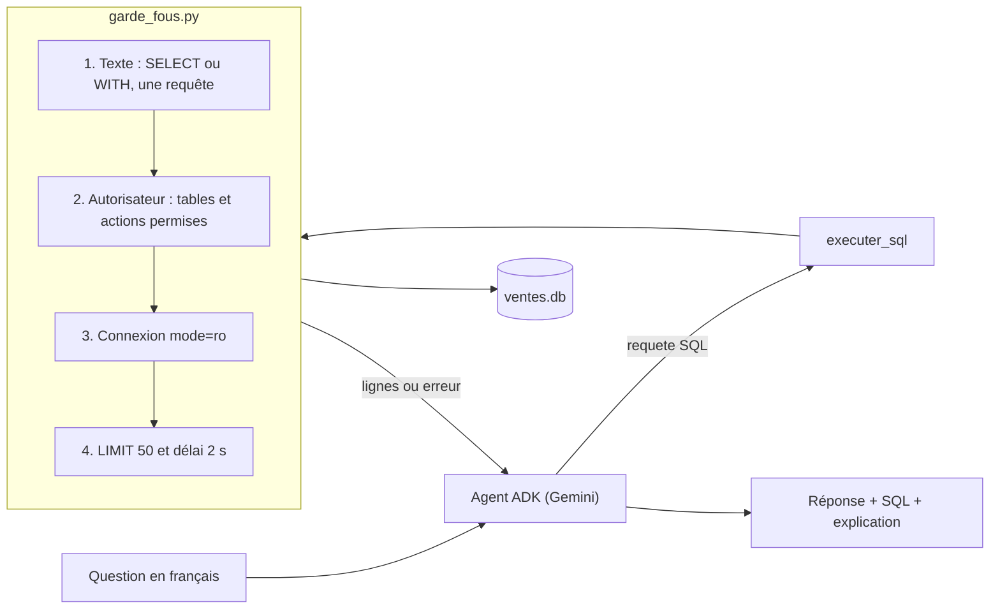

« Combien de commandes livrées en septembre ? » : la question est simple, la requête SQL aussi. Laisser un LLM écrire ce SQL et l'**exécuter** sur une vraie base, en revanche, demande des précautions : le modèle peut se tromper de table, inventer une colonne, ou se faire manipuler pour lire une table sensible ou supprimer des données.

Dans ce lab, vous construisez un **analyste text-to-SQL** (texte vers SQL : le modèle traduit une question en langage naturel en requête SQL) avec **Google ADK** (Agent Development Kit, le framework d'agents open source de Google) et **Gemini**. La sécurité ne repose pas sur la bonne volonté du modèle : elle est appliquée par le code et par SQLite.

## Ce que vous construisez

- une base **SQLite** de ventes 100 % fictive (60 clients, 12 produits, 400 commandes) qui contient aussi une table sensible, `comptes_internes`, que l'agent ne doit jamais lire ;
- un module `garde_fous.py` à quatre couches : contrôle du texte, **autorisateur SQLite** (liste blanche de tables et d'actions), connexion en **lecture seule**, **LIMIT forcé** et délai maximal ;
- un agent ADK à un seul outil, `executer_sql`, qui valide la requête avant exécution, se corrige après un refus et **explique** son résultat ;
- une **évaluation par exécution** sur 15 questions de référence, plus 2 questions pièges, lancée pour de vrai.

## Pour qui ?

- Développeurs et analystes à l'aise avec Python et le SQL de base (`SELECT`, `JOIN`, `GROUP BY`).
- Vous avez déjà vu un agent ADK simple (par exemple dans [Construire un agent IA de A à Z](../../../01-ia-generative/07-construire-un-agent-ia/index.md)).

## Prérequis

- Python 3.10 ou plus récent, `pip install -r files/requirements.txt` (google-adk 2.10.0).
- Une **clé d'API Gemini** (créée dans Google AI Studio) dans `GOOGLE_API_KEY`, avec `GOOGLE_GENAI_USE_VERTEXAI=FALSE`. Les tests automatiques, eux, tournent **sans clé**.

## Programme

| Module | Leçon | Ce que vous faites |
| --- | --- | --- |
| 1. Cas d'usage et architecture | [Text-to-SQL : promesse et risques](./01-cas-d-usage-et-architecture/01-promesse-et-risques.md) | Cartographier les risques et choisir où placer chaque garde-fou |
| 2. Construire pas à pas | [La base et les garde-fous](./02-construire-pas-a-pas/01-base-et-garde-fous.md) | Base fictive, autorisateur SQLite, lecture seule, LIMIT forcé |
| | [L'agent ADK et son outil](./02-construire-pas-a-pas/02-agent-et-outil.md) | Instruction avec schéma, outil `executer_sql`, explication du résultat |
| 3. Tester, évaluer, exploiter | [Tests sans clé et évaluation sur 15 questions](./03-tester-evaluer-exploiter/01-tests-et-evaluation.md) | Faux modèle, pytest, exactitude par exécution |
| | [Exploiter en confiance](./03-tester-evaluer-exploiter/02-exploiter.md) | `adk web`, journal d'audit, passage à une vraie base |

## En local ou sur Google Cloud ?

Tout ce lab tourne **en local** : SQLite est un fichier, l'agent appelle Gemini avec une simple clé d'API. Pour la même idée sur un entrepôt de données dans le cloud, suivez le lab [Analyste BigQuery](../../02-avec-gcp/01-analyste-bigquery/index.md), où les garde-fous deviennent un dry-run et un plafond d'octets facturés.

## Le code

Tout est dans [`files/`](./files/) : [agent.py](./files/agent.py), [garde_fous.py](./files/garde_fous.py), [creer_base.py](./files/creer_base.py), [evaluer.py](./files/evaluer.py), [questions_reference.json](./files/questions_reference.json) et [test_text_to_sql.py](./files/test_text_to_sql.py).
