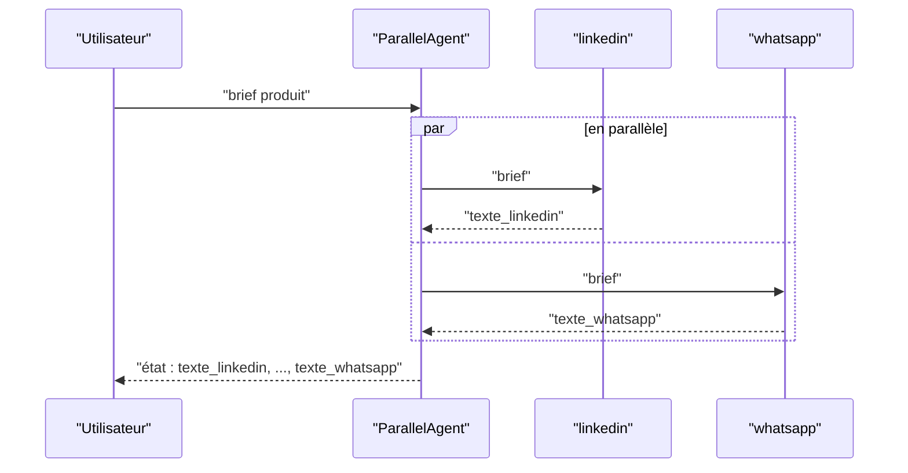
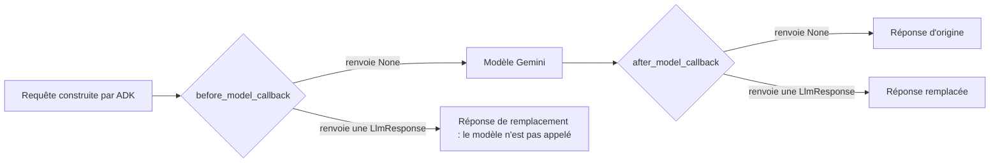

# Un brief, quatre canaux, des règles

> [!NOTE]
> Dans cette leçon, vous allez découper le problème « décliner un brief sur quatre canaux sans dérapage » en briques ADK : un sous-agent par canal, un agent parallèle qui les orchestre, et deux callbacks de modération.

## Le problème

Le même brief produit doit devenir quatre textes très différents :

| Canal | Format attendu | Longueur maximale (choix du lab) |
| --- | --- | --- |
| LinkedIn | accroche, 3 paragraphes courts, appel à l'action, 3 hashtags | 1 300 caractères |
| Instagram | ton chaleureux, quelques emojis, 5 hashtags | 800 caractères |
| Newsletter | ligne « Objet : », titre, 2 paragraphes, bouton | 1 500 caractères |
| WhatsApp | 2 ou 3 phrases, vouvoiement, un lien | 350 caractères |

Et deux règles s'appliquent partout :

- **pas de données personnelles** : un brief contient souvent un contact presse (« Léa Dupont, lea.dupont@... ») qui ne doit jamais être publié, ni même envoyé au modèle ;
- **pas de promesses interdites** : « garanti à vie », « 100 % sans risque », « le meilleur du marché » sont des allégations invérifiables, qui exposent la marque à un reproche de **pratique commerciale trompeuse**.

## Pourquoi un sous-agent par canal ?

On pourrait demander les quatre textes en un seul appel. Séparer les canaux apporte trois choses :

1. **Des consignes courtes et nettes** : chaque agent n'a que les règles de son canal ; il ne mélange pas les hashtags Instagram et la ligne « Objet : » de la newsletter.
2. **Du parallélisme** : les quatre appels partent en même temps, la durée totale est celle du plus lent, pas la somme.
3. **Une modération par canal** : si seul le texte Instagram dérape, seul lui est bloqué ; les trois autres restent utilisables.



Vocabulaire ADK :

| Terme | Définition | Dans ce lab |
| --- | --- | --- |
| **Sous-agent** | agent rattaché à un agent parent par `sub_agents=[...]` | les 4 rédacteurs |
| **`ParallelAgent`** | agent de **workflow** (sans LLM) qui lance tous ses sous-agents en même temps | `declinaisons` |
| **`output_key`** | clé de l'état de session où ADK enregistre la réponse finale de l'agent | `texte_linkedin`... |
| **Callback** | fonction appelée par ADK à un moment précis du cycle de vie | `moderer_entree`, `moderer_sortie` |

```quiz
question: "Pourquoi un ParallelAgent et non un SequentialAgent ici ?"
options:
  - "Parce que les quatre textes sont indépendants : aucun n'a besoin du résultat d'un autre"
  - "Parce qu'un SequentialAgent ne peut pas avoir plus de deux sous-agents"
  - "Parce qu'un ParallelAgent coûte moins de tokens"
answer: 0
explanation: "SequentialAgent sert quand l'étape B lit le résultat de l'étape A. Ici, chaque déclinaison part du même brief : on peut tout lancer en même temps. Le nombre de tokens, lui, est le même."
```

## Où placer la modération ?

ADK propose plusieurs **callbacks** autour d'un appel au modèle. Deux nous suffisent :



| Callback | Quand | Ce qu'il peut faire | Notre usage |
| --- | --- | --- | --- |
| `before_model_callback` | juste avant l'appel au modèle | modifier la requête, ou **court-circuiter** l'appel en renvoyant une réponse | masquer e-mails et téléphones ; refuser un brief qui exige « garanti à vie » |
| `after_model_callback` | juste après la réponse du modèle | **remplacer** la réponse | bloquer un texte qui contient une promesse interdite ou une donnée personnelle |

> [!TIP]
> Un brief refusé dans `before_model_callback` ne coûte **aucun token** : le modèle n'est jamais appelé. Filtrer tôt est à la fois plus sûr et moins cher.

```quiz
question: "Un brief contient le téléphone du contact presse. À quel moment faut-il le retirer pour que Gemini ne le voie jamais ?"
options:
  - "Dans after_model_callback, en effaçant le numéro du texte généré"
  - "Dans before_model_callback, en le remplaçant par [TELEPHONE] dans la requête"
  - "Dans l'instruction : « ne recopie pas le téléphone »"
answer: 1
explanation: "after_model_callback agit trop tard : le numéro a déjà été envoyé au modèle. L'instruction ne fait que demander de ne pas le recopier. Seul le masquage avant l'appel garantit que le modèle ne le reçoit pas."
```

## Exercice : choisir le bon point d'accroche

Pour chaque besoin, choisissez `before_model_callback`, `after_model_callback` ou « ni l'un ni l'autre » :

1. Refuser un brief écrit en anglais.
2. Couper un texte WhatsApp trop long.
3. Mesurer la durée de chaque appel au modèle.
4. Interdire au rédacteur LinkedIn d'appeler un outil de publication.

<details>
<summary>Voir la solution</summary>

1. **before_model** : on inspecte le brief et on renvoie une réponse de refus, sans appeler le modèle.
2. **after_model** : on remplace la réponse par une version coupée (ou mieux, on la bloque et on demande une nouvelle génération : couper au milieu d'une phrase donne un mauvais texte).
3. **Les deux ensemble** : `before_model` note l'heure dans l'état, `after_model` calcule la durée.
4. **Ni l'un ni l'autre** : c'est le rôle de `before_tool_callback` (avant l'exécution d'un outil), ou plus simplement de ne pas donner cet outil à l'agent.

</details>

## Résultat obtenu

Exécution réelle le 2026-10-15 (`gemini-3.5-flash`) sur [brief_produit.md](../files/brief_produit.md), qui contient un contact presse fictif : extrait du rapport.

```text
## whatsapp (262/350 car., ok)
Découvrez la gourde isotherme en inox Clairo de 500 ml, conçue pour maintenir vos boissons
froides 24 h et chaudes 12 h. Profitez de notre prix de lancement à 29,90 € jusqu'au
30 novembre 2026. Commandez la vôtre parmi 4 couleurs sur https://exemple.fr/produit 💧

## Journal de modération
- linkedin | entrée : masquage | email, telephone
- instagram | entrée : masquage | email, telephone
- newsletter | entrée : masquage | email, telephone
- whatsapp | entrée : masquage | email, telephone
```

## Je sais faire

- [ ] Expliquer pourquoi découper une tâche en un sous-agent par canal
- [ ] Choisir entre `ParallelAgent` et `SequentialAgent`
- [ ] Situer `before_model_callback` et `after_model_callback` dans le cycle d'un appel
- [ ] Dire pourquoi masquer une donnée personnelle **avant** l'appel au modèle
