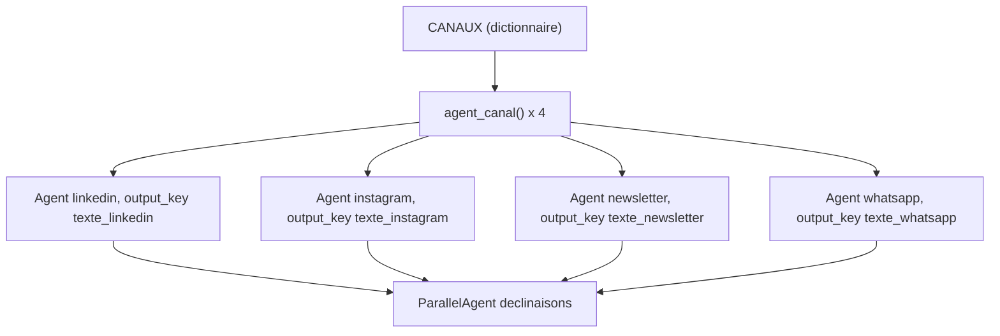

# Un sous-agent par canal

> [!NOTE]
> Dans cette leçon, vous allez générer les quatre rédacteurs à partir d'un simple dictionnaire, les regrouper dans un `ParallelAgent`, récupérer leurs textes dans l'état de session grâce à `output_key`, et produire un rapport avec contrôle des longueurs.

## Les canaux sont des données, pas du code

Les différences entre canaux tiennent en deux informations : une longueur maximale et une consigne de style. On les range dans un dictionnaire ; ajouter un canal = ajouter une ligne.

```python title="files/agent.py"
CANAUX = {
    "linkedin": (1300, "Post LinkedIn professionnel : une accroche forte en 1re ligne, "
                       "3 paragraphes courts, un appel à l'action, 3 hashtags maximum."),
    "instagram": (800, "Légende Instagram : ton chaleureux, 2 ou 3 emojis, phrases courtes, "
                       "5 hashtags en fin de texte."),
    "newsletter": (1500, "Bloc de newsletter : un objet d'e-mail (ligne 'Objet : ...'), "
                         "un titre, 2 paragraphes, un bouton d'action entre crochets."),
    "whatsapp": (350, "Message WhatsApp de diffusion : 2 à 3 phrases, vouvoiement, "
                      "1 emoji au plus, un lien factice https://exemple.fr/produit."),
}
```

Les **règles de conformité** sont communes et ajoutées à chaque instruction :

```python title="files/agent.py"
REGLES = """Règles de conformité (obligatoires) :
- n'invente aucun chiffre, aucune caractéristique, aucun prix absent du brief ;
- aucune promesse absolue : pas de « garanti à vie », « 100 % », « sans risque »,
  « le meilleur du marché », « miracle », ni d'allégation de santé ;
- n'écris aucune donnée personnelle (e-mail, téléphone, nom d'un particulier) ;
- si le brief contient [EMAIL], [TELEPHONE]... ignore ces marqueurs."""
```

> [!WARNING]
> Ces règles dans le prompt sont la **première** ligne de défense : elles évitent la plupart des dérapages. Elles ne garantissent rien. Les callbacks de la leçon suivante, eux, appliquent les règles quoi qu'écrive le modèle.

## Fabriquer un agent par canal

```python title="files/agent.py"
def agent_canal(canal: str, max_car: int, consigne: str, model=MODEL) -> Agent:
    return Agent(
        name=canal,
        model=model,
        description=f"Rédige la déclinaison {canal} du brief.",
        instruction=f"Tu es rédacteur marketing. À partir du brief produit de l'utilisateur, "
                    f"écris UNIQUEMENT le texte final pour ce canal, en français.\n{consigne}\n"
                    f"Longueur maximale : {max_car} caractères.\n{REGLES}",
        output_key=f"texte_{canal}",
        before_model_callback=moderer_entree,
        after_model_callback=moderer_sortie,
    )


def creer_agent(model=MODEL) -> ParallelAgent:
    return ParallelAgent(
        name="declinaisons",
        description="Produit en parallèle les 4 déclinaisons d'un brief.",
        sub_agents=[agent_canal(c, m, txt, model) for c, (m, txt) in CANAUX.items()],
    )

root_agent = creer_agent()
```

- `name=canal` : chaque agent a un nom unique ; il servira aussi dans le journal de modération (`callback_context.agent_name`).
- `output_key=f"texte_{canal}"` : ADK écrit la réponse finale de l'agent dans `state["texte_linkedin"]`, etc. Pas besoin de parcourir les événements.
- `model=` est un paramètre : les tests y passeront un **faux modèle**.



```quiz
question: "Que contient state[\"texte_newsletter\"] après l'exécution ?"
options:
  - "La liste de tous les événements de l'agent newsletter"
  - "Le texte de la réponse finale de l'agent newsletter, éventuellement remplacé par un callback"
  - "Le brief d'origine"
answer: 1
explanation: "output_key enregistre le texte de la réponse finale. Si after_model_callback a remplacé la réponse, c'est le texte de remplacement (« [BLOQUÉ PAR LA MODÉRATION] ... ») qui est enregistré."
```

## Lancer les quatre rédacteurs et lire l'état

```python title="files/agent.py"
async def decliner(brief: str, agent=root_agent) -> dict:
    runner = InMemoryRunner(agent=agent, app_name="multicanal")
    s = await runner.session_service.create_session(app_name="multicanal", user_id="u")
    async for _ in runner.run_async(user_id="u", session_id=s.id, new_message=types.Content(
            role="user", parts=[types.Part(text=brief)])):
        pass                                   # tout ce qui nous intéresse arrive dans l'état
    s = await runner.session_service.get_session(app_name="multicanal", user_id="u",
                                                 session_id=s.id)
    return s.state
```

Le rapport lit les quatre clés, compare chaque longueur au maximum du canal et ajoute le journal de modération :

```python title="files/agent.py"
def rapport(etat: dict) -> str:
    lignes = []
    for canal, (max_car, _) in CANAUX.items():
        texte = etat.get(f"texte_{canal}", "")
        statut = "BLOQUÉ" if texte.startswith(BLOQUE) else (
            "TROP LONG" if len(texte) > max_car else "ok")
        lignes += [f"## {canal} ({len(texte)}/{max_car} car., {statut})", texte, ""]
    ...
```

```quiz
question: "Vous ajoutez un canal « sms » limité à 160 caractères. Que faut-il modifier ?"
options:
  - "Écrire une nouvelle classe d'agent SmsAgent"
  - "Ajouter une entrée \"sms\": (160, \"...\") au dictionnaire CANAUX ; agents, état et rapport suivent"
  - "Modifier ParallelAgent pour accepter 5 sous-agents"
answer: 1
explanation: "Tout est généré depuis CANAUX : l'agent, son output_key texte_sms, la ligne du rapport et le contrôle de longueur. ParallelAgent accepte n'importe quel nombre de sous-agents."
```

## Exercice : un relecteur après les rédacteurs

Ajoutez une étape **après** les quatre rédacteurs : un agent `relecteur` qui lit les quatre textes dans l'état et signale les incohérences de prix ou de date entre canaux.

<details>
<summary>Voir la solution</summary>

On enchaîne le `ParallelAgent` et le relecteur dans un `SequentialAgent`. Les accolades `{texte_linkedin}` dans l'instruction sont remplacées par ADK par la valeur de l'état.

```python title="files/agent.py (variante)"
from google.adk.agents import SequentialAgent

relecteur = Agent(
    name="relecteur", model=MODEL, output_key="relecture",
    instruction="Compare ces 4 textes et liste les incohérences de prix, de date ou de "
                "caractéristique (ou réponds « aucune »).\n"
                "LinkedIn : {texte_linkedin}\nInstagram : {texte_instagram}\n"
                "Newsletter : {texte_newsletter}\nWhatsApp : {texte_whatsapp}",
    after_model_callback=moderer_sortie,
)
root_agent = SequentialAgent(name="chaine", sub_agents=[creer_agent(), relecteur])
```

Le parallélisme est conservé pour les rédacteurs ; seul le relecteur attend, car il a besoin de leurs résultats.

</details>

## Résultat obtenu

Exécution réelle le 2026-10-15 (`gemini-3.5-flash`), `python agent.py brief_produit.md` : en-têtes du rapport et texte LinkedIn.

```text
## linkedin (720/1300 car., ok)
Fini les bouteilles en plastique jetables au bureau !

Voici la Clairo 500, notre gourde isotherme en inox de 500 ml conçue pour accompagner le
quotidien des actifs urbains. Dotée d'un bouchon étanche et disponible en 4 couleurs, [...]
Côté performances, nos mesures internes indiquent un maintien de vos boissons au froid
pendant 24 h et au chaud pendant 12 h. [...]
Profitez de notre prix de lancement à 29,90 € jusqu'au 30 novembre 2026 (au lieu de 34,90 €).
Commandez la vôtre dès aujourd'hui : https://exemple.fr/produit
#ZeroDechet #VieDeBureau #GourdeIsotherme
## instagram (501/800 car., ok)   ## newsletter (816/1500 car., ok)   ## whatsapp (262/350 car., ok)
```

## Je sais faire

- [ ] Décrire des variantes d'agent dans un dictionnaire et générer les agents
- [ ] Regrouper des sous-agents dans un `ParallelAgent`
- [ ] Récupérer la réponse de chaque agent avec `output_key`
- [ ] Contrôler par le code une contrainte que le modèle respecte mal (longueur)
