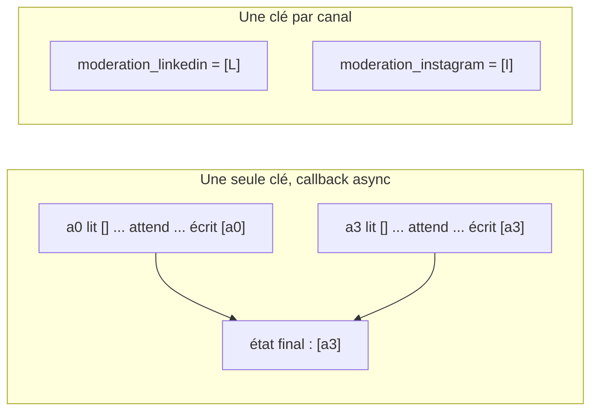

# Les callbacks de modération

> [!NOTE]
> Dans cette leçon, vous allez écrire les règles de modération en Python pur (`moderation.py`), puis les brancher dans ADK avec deux callbacks : `moderer_entree` (avant le modèle) et `moderer_sortie` (après le modèle), avec un journal par canal.

## 1. Les règles, sans ADK

Séparer les règles du framework permet de les tester en une milliseconde et de les faire relire par quelqu'un qui ne connaît pas ADK (le service juridique, par exemple).

```python title="files/moderation.py"
DONNEES_PERSONNELLES = {
    "email": re.compile(r"[\w.+-]+@[\w-]+(\.[\w-]+)+"),
    "telephone": re.compile(r"(?<!\d)(?:\+33\s?|0)[1-9](?:[\s.-]?\d{2}){4}(?!\d)"),
    "iban": re.compile(r"\bFR\d{2}(?:\s?[\dA-Z]{4}){5}\s?[\dA-Z]{3}\b", re.I),
    "carte": re.compile(r"(?<!\d)(?:\d{4}[\s-]?){3}\d{4}(?!\d)"),
}

PROMESSES_INTERDITES = {
    "garantie absolue": r"garanti(e|s|es)? (à vie|à 100|sans condition)|résultats? garantis?",
    "100 %": r"100 ?% (efficace|garanti|sûr|sans risque|satisfait)",
    "sans risque": r"(sans|zéro|aucun) (aucun )?risque",
    "allégation santé": r"\bguéri[rt]\b|\bsoigne(nt)?\b|prévient (le|la|les) (cancer|maladie)",
    "superlatif invérifiable": r"\bmeilleur(e|s|es)?\b[^.!?\n]{0,30}\b(du|au) (marché|monde)|...",
    "miracle": r"\bmiracle\b",
}

def masquer_donnees_personnelles(texte: str) -> tuple[str, list[str]]:
    trouves = []
    for nom, motif in DONNEES_PERSONNELLES.items():
        texte, n = motif.subn(f"[{nom.upper()}]", texte)
        if n:
            trouves.append(nom)
    return texte, trouves
```

Une **donnée personnelle** est une information qui permet d'identifier une personne, directement ou non (au sens du RGPD) : nom, e-mail, téléphone, IBAN… Le masquage remplace la valeur par un **marqueur** (`[EMAIL]`) : le texte garde son sens, la donnée disparaît.

> [!WARNING]
> Les expressions régulières attrapent les formats **réguliers** (e-mail, téléphone, IBAN). Elles ne reconnaissent pas un nom propre ni une adresse postale. Pour cela, il faut un service de détection dédié (par exemple Sensitive Data Protection sur Google Cloud) ; la leçon sur les limites y revient.

## 2. Avant le modèle : masquer, et refuser un brief non conforme

```python title="files/agent.py"
def moderer_entree(callback_context: CallbackContext,
                   llm_request: LlmRequest) -> LlmResponse | None:
    """AVANT le modèle : masque les données personnelles, refuse un brief non conforme."""
    for content in llm_request.contents:
        for part in content.parts or []:
            if part.text:
                part.text, trouves = masquer_donnees_personnelles(part.text)
                if trouves:
                    _journal(callback_context, "entrée : masquage", trouves)
    brief = " ".join(p.text or "" for c in llm_request.contents if c.role == "user"
                     for p in c.parts or [])
    interdites = promesses_interdites(brief)
    if interdites:  # Le modèle n'est PAS appelé : 0 token consommé.
        _journal(callback_context, "entrée : brief refusé", interdites)
        return LlmResponse(content=types.Content(role="model", parts=[types.Part(
            text=f"{BLOQUE} Brief non conforme : {', '.join(interdites)}.")]))
    return None
```

- `llm_request.contents` est la conversation qui va partir vers le modèle ; on **modifie** son texte sur place.
- Renvoyer `None` laisse l'appel se faire ; renvoyer une `LlmResponse` le **remplace** : Gemini n'est pas appelé.
- On ne vérifie les promesses que dans les messages `user` (le brief), pas dans l'instruction système, qui cite elle-même les expressions interdites.

```quiz
question: "Pourquoi moderer_entree ne cherche-t-elle pas les promesses interdites dans l'instruction système ?"
options:
  - "Parce que l'instruction n'est pas envoyée au modèle"
  - "Parce que l'instruction contient justement la liste des expressions interdites : chaque brief serait refusé"
  - "Parce que ADK interdit de lire l'instruction dans un callback"
answer: 1
explanation: "Les règles de conformité écrivent « pas de garanti à vie, 100 %, sans risque... ». Scanner ce texte déclencherait le refus à chaque fois. On ne contrôle que ce qui vient de l'utilisateur."
```

## 3. Après le modèle : bloquer

```python title="files/agent.py"
def moderer_sortie(callback_context: CallbackContext,
                   llm_response: LlmResponse) -> LlmResponse | None:
    """APRÈS le modèle : bloque une promesse interdite ou une donnée personnelle."""
    if not llm_response.content or not llm_response.content.parts:
        return None
    texte = "".join(p.text or "" for p in llm_response.content.parts)
    motifs = promesses_interdites(texte) + masquer_donnees_personnelles(texte)[1]
    if not motifs:
        return None
    _journal(callback_context, "sortie : texte bloqué", motifs)
    return LlmResponse(content=types.Content(role="model", parts=[types.Part(
        text=f"{BLOQUE} Le texte généré contenait : {', '.join(motifs)}.")]))
```

On **bloque** plutôt que de corriger : remplacer « garanti à vie » par un blanc donnerait une phrase bancale, publiée sans relecture. Le texte bloqué est visible dans le rapport, un humain décide.

## 4. Un journal par canal, à cause du parallélisme

```python title="files/agent.py"
def _journal(ctx: CallbackContext, etape: str, motif: list[str]) -> None:
    # Une clé PAR canal : les 4 agents tournent en parallèle ; avec une liste
    # commune, une lecture périmée suivie d'une écriture ferait perdre des entrées.
    cle = f"moderation_{ctx.agent_name}"
    ctx.state[cle] = ctx.state.get(cle, []) + [{"etape": etape, "motif": motif}]
```

Nous l'avons vérifié avec ADK 2.10 : nos callbacks étant **synchrones** (aucun `await` entre la lecture et l'écriture de l'état), une liste commune ne perdait rien. Mais il suffit d'un callback `async` qui attend un service externe entre les deux pour que les quatre agents lisent la même liste vide : dans notre essai, il ne restait qu'**une** entrée sur quatre. Une clé par canal est sûre par construction, quelle que soit l'évolution du code.



```quiz
question: "Quatre agents parallèles ont un callback async qui lit state[\"moderation\"], attend 50 ms une API, puis écrit la liste lue + son nom. Que contient l'état à la fin ?"
options:
  - "Les quatre noms, ADK fusionne les listes"
  - "Un seul nom : chaque agent a lu la liste vide, et la dernière écriture remplace les autres"
  - "Une erreur Python"
answer: 1
explanation: "C'est une situation de concurrence (race condition) : la lecture est périmée au moment de l'écriture. Vérifié avec ADK 2.10 : il ne restait qu'une entrée sur quatre. Des clés séparées par canal évitent le problème sans verrou."
```

## Exercice : masquer aussi les numéros de commande

Les briefs du service client citent parfois des numéros de commande au format `CMD-2026-123456`. Ajoutez ce type au masquage et vérifiez qu'il apparaît dans le journal.

<details>
<summary>Voir la solution</summary>

Une ligne dans le dictionnaire suffit : la fonction de masquage, les callbacks et le journal suivent.

```python title="files/moderation.py (ajout)"
DONNEES_PERSONNELLES = {
    ...,
    "commande": re.compile(r"\bCMD-\d{4}-\d{6}\b"),
}
```

```python title="vérification"
>>> masquer_donnees_personnelles("Suite à la CMD-2026-123456 de Mme X")
('Suite à la [COMMANDE] de Mme X', ['commande'])
```

« Mme X » n'est pas masqué : un nom propre ne se détecte pas avec une expression régulière.

</details>

## Résultat obtenu

Exécution réelle le 2026-10-15 sur [brief_piege.md](../files/brief_piege.md), qui exige « la meilleure gourde du marché, garantie à vie, 100 % sans risque » : les quatre canaux sont refusés **avant** tout appel au modèle.

```text
## linkedin (110/1300 car., BLOQUÉ)
[BLOQUÉ PAR LA MODÉRATION] Brief non conforme : garantie absolue, 100 %, sans risque, superlatif invérifiable.
[...]
## Journal de modération
- linkedin | entrée : brief refusé | garantie absolue, 100 %, sans risque, superlatif invérifiable
- instagram | entrée : brief refusé | garantie absolue, 100 %, sans risque, superlatif invérifiable
- newsletter | entrée : brief refusé | garantie absolue, 100 %, sans risque, superlatif invérifiable
- whatsapp | entrée : brief refusé | garantie absolue, 100 %, sans risque, superlatif invérifiable
```

## Je sais faire

- [ ] Écrire des règles de modération testables sans framework
- [ ] Modifier la requête ou court-circuiter le modèle dans `before_model_callback`
- [ ] Remplacer une réponse dans `after_model_callback`
- [ ] Éviter une écriture concurrente dans l'état avec des clés séparées
