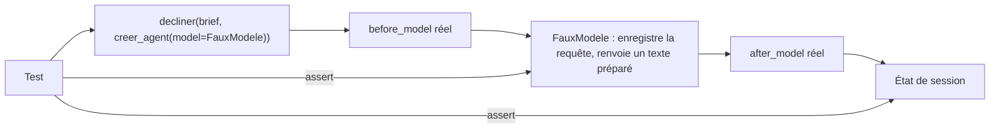

# Tester sans clé avec un faux modèle

> [!NOTE]
> Dans cette leçon, vous allez écrire les tests qui **prouvent** les trois promesses du lab : le modèle ne voit jamais les données personnelles du brief, un brief non conforme ne coûte aucun appel, et un texte qui dérape est bloqué sur son seul canal. Le tout sans clé d'API, en moins de 2 secondes.

## Ce qu'on veut prouver

| Promesse | Test | Comment on le voit |
| --- | --- | --- |
| les règles détectent ce qu'elles doivent, et rien d'autre | `test_donnees_personnelles_masquees`, `test_promesses_detectees`, `test_pas_de_faux_positif` | appels directs aux fonctions de `moderation.py` |
| le modèle ne reçoit jamais l'e-mail ni le téléphone | `test_brief_propre_et_masquage` | on inspecte les requêtes reçues par le faux modèle |
| un brief piège ne déclenche aucun appel | `test_brief_piege_bloque_avant_le_modele` | la liste des requêtes reçues reste vide |
| un dérapage ne bloque que son canal | `test_sortie_bloquee_sur_un_seul_canal` | 1 texte bloqué, 3 intacts |



Le point clé : seul le **modèle** est faux. Les callbacks, le `ParallelAgent`, `output_key` et la session sont les vrais composants d'ADK.

## Un faux modèle qui répond selon le canal

```python title="files/test_multicanal.py"
class FauxModele(BaseLlm):
    """Répond selon le nom de l'agent appelant ; garde chaque requête reçue."""
    reponses: dict = {}
    vus: list = []

    async def generate_content_async(self, llm_request, stream=False):
        self.vus.append(llm_request)
        consignes = str(llm_request.config.system_instruction)
        canal = next(c for c, (_, txt) in CANAUX.items() if txt in consignes)
        yield LlmResponse(content=types.Content(role="model", parts=[
            types.Part(text=self.reponses[canal])]))
```

Les quatre agents partagent le même objet modèle ; pour savoir **qui** l'appelle, le faux modèle cherche la consigne du canal dans l'instruction système reçue.

```quiz
question: "Pourquoi le faux modèle conserve-t-il chaque llm_request dans self.vus ?"
options:
  - "Pour rejouer la conversation plus tard"
  - "Pour vérifier ce qui aurait été envoyé à Gemini : c'est la seule façon de prouver que l'e-mail n'est jamais parti"
  - "Parce que BaseLlm l'exige"
answer: 1
explanation: "La garantie « le modèle ne voit pas la donnée » porte sur la requête sortante. En la capturant, le test vérifie exactement ce que le vrai modèle aurait reçu."
```

## Prouver le masquage

```python title="files/test_multicanal.py"
def test_brief_propre_et_masquage():
    reponses = {c: f"Texte {c} : gourde Clairo à 29,90 €." for c in CANAUX}
    modele, etat = lancer((ICI / "brief_produit.md").read_text(encoding="utf-8"), reponses)
    assert len(modele.vus) == 4                         # un appel par canal
    for req in modele.vus:                              # le modèle n'a jamais vu le contact
        vu = str([c.model_dump() for c in req.contents])
        assert "lea.dupont@exemple.fr" not in vu and "06 12 34 56 78" not in vu
        assert "[EMAIL]" in vu and "[TELEPHONE]" in vu
    for c in CANAUX:
        assert etat[f"texte_{c}"] == reponses[c]
        assert etat[f"moderation_{c}"][0]["etape"] == "entrée : masquage"
```

## Prouver le court-circuit et le blocage ciblé

```python title="files/test_multicanal.py"
def test_brief_piege_bloque_avant_le_modele():
    modele, etat = lancer((ICI / "brief_piege.md").read_text(encoding="utf-8"), {})
    assert modele.vus == []                             # aucun appel : 0 token
    for c in CANAUX:
        assert etat[f"texte_{c}"].startswith(BLOQUE)

def test_sortie_bloquee_sur_un_seul_canal():
    reponses = {c: "Texte sobre." for c in CANAUX}
    reponses["instagram"] = "La gourde garantie à vie ! Écrivez à jean@exemple.fr"
    _, etat = lancer("Brief : gourde Clairo 500, 29,90 €.", reponses)
    assert etat["texte_instagram"].startswith(BLOQUE)
    assert etat["moderation_instagram"][-1]["motif"] == ["garantie absolue", "email"]
    assert all(etat[f"texte_{c}"] == "Texte sobre." for c in CANAUX if c != "instagram")
```

Le second test injecte le dérapage **dans la réponse du modèle** : c'est le seul moyen fiable de tester `after_model_callback`, car un vrai modèle bien instruit dérape rarement (voir la leçon suivante).

> [!TIP]
> Le test `test_pas_de_faux_positif` compte autant que les autres : une règle qui bloque « 500 ml » ou « soigneusement » (qui contient « soigne ») ferait perdre confiance dans tout le système. Chaque nouvelle règle mérite un exemple qui **ne doit pas** la déclencher.

```quiz
question: "Le test test_brief_piege_bloque_avant_le_modele vérifie modele.vus == []. Que prouve cette assertion ?"
options:
  - "Que le brief piège est bien écrit"
  - "Que before_model_callback a court-circuité les quatre appels : aucune requête n'est partie vers le modèle"
  - "Que after_model_callback a bloqué les quatre réponses"
answer: 1
explanation: "Si after_model avait fait le travail, le modèle aurait été appelé 4 fois (vus contiendrait 4 requêtes). Une liste vide prouve que le refus a eu lieu avant tout appel."
```

## Exercice : un test pour les numéros de carte collés

Un numéro de carte peut être écrit sans espace (`4970101234567890`). Écrivez le test, puis vérifiez s'il passe avec le motif actuel.

<details>
<summary>Voir la solution</summary>

```python title="files/test_multicanal.py (ajout)"
def test_carte_sans_espace():
    masque, trouves = masquer_donnees_personnelles("carte 4970101234567890")
    assert trouves == ["carte"] and masque == "carte [CARTE]"
```

Le motif `(?<!\d)(?:\d{4}[\s-]?){3}\d{4}(?!\d)` rend le séparateur facultatif (`[\s-]?`) : le test passe. Il protège contre une régression si quelqu'un « simplifie » un jour le motif en rendant l'espace obligatoire.

</details>

## Résultat obtenu

`pytest -v` sans clé d'API, le 2026-10-15 :

```text
test_donnees_personnelles_masquees[écrire à lea.dupont@exemple.fr-email] PASSED [  6%]
test_donnees_personnelles_masquees[appeler le 06 12 34 56 78-telephone] PASSED [ 13%]
test_donnees_personnelles_masquees[ou le +33 6 12 34 56 78-telephone] PASSED [ 20%]
test_donnees_personnelles_masquees[IBAN FR76 3000 6000 0112 3456 7890 189-iban] PASSED [ 26%]
test_donnees_personnelles_masquees[carte 4970 1012 3456 7890-carte] PASSED [ 33%]
test_pas_de_faux_positif PASSED                      [ 40%]
test_promesses_detectees[Garantie à vie !] PASSED [ 46%]
[...]
test_brief_propre_et_masquage PASSED                 [ 86%]
test_brief_piege_bloque_avant_le_modele PASSED       [ 93%]
test_sortie_bloquee_sur_un_seul_canal PASSED         [100%]
============================== 15 passed in 1.58s ==============================
```

Premier passage : un échec utile. « La meilleure gourde du marché » n'était pas détecté, car le motif attendait « meilleure du marché » sans nom au milieu. Le motif a été élargi (`meilleur(e)…` suivi de 30 caractères au plus avant `du marché`).

## Je sais faire

- [ ] Écrire un faux `BaseLlm` qui enregistre les requêtes et répond selon l'agent appelant
- [ ] Prouver qu'une donnée n'est jamais envoyée au modèle
- [ ] Tester `after_model_callback` en injectant un dérapage dans la réponse
- [ ] Ajouter des cas négatifs pour éviter les faux positifs
