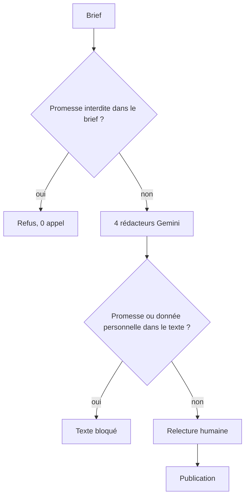

# Essais réels et limites de la modération

> [!NOTE]
> Dans cette leçon, vous allez lancer le système sur trois briefs réels (propre, piège, ambigu), lire ce que la modération a laissé passer, et organiser le circuit de validation humaine qui reste indispensable avant publication.

## Trois briefs, trois comportements

```bash title="terminal"
python agent.py brief_produit.md     # propre, avec un contact presse à masquer
python agent.py brief_piege.md       # exige « garantie à vie », « 100 % sans risque »
python agent.py brief_ambigu.md      # pousse vers l'exagération sans les mots interdits
```

| Brief | Appels au modèle | Ce qui s'est passé (2026-10-15) |
| --- | --- | --- |
| [brief_produit.md](../files/brief_produit.md) | 4 | e-mail et téléphone masqués pour les 4 canaux ; 4 textes « ok », dans les longueurs |
| [brief_piege.md](../files/brief_piege.md) | **0** | refusé par `before_model` pour 4 motifs ; aucun token consommé |
| [brief_ambigu.md](../files/brief_ambigu.md) | 4 | aucun mot interdit écrit par le modèle ; journal « rien à signaler » ; mais une exagération est passée |



## Ce que la modération laisse passer

Le brief ambigu dit : « imbattable, aucune autre gourde ne fait mieux », « achetez-la les yeux fermés, satisfaction assurée ». Le modèle a bien suivi les règles du prompt : aucun « meilleur du marché », aucune garantie. Mais la newsletter générée contient :

> « La gourde Clairo 500 a pleinement convaincu nos testeurs sur le terrain. Après plusieurs mois d'utilisation, leurs retours sont **unanimes** [...] »

Le brief cite trois testeurs, rien ne dit que **tous** les testeurs sont d'accord. « Unanimes » est une affirmation inventée, invisible pour une expression régulière : elle ne contient aucun mot interdit.

| Ce que les règles attrapent | Ce qu'elles ne voient pas |
| --- | --- |
| formats réguliers : e-mail, téléphone, IBAN, carte | noms propres, adresses postales |
| expressions listées : « garanti à vie », « 100 % efficace » | paraphrases : « vous ne serez jamais déçu » |
| superlatifs listés : « le meilleur du marché » | exagérations : « retours unanimes », « tout le monde l'adore » |
| — | chiffres faux mais plausibles (« 48 h » au lieu de 24 h) |

```quiz
question: "Le texte généré dit « froid pendant 48 h » alors que le brief dit 24 h. Quelle brique du lab le détecte ?"
options:
  - "after_model_callback, grâce aux motifs de promesses interdites"
  - "Aucune : il faudrait une vérification de cohérence avec le brief (relecteur LLM ou contrôle des chiffres) et une relecture humaine"
  - "before_model_callback"
answer: 1
explanation: "Les motifs cherchent des formulations interdites, pas des faits faux. Vérifier qu'un chiffre vient du brief demande une autre règle (extraire les nombres et les comparer) ou un relecteur, et la validation humaine reste le dernier filet."
```

## Renforcer sans tout réécrire

Trois pistes, de la plus simple à la plus lourde :

1. **Contrôle des chiffres** dans `after_model_callback` : extraire tous les nombres du texte (`re.findall(r"\d+[.,]?\d*", texte)`) et bloquer ceux qui n'apparaissent pas dans le brief.
2. **Relecteur LLM** après les rédacteurs (exercice de la leçon « Un sous-agent par canal ») : un agent qui compare chaque texte au brief et liste les affirmations non sourcées. Il coûte un appel de plus par brief.
3. **Service de détection de données personnelles** pour les noms et adresses, appelé dans `before_model_callback`.

> [!WARNING]
> Les **paramètres de sécurité** de l'API Gemini (*safety settings*) filtrent les contenus dangereux (haine, harcèlement, contenu sexuel, dangereux). Ils ne savent rien de vos règles marketing : « garanti à vie » n'est pas un contenu dangereux. Les deux mécanismes sont complémentaires.

## La relecture humaine reste obligatoire

| Étape | Qui | Outil |
| --- | --- | --- |
| écrire le brief, sans données personnelles inutiles | marketing | modèle de brief |
| générer et modérer automatiquement | l'agent | `python agent.py brief.md` |
| relire chaque texte « ok », corriger ou rejeter | marketing | rapport Markdown |
| examiner les textes bloqués et le journal | conformité | journal de modération |
| publier | marketing | outils de chaque réseau |

Coût par brief : 4 appels au modèle (0 si le brief est refusé). Pour de gros volumes, essayez `MODEL=gemini-3.5-flash-lite` et comparez les textes sur quelques briefs.

```quiz
question: "Pourquoi ne pas publier automatiquement les textes marqués « ok » ?"
options:
  - "Parce que l'API Gemini l'interdit"
  - "Parce que « ok » signifie seulement « aucune règle déclenchée » : une affirmation inventée comme « retours unanimes » passe les règles"
  - "Parce que les textes sont trop longs"
answer: 1
explanation: "La modération automatique réduit le risque, elle ne certifie pas le contenu. L'essai réel l'a montré : sans mot interdit, une exagération a traversé toutes les règles."
```

## Exercice : bloquer les chiffres absents du brief

Ajoutez à `moderation.py` une fonction `chiffres_inventes(texte, brief)` qui renvoie les nombres du texte absents du brief, puis utilisez-la dans `moderer_sortie`.

<details>
<summary>Voir la solution</summary>

```python title="files/moderation.py (ajout)"
_NOMBRE = re.compile(r"\d+(?:[.,]\d+)?")

def chiffres_inventes(texte: str, brief: str) -> list[str]:
    connus = set(_NOMBRE.findall(brief))
    return sorted(set(_NOMBRE.findall(texte)) - connus)
```

Dans `moderer_sortie`, le brief se lit dans `callback_context.user_content` (le message de l'utilisateur qui a lancé l'invocation) :

```python title="files/agent.py (variante)"
brief = "".join(p.text or "" for p in callback_context.user_content.parts)
inventes = chiffres_inventes(texte, brief)
if inventes:
    motifs.append("chiffres absents du brief : " + ", ".join(inventes))
```

Attention aux faux positifs : « 2 paragraphes », « 1 emoji » ou une année calculée (« 2027 ») ne sont pas dans le brief. Commencez par **signaler** dans le journal plutôt que bloquer, et observez quelques semaines.

</details>

## Résultat obtenu

Exécution réelle le 2026-10-15 (`gemini-3.5-flash`) sur `brief_ambigu.md` : extrait du rapport.

```text
## newsletter (673/1500 car., ok)
Objet : La gourde Clairo 500 validée par nos testeurs !

La gourde Clairo 500 : la tranquillité au quotidien

Vous cherchez un contenant fiable pour vos boissons ? La gourde Clairo 500 a pleinement
convaincu nos testeurs sur le terrain. Après plusieurs mois d'utilisation, leurs retours
sont unanimes : ils soulignent notamment l'absence de fuite sur une période de 6 mois [...]

## whatsapp (236/350 car., ok)
Découvrez la gourde Clairo 500 au prix de 29,90 €. Après 6 mois de test sans aucune fuite
signalée par nos utilisateurs, elle est prête à devenir votre alliée au quotidien. [...]

## Journal de modération
- rien à signaler
```

## Je sais faire

- [ ] Lancer l'agent sur des briefs propres, pièges et ambigus, et comparer les résultats
- [ ] Citer ce qu'une modération par expressions régulières ne peut pas voir
- [ ] Proposer un renforcement adapté (contrôle des chiffres, relecteur, détection de données personnelles)
- [ ] Organiser une relecture humaine avant publication
