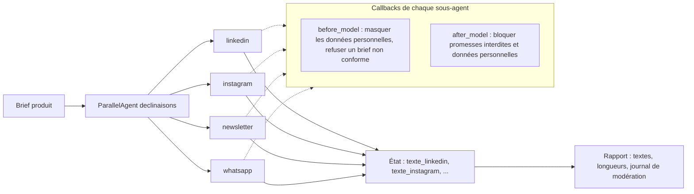

Une équipe marketing écrit un **brief produit** (le document qui résume le produit, la cible, le prix et le ton), puis le décline pour chaque canal : un post LinkedIn, une légende Instagram, un bloc de newsletter, un message WhatsApp. C'est répétitif, et chaque canal a ses codes et sa longueur maximale.

Dans ce lab, vous confiez ce travail à **quatre sous-agents ADK** qui écrivent en parallèle, et vous placez autour d'eux une **modération automatique** : avant l'appel au modèle, les données personnelles du brief sont masquées et un brief non conforme est refusé ; après l'appel, tout texte qui contient une promesse interdite ou une donnée personnelle est bloqué.

## Ce que vous construisez

- `moderation.py` : les règles en Python pur (expressions régulières), testables sans modèle ;
- `agent.py` : 4 sous-agents générés depuis un dictionnaire `CANAUX`, un `ParallelAgent`, deux callbacks et un rapport ;
- `test_multicanal.py` : 15 tests **sans clé**, avec un faux modèle qui prouve que le modèle ne voit jamais l'e-mail du brief ;
- trois essais réels : un brief propre, un brief piège, un brief ambigu.

## Pour qui ?

- Développeurs Python qui ont déjà écrit un agent ADK simple, et veulent passer au multi-agents et aux callbacks.
- Équipes marketing ou conformité curieuses de voir **où** placer des règles automatiques, et ce qu'elles ne savent pas faire.

## Prérequis

- Python 3.10 ou plus récent, `pip install -r files/requirements.txt` (google-adk 2.10.0).
- Une **clé d'API Gemini** dans `GOOGLE_API_KEY`, avec `GOOGLE_GENAI_USE_VERTEXAI=FALSE`. Les tests tournent sans clé.

## Programme

| Module | Leçon | Ce que vous faites |
| --- | --- | --- |
| 1. Cas d'usage et architecture | [Un brief, quatre canaux, des règles](./01-cas-d-usage-et-architecture/01-brief-canaux-et-regles.md) | Comprendre ParallelAgent, output_key et le cycle de vie des callbacks |
| 2. Construire pas à pas | [Un sous-agent par canal](./02-construire-pas-a-pas/01-un-sous-agent-par-canal.md) | Générer 4 agents depuis un dictionnaire, les lancer en parallèle |
| | [Les callbacks de modération](./02-construire-pas-a-pas/02-callbacks-de-moderation.md) | `before_model` qui masque et refuse, `after_model` qui bloque |
| 3. Tester, évaluer, exploiter | [Tester sans clé avec un faux modèle](./03-tester-evaluer-exploiter/01-tester-sans-cle.md) | Prouver le masquage et le blocage sans appel réseau |
| | [Essais réels et limites de la modération](./03-tester-evaluer-exploiter/02-essais-reels-et-limites.md) | Trois briefs réels, ce que les règles laissent passer, la relecture humaine |

## En local ou sur Google Cloud ?

Tout tourne **en local** avec une clé d'API Gemini. Pour mettre l'agent à disposition d'une équipe, les mêmes fichiers se déploient sur Cloud Run ou Vertex AI Agent Engine (voir les labs [Avec Google Cloud](../../02-avec-gcp/index.md)) ; les callbacks voyagent avec l'agent, sans changement.

## Le code

Tout est dans [`files/`](./files/) : [agent.py](./files/agent.py), [moderation.py](./files/moderation.py), [brief_produit.md](./files/brief_produit.md), [brief_piege.md](./files/brief_piege.md) et [test_multicanal.py](./files/test_multicanal.py).
