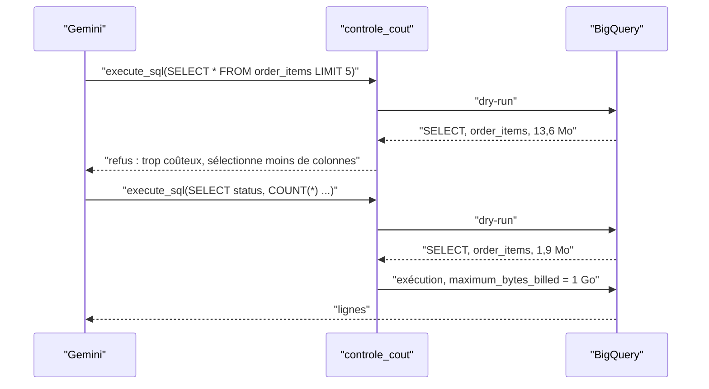

# Un analyste qui ne fait pas exploser la facture

> [!NOTE]
> Dans cette leçon, vous allez comprendre comment BigQuery facture une requête, pourquoi un `LIMIT` ne protège pas votre budget, et comment le **dry-run** et le **plafond d'octets facturés** permettent de laisser un agent écrire du SQL sans risque financier.

## Le cas d'usage

Une équipe e-commerce pose des questions du type « quel chiffre d'affaires par catégorie en 2025 ? », « combien de commandes annulées ? ». Les données sont dans BigQuery. L'agent doit :

1. comprendre la question et les tables ;
2. écrire une requête **GoogleSQL** (le dialecte SQL de BigQuery) ;
3. l'exécuter **sans risque** : ni écriture, ni table interdite, ni facture surprise ;
4. répondre avec le résultat, la requête et une explication.

## Comment BigQuery facture une requête

En tarification **à la demande** (*on-demand*), BigQuery facture les **octets lus**, pas le temps ni le nombre de lignes renvoyées. Et il stocke les données **par colonne** : il ne lit que les colonnes citées dans la requête.

| Requête | Ce qui est lu | Conséquence |
| --- | --- | --- |
| `SELECT * FROM t LIMIT 5` | **toutes** les colonnes, **toute** la table | `LIMIT` ne réduit pas les octets facturés |
| `SELECT id, status FROM t` | 2 colonnes, toute la table | beaucoup moins cher |
| `SELECT COUNT(*) FROM t` | métadonnées seulement | presque gratuit |
| requête sur une table partitionnée, filtrée sur la partition | seulement les partitions utiles | le bon réflexe sur les grosses tables |

> [!WARNING]
> Une table de 10 To lue en entier coûte environ 10 fois le tarif par To affiché sur la page des tarifs BigQuery. Un agent qui écrit `SELECT *` sur une telle table, même avec `LIMIT 5`, déclenche cette dépense. Le premier To lu chaque mois est gratuit, mais une seule requête peut le dépasser.

Les tables de `thelook_ecommerce` sont petites (mesuré le 2026-10-15 : `orders` 6,8 Mo, `order_items` 13,6 Mo, `products` 4,3 Mo, `events` 385 Mo), ce qui en fait un terrain d'entraînement sans danger.

```quiz
question: "Un agent exécute SELECT * FROM `projet.ventes.evenements` LIMIT 10 sur une table de 500 Go. Combien d'octets sont facturés à la demande ?"
options:
  - "Environ 10 lignes, quelques Ko"
  - "Environ 500 Go : toutes les colonnes de toute la table sont lues"
  - "Rien, les requêtes avec LIMIT sont gratuites"
answer: 1
explanation: "Le LIMIT s'applique après la lecture. BigQuery facture les colonnes lues sur toute la table (sauf partitions ou clustering exploités par un filtre). Sélectionner moins de colonnes est le premier levier."
```

## Deux protections natives de BigQuery

| Mécanisme | Ce qu'il fait | Coût |
| --- | --- | --- |
| **Dry-run** (`dry_run=True`) | BigQuery valide la requête et renvoie : type d'instruction (`SELECT`, `DELETE`…), tables lues, **octets qui seraient traités** | gratuit, rien n'est exécuté |
| **`maximum_bytes_billed`** | si la requête dépasse ce plafond, BigQuery la refuse **avant** de la lancer | aucun : la requête échoue sans être facturée |

Le dry-run sert à **décider** (et à expliquer au modèle pourquoi on refuse) ; `maximum_bytes_billed` est le **filet** appliqué par BigQuery lui-même si tout le reste a échoué.



## L'architecture du lab

| Brique | Rôle | Fourni par |
| --- | --- | --- |
| `BigQueryToolset` | outils `get_table_info` et `execute_sql`, lecture seule, plafond, labels | ADK |
| `controle_cout` | dry-run, liste blanche de tables, plafond expliqué au modèle | votre code (`before_tool_callback`) |
| `Gemini` sur Vertex AI | comprendre la question, écrire le SQL, expliquer | Vertex AI, `europe-west1` |
| ADC | identifiants de votre compte, trouvés automatiquement | `gcloud auth application-default login` |

```quiz
question: "Pourquoi garder maximum_bytes_billed alors que le callback refuse déjà les requêtes trop chères au dry-run ?"
options:
  - "Parce que le dry-run est payant"
  - "Défense en profondeur : si le callback a un bug ou est contourné, BigQuery refuse quand même la requête au-delà du plafond"
  - "Parce que le callback ne voit pas les octets"
answer: 1
explanation: "Le callback est votre code : il peut avoir un bug, être retiré par erreur, ou ne pas couvrir un nouvel outil. maximum_bytes_billed est vérifié par BigQuery pour chaque requête exécutée avec cette configuration."
```

## Exercice : estimer avant de lancer

Avec la console BigQuery ou la commande `bq`, estimez sans rien payer le volume lu par ces deux requêtes, et expliquez la différence.

```sql
SELECT * FROM `bigquery-public-data.thelook_ecommerce.order_items` LIMIT 5;
SELECT status, COUNT(*) FROM `bigquery-public-data.thelook_ecommerce.order_items` GROUP BY status;
```

<details>
<summary>Voir la solution</summary>

```bash title="terminal"
bq query --project_id=VOTRE_PROJET --use_legacy_sql=false --dry_run \
  'SELECT * FROM `bigquery-public-data.thelook_ecommerce.order_items` LIMIT 5'
```

Le dry-run de la première annonce environ 13,6 Mo (toutes les colonnes, toute la table) ; la seconde, environ 1,9 Mo (une seule colonne, `status`). Le `LIMIT 5` n'a rien changé. Notez qu'en facturation à la demande, BigQuery arrondit au Mo supérieur avec un minimum de 10 Mo par table lue : deux petites requêtes peuvent coûter autant.

</details>

## Résultat obtenu

Dry-runs réels du 2026-10-15 lancés par la fonction `estimer()` du lab (rien n'est facturé) :

```text
{'type': 'SELECT', 'octets': 1000032,   'tables': ['bigquery-public-data.thelook_ecommerce.orders']}
{'type': 'SELECT', 'octets': 384573827, 'tables': ['bigquery-public-data.thelook_ecommerce.events']}
{'type': 'SELECT', 'octets': 2610516,   'tables': ['bigquery-public-data.thelook_ecommerce.users']}
```

La première compte les commandes de 2025 (1 Mo lu : seule la colonne `created_at`) ; la deuxième lit toute la table `events` (385 Mo) ; la troisième lit les e-mails de `users`, une table que notre liste blanche refusera.

## Je sais faire

- [ ] Expliquer ce que BigQuery facture à la demande, et pourquoi `LIMIT` ne réduit pas la facture
- [ ] Lancer un dry-run et lire les octets estimés
- [ ] Distinguer le rôle du dry-run et celui de `maximum_bytes_billed`
- [ ] Décrire l'architecture agent + toolset + callback de contrôle
