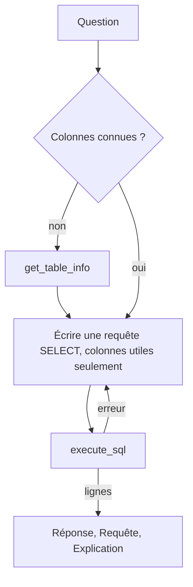

# Le toolset BigQuery d'ADK

> [!NOTE]
> Dans cette leçon, vous allez configurer le `BigQueryToolset` fourni par ADK 2.10 : ne garder que deux outils, imposer la lecture seule et un plafond d'octets, étiqueter les requêtes, puis écrire l'instruction de l'agent et brancher Gemini sur Vertex AI avec des réessais automatiques.

## Un toolset plutôt que des outils maison

Un **toolset** est un ensemble d'outils prêts à l'emploi qu'ADK expose au modèle. Le `BigQueryToolset` d'ADK 2.10 en contient onze (métadonnées, `execute_sql`, prévisions, détection d'anomalies, recherche de catalogue…). Nous n'en gardons que deux :

| Outil | Rôle | Pourquoi le garder |
| --- | --- | --- |
| `get_table_info` | schéma et description d'une table | le modèle vérifie les noms de colonnes au lieu de les deviner |
| `execute_sql` | exécute une requête et renvoie au plus N lignes | le cœur de l'analyste |

> [!TIP]
> Dans ADK 2.10, le module historique `google.adk.tools.bigquery` affiche un avertissement de dépréciation : importez depuis `google.adk.integrations.bigquery`, comme dans ce lab.

## La configuration

```python title="files/agent.py"
from google.adk.integrations.bigquery import BigQueryToolset
from google.adk.integrations.bigquery.config import BigQueryToolConfig, WriteMode

PROJET = os.environ.get("GOOGLE_CLOUD_PROJECT", "votre-projet")
MAX_OCTETS = int(os.environ.get("MAX_OCTETS", 1_000_000_000))     # 1 Go par requête
LABELS = {"formation-lab": "analyste-bigquery"}

boite_a_outils = BigQueryToolset(
    tool_filter=["get_table_info", "execute_sql"],
    bigquery_tool_config=BigQueryToolConfig(
        write_mode=WriteMode.BLOCKED,          # lecture seule (vérifiée aussi par dry-run)
        maximum_bytes_billed=MAX_OCTETS,       # plafond appliqué par BigQuery lui-même
        max_query_result_rows=50,
        compute_project_id=PROJET, default_project_id=PROJET,
        location="US",                          # thelook_ecommerce est en multirégion US
        application_name="lab-analyste-bigquery", job_labels=LABELS,
    ),
)
```

| Paramètre | Effet | À retenir |
| --- | --- | --- |
| `write_mode=WriteMode.BLOCKED` | avant d'exécuter, ADK fait un dry-run et refuse tout ce qui n'est pas `SELECT` | valeur par défaut, mais écrivez-la : c'est une décision de sécurité |
| `maximum_bytes_billed` | transmis à chaque job ; BigQuery refuse au-delà | minimum accepté : 10 485 760 octets (10 Mo) |
| `max_query_result_rows=50` | au plus 50 lignes renvoyées au modèle | un résultat tronqué est signalé par `result_is_likely_truncated` |
| `compute_project_id` | les requêtes ne peuvent tourner (et être facturées) que dans ce projet | le modèle ne peut pas choisir un autre projet payeur |
| `default_project_id` | projet utilisé quand le modèle n'en donne pas | doit être égal à `compute_project_id` s'il est défini |
| `location="US"` | région de calcul | doit correspondre à la région des données lues |
| `job_labels` | étiquettes sur chaque job | retrouver et chiffrer les requêtes du lab (leçon « Coûts ») |

```quiz
question: "Que se passe-t-il si le modèle appelle execute_sql avec project_id=\"autre-projet\" alors que compute_project_id vaut votre projet ?"
options:
  - "La requête tourne dans autre-projet et lui est facturée"
  - "L'outil refuse : il est limité au projet de calcul configuré"
  - "ADK demande une confirmation à l'utilisateur"
answer: 1
explanation: "Le code d'execute_sql compare project_id à compute_project_id et renvoie une erreur s'ils diffèrent. Les données lues peuvent venir d'un autre projet (ici bigquery-public-data), mais le calcul est toujours fait et facturé dans votre projet."
```

## Identifiants et modèle

Aucun identifiant n'apparaît dans le code. Sans `credentials_config`, les outils créent un client BigQuery qui utilise les **ADC** de la machine : votre compte en local (`gcloud auth application-default login`), le compte de service en production.

Le modèle passe par **Vertex AI** (`GOOGLE_GENAI_USE_VERTEXAI=TRUE`). Comme le quota est partagé, on demande au client Gemini de réessayer seul les erreurs 429 (quota) et 503 (indisponible) :

```python title="files/agent.py"
from google.adk.models.google_llm import Gemini

def modele_avec_reessais() -> Gemini:
    """Quota partagé : on réessaie les 429/503 avec un délai croissant (2 s, 4 s, 8 s...)."""
    return Gemini(model=MODEL, retry_options=types.HttpRetryOptions(initial_delay=2, attempts=6))
```

> [!WARNING]
> Lors de notre premier essai, sans ces réessais, trois questions sur six ont échoué en 429 : ADK a journalisé l'erreur et la conversation s'est terminée **sans réponse**, sans lever d'exception. D'où la vérification ajoutée dans `demander()` : pas de réponse finale = `RuntimeError`.

## L'instruction

```python title="files/agent.py (extrait)"
instruction=f"""Tu es un analyste de données. Tu réponds en français.
Données : jeu public fictif {DATASET} (boutique de vêtements en ligne).
Tables autorisées (et AUCUNE autre) : {', '.join(sorted(TABLES_AUTORISEES))}.
Écris toujours le nom complet des tables entre accents graves [...]
2. Écris UNE requête GoogleSQL SELECT qui calcule directement le résultat final, en ne
   sélectionnant que les colonnes utiles (BigQuery facture les colonnes lues) [...]
   Ne réponds jamais à partir des métadonnées de get_table_info (nombre de lignes...) [...]
3. [...] la dernière requête exécutée doit être celle que tu cites dans ta réponse.
Règles métier (sauf demande contraire) :
- chiffre d'affaires = SUM(order_items.sale_price) sur les articles au statut 'Complete' ;
- la date de référence d'une vente est order_items.created_at (TIMESTAMP, UTC) ; [...]"""
```

Chaque phrase a une raison mesurée (voir l'évaluation) : sans la règle sur les métadonnées, l'agent a répondu « 10 centres de distribution » en lisant le nombre de lignes renvoyé par `get_table_info`, sans requête ; sans la règle sur la dernière requête, il a lancé une vérification après le bon calcul, ce qui brouille l'audit.



```quiz
question: "Pourquoi l'instruction demande-t-elle de ne sélectionner que les colonnes utiles ?"
options:
  - "Pour que la réponse soit plus courte"
  - "Parce que BigQuery facture les colonnes lues : moins de colonnes = moins d'octets facturés et moins de refus du contrôle de coût"
  - "Parce que execute_sql refuse SELECT *"
answer: 1
explanation: "Le stockage en colonnes rend chaque colonne citée coûteuse. Le contrôle de coût refusera de toute façon une requête trop chère, mais mieux vaut que le modèle écrive bien du premier coup."
```

## Exercice : ajouter les prévisions

Votre équipe veut demander « prévois les ventes des 30 prochains jours ». Le toolset contient un outil `forecast`. Que faut-il modifier, et quel risque cela ajoute-t-il ?

<details>
<summary>Voir la solution</summary>

Ajoutez `"forecast"` à `tool_filter`. Dans ADK 2.10, cet outil construit une requête utilisant la fonction `AI.FORECAST` de BigQuery, qui s'exécute aussi dans votre projet de calcul.

Risques à traiter :

- le contrôle `controle_cout` ne regarde que `execute_sql` : étendez-le à `forecast` (le dry-run de la requête générée), sinon cet outil échappe à la liste blanche ;
- les fonctions d'IA de BigQuery peuvent avoir une tarification propre : vérifiez la page des tarifs avant de l'ouvrir à toute une équipe.

</details>

## Résultat obtenu

Exécution réelle le 2026-10-15 (`gemini-2.5-flash` sur Vertex AI, `europe-west1`) : « Quel est le chiffre d'affaires par catégorie de produit en 2025 ? Donne les 5 premières. »

```text
**Réponse**
1.  **Outerwear & Coats** : 80 554,47
2.  **Jeans** : 72 003,87
3.  **Sweaters** : 46 898,11
[...]
**Requête**
SELECT t2.category, ROUND(SUM(t1.sale_price), 2) AS revenue
FROM `bigquery-public-data.thelook_ecommerce.order_items` AS t1
INNER JOIN `bigquery-public-data.thelook_ecommerce.products` AS t2 ON t1.product_id = t2.id
WHERE t1.status = 'Complete' AND EXTRACT(YEAR FROM t1.delivered_at) = 2025
GROUP BY t2.category ORDER BY revenue DESC LIMIT 5

estimation du dry-run : 5 852 459 octets, tables order_items et products
```

Ce premier essai a pris `delivered_at` comme date de référence : c'est ce qui a motivé la règle métier « la date de référence d'une vente est `order_items.created_at` ». Les montants affichés ici avec le symbole € ont aussi conduit à la règle « pas de devise ».

## Je sais faire

- [ ] Filtrer les outils d'un toolset ADK avec `tool_filter`
- [ ] Configurer `BigQueryToolConfig` : lecture seule, plafond, projet de calcul, région, labels
- [ ] Utiliser les ADC au lieu d'identifiants dans le code
- [ ] Activer les réessais automatiques de Gemini sur les erreurs 429/503
