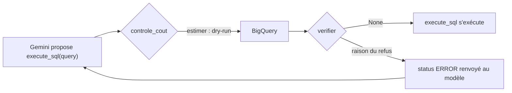

# Dry-run et liste blanche avant chaque requête

> [!NOTE]
> Dans cette leçon, vous allez écrire `controle_cout`, un `before_tool_callback` qui fait un dry-run de chaque requête proposée par le modèle, vérifie le type d'instruction, les tables lues et le volume estimé, et refuse avec un message que le modèle peut exploiter pour se corriger.

## Où s'accroche le contrôle

Un `before_tool_callback` est appelé par ADK **juste avant** l'exécution d'un outil, avec l'outil, ses arguments et le contexte. S'il renvoie `None`, l'outil s'exécute ; s'il renvoie un dictionnaire, ce dictionnaire **remplace** le résultat de l'outil, qui n'est pas exécuté.



## Trois fonctions courtes

### `estimer` : le dry-run

```python title="files/agent.py"
@cache
def client_bq():
    from google.cloud import bigquery
    return bigquery.Client(project=PROJET)

def estimer(requete: str) -> dict:
    """Dry-run BigQuery : type d'instruction, tables lues, octets traités. Rien n'est facturé."""
    from google.cloud import bigquery
    job = client_bq().query(requete, job_config=bigquery.QueryJobConfig(
        dry_run=True, use_query_cache=False, labels=LABELS))
    return {"type": job.statement_type, "octets": job.total_bytes_processed or 0,
            "tables": sorted(f"{t.project}.{t.dataset_id}.{t.table_id}"
                             for t in job.referenced_tables)}
```

`use_query_cache=False` donne l'estimation **sans** cache : avec le cache, une requête déjà lancée serait estimée à 0 octet, ce qui fausserait le contrôle. `@cache` crée le client une seule fois, au premier besoin : les tests, qui remplacent `estimer`, n'ont jamais besoin d'identifiants.

### `verifier` : la décision, en Python pur

```python title="files/agent.py"
DATASET = "bigquery-public-data.thelook_ecommerce"
TABLES_AUTORISEES = {f"{DATASET}.{t}" for t in
                     ("orders", "order_items", "products", "distribution_centers")}

def verifier(estimation: dict) -> str | None:
    if estimation["type"] != "SELECT":
        return f"Seules les requêtes SELECT sont permises (reçu : {estimation['type']})."
    interdites = [t for t in estimation["tables"] if t not in TABLES_AUTORISEES]
    if interdites:
        return (f"Tables non autorisées : {', '.join(interdites)}. Tables permises : " ...)
    if estimation["octets"] > MAX_OCTETS:
        return (f"Requête trop coûteuse : {estimation['octets'] / 1e6:.0f} Mo estimés, "
                f"plafond {MAX_OCTETS / 1e6:.0f} Mo. Sélectionne moins de colonnes ou filtre.")
    return None
```

La liste des tables vient de BigQuery (`referenced_tables`), pas d'une analyse du texte : une sous-requête, une vue ou un alias ne la trompent pas. `users` (e-mails et adresses, même fictifs) et `events` (385 Mo) sont **hors** liste blanche.

```quiz
question: "Le modèle écrit SELECT o.order_id FROM `bigquery-public-data.thelook_ecommerce.orders` o WHERE o.user_id IN (SELECT id FROM `bigquery-public-data.thelook_ecommerce.users` WHERE state = 'Texas'). Que fait verifier() ?"
options:
  - "Elle accepte : la table principale est orders"
  - "Elle refuse : le dry-run liste aussi users dans les tables lues"
  - "Elle laisse BigQuery décider"
answer: 1
explanation: "referenced_tables contient toutes les tables lues par la requête, sous-requêtes comprises. users n'étant pas autorisée, la requête est refusée avant toute exécution."
```

### `controle_cout` : le callback

```python title="files/agent.py"
def controle_cout(tool, args: dict, tool_context) -> dict | None:
    """before_tool_callback : dry-run et vérifications AVANT toute exécution réelle."""
    if tool.name == "get_table_info":
        cible = f"{args.get('project_id')}.{args.get('dataset_id')}.{args.get('table_id')}"
        if cible not in TABLES_AUTORISEES:
            return {"status": "ERROR", "error_details": f"Table non autorisée : {cible}."}
        return None
    if tool.name != "execute_sql":
        return None
    try:
        estimation = estimer(args.get("query", ""))
    except Exception as e:  # SQL invalide : le dry-run échoue, on renvoie l'erreur au modèle
        return {"status": "ERROR", "error_details": f"Dry-run refusé : {e}"}
    tool_context.state["estimations"] = tool_context.state.get("estimations", []) + [
        {"sql": args.get("query"), **estimation}]
    raison = verifier(estimation)
    return {"status": "ERROR", "error_details": raison} if raison else None
```

- Le format `{"status": "ERROR", "error_details": ...}` est **celui des outils BigQuery d'ADK** : le modèle reçoit un refus qui ressemble à une erreur BigQuery normale.
- Un SQL invalide fait échouer le dry-run : le message d'erreur de BigQuery (colonne inconnue, syntaxe…) part au modèle, qui corrige.
- Chaque estimation est **journalisée** dans l'état : c'est la trace d'audit des coûts.

> [!TIP]
> `get_table_info` est aussi filtré : sans cela, le modèle pourrait lire le schéma (et la description) d'une table interdite, et insister pour l'interroger.

| Situation | Qui réagit | Résultat |
| --- | --- | --- |
| `DELETE`, `DROP`, `CREATE` | sur le jeu public : le dry-run lui-même (« Access Denied ») ; sur vos tables : `verifier` (type ≠ SELECT), puis `WriteMode.BLOCKED` | refus |
| table `users` ou `events` | `verifier` (liste blanche) | refus |
| `SELECT *` sur une table trop grosse | `verifier` (octets), puis `maximum_bytes_billed` | refus, avec conseil |
| colonne inexistante | dry-run de BigQuery | erreur renvoyée, le modèle corrige |

```quiz
question: "Pourquoi le callback renvoie-t-il un dictionnaire d'erreur plutôt que de lever une exception ?"
options:
  - "Parce qu'un dictionnaire renvoyé par before_tool_callback remplace le résultat de l'outil : le modèle lit le refus et peut proposer une meilleure requête"
  - "Parce que les exceptions sont interdites en Python asynchrone"
  - "Pour économiser des tokens"
answer: 0
explanation: "Renvoyer un résultat de remplacement est le mécanisme prévu par ADK pour court-circuiter un outil. Le modèle voit l'erreur comme un résultat d'outil et peut réagir, comme dans la trace ci-dessous."
```

## Exercice : un budget par conversation

Un plafond par requête n'empêche pas 50 requêtes de 900 Mo. Ajoutez un **budget par session** de 3 Go : au-delà, toute nouvelle requête est refusée.

<details>
<summary>Voir la solution</summary>

Les estimations sont déjà journalisées dans `tool_context.state["estimations"]` ; il suffit de les additionner avant d'accepter la suivante.

```python title="files/agent.py (variante)"
BUDGET_SESSION = 3_000_000_000

def controle_cout(tool, args, tool_context):
    ...
    deja = sum(e["octets"] for e in tool_context.state.get("estimations", []))
    if deja + estimation["octets"] > BUDGET_SESSION:
        return {"status": "ERROR",
                "error_details": f"Budget de la conversation atteint ({deja / 1e9:.1f} Go)."}
    tool_context.state["estimations"] = ...
```

Pour un budget **par utilisateur et par jour**, utilisez une clé d'état préfixée `user:` avec un service de sessions persistant, ou mieux, les quotas personnalisés de BigQuery (par projet ou par utilisateur), appliqués côté Google Cloud.

</details>

## Résultat obtenu

Trace réelle du 2026-10-15, avec un plafond abaissé à 10 Mo (`MAX_OCTETS=10485760`, le minimum accepté) pour montrer le refus : « Montre-moi toutes les colonnes des 5 premières lignes de order_items. »

```text
APPEL  execute_sql SELECT * FROM `bigquery-public-data.thelook_ecommerce.order_items` LIMIT 5
RETOUR {'status': 'ERROR', 'error_details': 'Requête trop coûteuse : 14 Mo estimés, plafond 10 Mo.
        Sélectionne moins de colonnes ou filtre.'}
APPEL  get_table_info {'dataset_id': 'thelook_ecommerce', 'table_id': 'order_items', ...}
APPEL  execute_sql SELECT * FROM `bigquery-public-data.thelook_ecommerce.order_items` LIMIT 5
RETOUR {'status': 'ERROR', 'error_details': 'Requête trop coûteuse : 14 Mo estimés, plafond 10 Mo. [...]'}
FINAL  Je ne peux pas récupérer toutes les colonnes des 5 premières lignes de la table
       `order_items` directement, car la requête estimée dépasse la limite de coût autorisée
       (14 Mo estimés, avec un plafond de 10 Mo). Il semble que même avec une clause `LIMIT`,
       BigQuery estime le coût comme si toutes les données de la table devaient être lues.
ESTIM  13589426 octets ['bigquery-public-data.thelook_ecommerce.order_items']
ESTIM  13589426 octets ['bigquery-public-data.thelook_ecommerce.order_items']
```

Aucune des deux requêtes n'a été exécutée ni facturée : seuls les dry-runs ont eu lieu. Le modèle a même retrouvé seul la leçon précédente : `LIMIT` ne réduit pas le volume lu.

## Je sais faire

- [ ] Écrire un `before_tool_callback` qui court-circuite un outil en renvoyant un résultat
- [ ] Obtenir par dry-run le type d'instruction, les tables lues et les octets estimés
- [ ] Appliquer une liste blanche de tables à partir de `referenced_tables`
- [ ] Journaliser les estimations dans l'état de session pour l'audit des coûts
