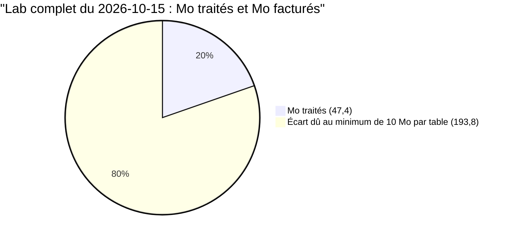
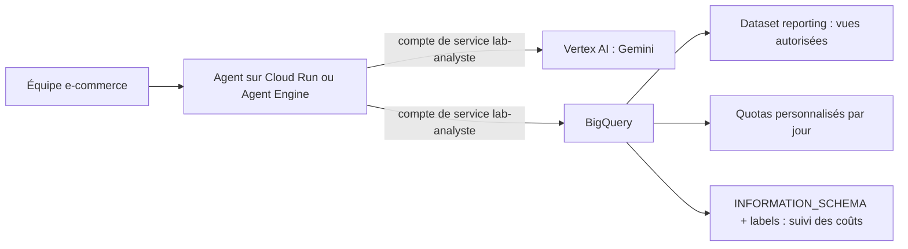

# Coûts, nettoyage et exploitation

> [!NOTE]
> Dans cette leçon, vous allez mesurer le coût réel de toutes les requêtes du lab grâce aux labels, vérifier qu'il ne reste aucune ressource à supprimer, et préparer le passage en production : compte de service, rôles minimaux, quotas et suivi.

## Mesurer le coût réel avec les labels

Chaque job lancé par le toolset ou par `estimer()` porte le label `formation-lab=analyste-bigquery`. La vue `INFORMATION_SCHEMA.JOBS_BY_USER` (l'historique de vos jobs BigQuery, interrogeable en SQL) permet de les additionner :

```sql title="cout_du_lab.sql"
SELECT COUNT(*) AS requetes,
       ROUND(SUM(total_bytes_billed) / 1e6, 1)    AS mo_factures,
       ROUND(SUM(total_bytes_processed) / 1e6, 1) AS mo_traites
FROM `region-us`.INFORMATION_SCHEMA.JOBS_BY_USER, UNNEST(labels) AS l
WHERE l.key = "formation-lab" AND l.value = "analyste-bigquery"
  AND creation_time > TIMESTAMP_SUB(CURRENT_TIMESTAMP(), INTERVAL 1 DAY)
  AND job_type = "QUERY"
```

| Colonne | Sens |
| --- | --- |
| `total_bytes_processed` | octets réellement lus |
| `total_bytes_billed` | octets facturés : arrondis au Mo, **minimum 10 Mo par table lue** |

L'écart entre les deux est attendu : nos requêtes lisent souvent 1 à 2 Mo, mais chaque table référencée compte pour 10 Mo au moins. Sur des tables de plusieurs Go, cet écart devient négligeable.



```quiz
question: "Une requête lit 1,9 Mo dans une seule table. Combien d'octets sont facturés à la demande ?"
options:
  - "1,9 Mo"
  - "2 Mo, arrondi au Mo supérieur"
  - "10 Mo, le minimum par table référencée"
answer: 2
explanation: "BigQuery arrondit au Mo supérieur avec un minimum de 10 Mo par table référencée (et par requête). Une requête qui joint deux petites tables est donc facturée au moins 20 Mo."
```

## Nettoyage : ce que le lab a créé

| Élément | Créé par le lab ? | Action |
| --- | --- | --- |
| dataset, table, vue | **non** | rien à supprimer |
| jobs de requête (historique) | oui, 44 jobs | rien à faire : ce n'est pas une ressource facturée, l'historique est conservé par BigQuery |
| dry-runs | non enregistrés comme jobs | — |
| service Cloud Run, bucket, Agent Engine | **non** | — |
| identifiants ADC sur votre poste | oui | `gcloud auth application-default revoke` si vous ne vous en servez plus |

Vérification que le projet ne contient aucun dataset créé par le lab :

```bash title="terminal"
bq ls --project_id=VOTRE_PROJET          # sortie vide : aucun dataset
```

> [!TIP]
> Si vous étendez le lab (table de résultats, vue de reporting), nommez tout avec le préfixe `lab_analyste_bigquery` et posez le label `formation-lab=analyste-bigquery` : un `bq ls --filter labels.formation-lab:analyste-bigquery` retrouvera tout pour le nettoyage.

## Passer en production



| Sujet | En local (ce lab) | En production |
| --- | --- | --- |
| identité | votre compte (ADC) | un **compte de service** dédié |
| droits BigQuery | ceux de votre compte | `BigQuery Job User` sur le projet + `BigQuery Data Viewer` sur le **seul** dataset de reporting |
| liste blanche | `TABLES_AUTORISEES` dans le code | la même, **plus** les droits IAM (le compte ne peut pas lire le reste) |
| plafond | `maximum_bytes_billed` par requête | idem + **quotas personnalisés** de BigQuery par jour (projet ou utilisateur) |
| suivi | requête `INFORMATION_SCHEMA` à la main | tableau de bord planifié sur les labels |

> [!WARNING]
> En production, la liste blanche du code ne suffit pas : elle protège contre le modèle, pas contre un bug ou une modification du code. Donnez au compte de service **uniquement** l'accès aux données qu'il doit lire : c'est BigQuery qui refusera le reste.

```quiz
question: "Quels rôles donner au compte de service de l'agent en production ?"
options:
  - "BigQuery Admin sur le projet, pour éviter les erreurs de droits"
  - "BigQuery Job User sur le projet de calcul et BigQuery Data Viewer sur le seul dataset de reporting"
  - "Owner sur le projet"
answer: 1
explanation: "Job User permet de lancer des requêtes (facturées au projet) ; Data Viewer limité au dataset de reporting permet de lire ces données et rien d'autre. Des rôles larges transformeraient une erreur du modèle ou du code en fuite ou en suppression."
```

## Exercice : alerter sur une dérive de coût

Écrivez une requête qui liste, pour les 7 derniers jours, les jobs du lab ayant facturé plus de 500 Mo, avec leur texte SQL, pour repérer les questions qui coûtent cher.

<details>
<summary>Voir la solution</summary>

```sql title="jobs_chers.sql"
SELECT creation_time, ROUND(total_bytes_billed / 1e6) AS mo_factures,
       LEFT(query, 200) AS requete
FROM `region-us`.INFORMATION_SCHEMA.JOBS_BY_USER, UNNEST(labels) AS l
WHERE l.key = "formation-lab" AND l.value = "analyste-bigquery"
  AND creation_time > TIMESTAMP_SUB(CURRENT_TIMESTAMP(), INTERVAL 7 DAY)
  AND total_bytes_billed > 500 * 1000 * 1000
ORDER BY total_bytes_billed DESC
```

Planifiez-la (requête programmée BigQuery) et envoyez le résultat à l'équipe : chaque ligne est une question à mieux cadrer dans l'instruction ou une table à partitionner. Pour une vue à l'échelle de l'organisation, utilisez `JOBS_BY_PROJECT` (droits plus larges nécessaires).

</details>

## Résultat obtenu

Coût réel mesuré le 2026-10-15 sur toutes les exécutions du lab (smoke tests, 3 passages d'évaluation, traces), puis vérification qu'aucun dataset n'existe dans le projet :

```text
+----------+-------------+------------+
| requetes | mo_factures | mo_traites |
+----------+-------------+------------+
|       44 |       241.2 |       47.4 |
+----------+-------------+------------+

$ bq ls --project_id=<projet>
(aucune sortie : aucun dataset)
```

241 Mo facturés au total : au tarif à la demande en vigueur, c'est de l'ordre d'un millième de dollar, et cela reste dans le To gratuit mensuel.

## Je sais faire

- [ ] Mesurer le coût réel d'un agent grâce aux labels de jobs et à `INFORMATION_SCHEMA`
- [ ] Expliquer l'écart entre octets traités et octets facturés
- [ ] Vérifier qu'un lab n'a laissé aucune ressource et savoir quoi nettoyer
- [ ] Définir l'identité, les droits et les quotas d'un agent BigQuery en production
