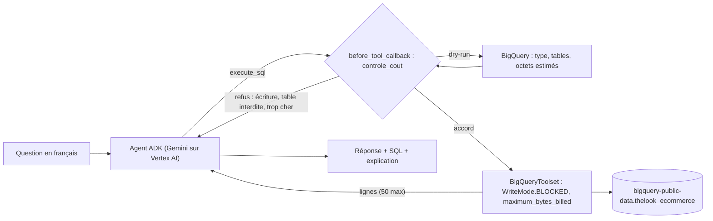

Un entrepôt de données comme **BigQuery** (le service d'analyse de données de Google Cloud, facturé ici au volume de données lues) répond en quelques secondes sur des millions de lignes. Le brancher à un agent IA est tentant… et risqué : une requête mal écrite peut lire des centaines de gigaoctets, une table sensible peut être interrogée, une instruction de suppression peut être tentée.

Dans ce lab, vous construisez un **analyste BigQuery** avec **Google ADK** et Gemini sur Vertex AI. Il interroge le jeu de données public et fictif `bigquery-public-data.thelook_ecommerce` (une boutique de vêtements en ligne), avec quatre protections : lecture seule, **dry-run** avant chaque exécution, plafond de **1 Go facturé** par requête, et **liste blanche** de tables.

## Ce que vous construisez

- `agent.py` : le **toolset BigQuery officiel d'ADK** (`BigQueryToolset`) limité à deux outils, configuré en lecture seule et plafonné, plus un callback `controle_cout` qui fait un dry-run avant toute exécution ;
- `evaluer.py` : 6 questions de référence comparées par exécution, plus 2 questions pièges ;
- `test_analyste.py` : 12 tests **sans compte Google Cloud** ni clé.

## Pour qui ?

- Développeurs et analystes à l'aise avec SQL et Python, qui ont déjà vu un agent ADK.
- Idéalement après le lab [Text-to-SQL sur SQLite](../../01-sans-gcp/13-text-to-sql-sqlite-garde-fous/index.md), qui pose les mêmes questions sur une base locale.

## Prérequis

- Un projet Google Cloud avec facturation, les API **BigQuery** et **Vertex AI** activées.
- Les rôles IAM `BigQuery Job User` (lancer des requêtes) et `Vertex AI User` (appeler Gemini) sur ce projet. Les données publiques sont lisibles par tous.
- `gcloud auth application-default login` : les **identifiants par défaut de l'application** (ADC, *Application Default Credentials*) que les bibliothèques Google trouvent toutes seules.
- Python 3.10 ou plus récent, `pip install -r files/requirements.txt`.

## Programme

| Module | Leçon | Ce que vous faites |
| --- | --- | --- |
| 1. Cas d'usage et architecture | [Un analyste qui ne fait pas exploser la facture](./01-cas-d-usage-et-architecture/01-analyste-et-couts.md) | Comprendre la facturation BigQuery, le dry-run et le plafond |
| 2. Construire pas à pas | [Le toolset BigQuery d'ADK](./02-construire-pas-a-pas/01-toolset-bigquery.md) | Configurer lecture seule, plafond, labels, projet ; écrire l'instruction |
| | [Dry-run et liste blanche avant chaque requête](./02-construire-pas-a-pas/02-dry-run-et-liste-blanche.md) | `before_tool_callback` qui estime et refuse |
| 3. Tester, évaluer, exploiter | [Tests sans Google Cloud et évaluation réelle](./03-tester-evaluer-exploiter/01-tests-et-evaluation.md) | 12 tests hors ligne, 6 questions de référence sur BigQuery |
| | [Coûts, nettoyage et exploitation](./03-tester-evaluer-exploiter/02-couts-nettoyage-exploitation.md) | Mesurer le coût réel, ce qu'il faut (ou non) supprimer, passer en production |

## En local ou sur Google Cloud ?

L'agent tourne **sur votre poste**, mais tout le reste est dans Google Cloud : Gemini via **Vertex AI** (région `europe-west1`) et les requêtes dans **BigQuery** (le jeu public est stocké en multirégion `US`). Ce lab ne crée **aucune ressource** durable : pas de dataset, pas de table, pas de service. Seules les requêtes sont facturées, quelques centaines de Mo au total pour tout le lab, soit une fraction de centime au tarif à la demande.

## Le code

Tout est dans [`files/`](./files/) : [agent.py](./files/agent.py), [evaluer.py](./files/evaluer.py), [test_analyste.py](./files/test_analyste.py), [requirements.txt](./files/requirements.txt) et [.env.example](./files/.env.example).
