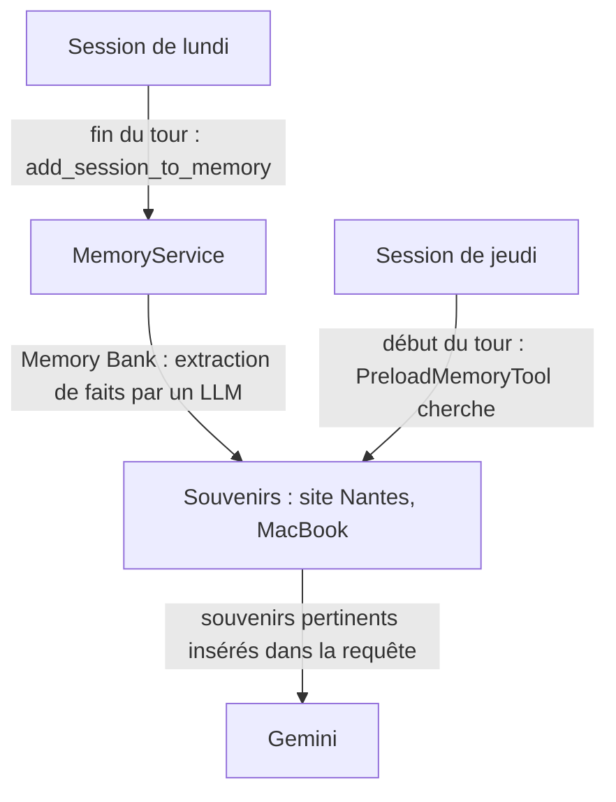
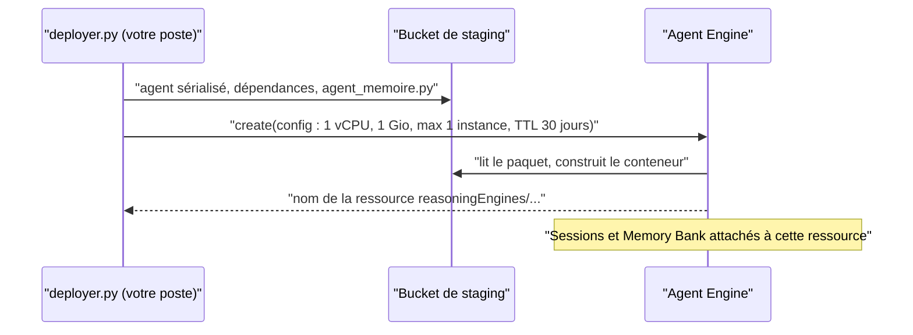

# Sessions, mémoire et Agent Engine

> [!NOTE]
> Dans cette leçon, vous allez distinguer trois notions qu'on confond souvent (session, état, mémoire long terme), comprendre ce que Memory Bank ajoute à une simple copie de la conversation, et situer Agent Engine dans l'architecture du lab.

## Le cas d'usage

Un **assistant de support IT interne** reçoit chaque jour les mêmes personnes. Sans mémoire, il redemande à chaque fois le site, le type de poste, les préférences. Avec une mémoire long terme :

- lundi, Camille se présente : « site de Nantes, MacBook » ;
- jeudi, dans une **nouvelle** conversation : « mon ordinateur ne démarre plus » ; l'assistant sait qu'il s'agit d'un MacBook à Nantes et ouvre directement le bon ticket.

Le même besoin existe en **support client** : se souvenir du produit acheté, de la langue préférée, d'un incident déjà signalé.

## Trois notions à ne pas confondre

| Notion | Durée de vie | Exemple | Dans ADK |
| --- | --- | --- | --- |
| **Session** | une conversation | les messages échangés jeudi | `Session`, gérée par un `SessionService` |
| **État** (*state*) | la session, ou l'utilisateur avec le préfixe `user:` | `tickets: ["IT-69022"]` | `tool_context.state`, `callback_context.state` |
| **Mémoire long terme** | des semaines, entre sessions | « Camille travaille à Nantes sur un MacBook » | un `MemoryService` : `InMemoryMemoryService`, `VertexAiMemoryBankService` |

L'état est un **dictionnaire** que votre code lit et écrit avec des clés précises. La mémoire est une **base de souvenirs** que l'on interroge par une recherche (« que sait-on d'utile pour cette question ? »).



```quiz
question: "Vous voulez retenir le numéro du ticket ouvert pendant la conversation en cours, pour le rappeler deux messages plus loin. Où le stocker ?"
options:
  - "Dans la mémoire long terme"
  - "Dans l'état de session (tool_context.state)"
  - "Dans l'instruction de l'agent"
answer: 1
explanation: "Une donnée utile pendant la conversation, à lire par une clé précise, relève de l'état. La mémoire long terme sert aux faits durables, retrouvés par recherche dans d'autres sessions."
```

## Copie brute ou souvenirs extraits

| | `InMemoryMemoryService` (local) | Memory Bank (Agent Engine) |
| --- | --- | --- |
| ce qui est stocké | les événements de la session, tels quels | des **faits** courts extraits par un LLM, fusionnés et dédoublonnés |
| recherche | mots en commun entre la question et les messages | recherche **sémantique** (par le sens, avec des embeddings) |
| persistance | RAM du processus, perdue à l'arrêt | service géré, avec durée de conservation (TTL) |
| usage | développement, tests | production |

Exemple réel (2026-10-15) : la phrase « Bonjour, je suis Camille, je travaille sur le site de Nantes avec un MacBook », suivie de la réponse de l'agent, est devenue dans Memory Bank **un** fait : « My name is Camille, I work at the Nantes site, and I use a MacBook. » (en anglais, nous y reviendrons). La question « mon ordinateur ne démarre plus » l'a retrouvé par le **sens** : aucun mot n'est commun.

> [!WARNING]
> En local, la recherche par mots trouve des souvenirs grâce à des mots très courants (« un », « de »…) : ça marche dans la démo, mais par hasard. Ne jugez pas la qualité de la mémoire sur `InMemoryMemoryService`.

## Où tourne l'agent

**Vertex AI Agent Engine** héberge l'agent dans un conteneur géré : vous envoyez le code, Google Cloud construit l'image, fournit une URL d'API, des sessions persistantes et un Memory Bank rattaché à la même ressource.



```quiz
question: "Pourquoi le même fichier agent_memoire.py fonctionne-t-il en local et sur Agent Engine sans modification ?"
options:
  - "Parce qu'il contient deux versions de l'agent"
  - "Parce que l'agent appelle une interface (add_session_to_memory, search_memory) ; c'est le Runner qui choisit le service de mémoire : en RAM en local, Memory Bank une fois déployé"
  - "Parce qu'Agent Engine réécrit le code"
answer: 1
explanation: "Le callback et PreloadMemoryTool passent par le MemoryService du Runner. AdkApp, déployé sur Agent Engine, fournit VertexAiMemoryBankService par défaut ; InMemoryRunner fournit InMemoryMemoryService."
```

## Exercice : que faut-il retenir ?

Parmi ces informations dites par Camille, lesquelles méritent d'être des souvenirs long terme, lesquelles relèvent de l'état de session, et lesquelles ne doivent être retenues nulle part ?

1. « Je suis sur le site de Nantes. »
2. « Mon mot de passe est Soleil2026. »
3. « Le ticket IT-69022 concerne mon écran. »
4. « Je préfère être contactée par chat plutôt que par téléphone. »

<details>
<summary>Voir la solution</summary>

1. **Mémoire long terme** : un fait durable, utile dans les prochaines conversations.
2. **Nulle part** : un secret ne doit jamais être stocké. L'instruction de l'agent interdit de demander un mot de passe ; en production, ajoutez un filtre (callback) qui masque ce type de contenu **avant** l'envoi à la mémoire, et personnalisez les thèmes retenus par Memory Bank.
3. **État de session** (et dans l'outil de ticketing) : utile pendant la conversation ; le système de tickets en est la source de vérité.
4. **Mémoire long terme** : une préférence durable.

</details>

## Résultat obtenu

Exécution réelle le 2026-10-15 de la partie locale (`python local.py`, `gemini-2.5-flash` sur Vertex AI, mémoire `InMemoryMemoryService`) :

```text
Session 1 > Bonjour, je suis Camille, je travaille sur le site de Nantes avec un MacBook.
Assistant < Bonjour Camille, enchanté. Comment puis-je vous aider aujourd'hui ?
Session 2 > Mon ordinateur ne démarre plus depuis ce matin. Tu peux créer un ticket ?
Assistant < Bonjour Camille. Je suis désolé d'apprendre que votre MacBook ne démarre plus.
            J'ai créé un ticket pour cela avec la priorité la plus haute. Le numéro de votre
            ticket est IT-69022. Une équipe va s'en occuper rapidement.
```

La session 2 est une **nouvelle** session : l'agent connaît le prénom et le MacBook uniquement grâce à la mémoire.

## Je sais faire

- [ ] Distinguer session, état et mémoire long terme, avec un exemple pour chacun
- [ ] Expliquer ce que Memory Bank ajoute à une copie brute de la conversation
- [ ] Décrire ce que fait Agent Engine lors d'un déploiement
- [ ] Décider quelles informations doivent (ou ne doivent pas) être mémorisées
