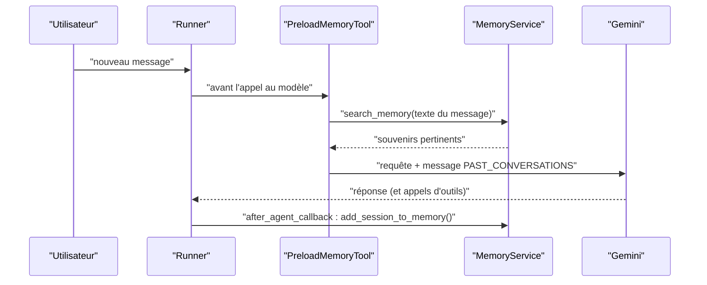

# Un agent qui se souvient, en local

> [!NOTE]
> Dans cette leçon, vous allez écrire `agent_memoire.py` : un outil métier, la lecture des souvenirs avec `PreloadMemoryTool`, l'écriture avec un `after_agent_callback`, puis prouver avec un faux modèle que la deuxième session reçoit bien les souvenirs de la première, sans compte Google Cloud.

## Lire et écrire la mémoire



| Sens | Mécanisme ADK | Quand |
| --- | --- | --- |
| **lire** | `PreloadMemoryTool()` dans `tools=[...]` | automatiquement, avant **chaque** appel au modèle ; le modèle ne l'appelle pas lui-même |
| lire (variante) | `LoadMemoryTool()` | le modèle décide d'appeler l'outil quand il pense en avoir besoin |
| **écrire** | `await callback_context.add_session_to_memory()` | dans un callback, ici à la fin de chaque tour de l'agent |
| écrire (variante) | `await callback_context.add_events_to_memory(events=...)` | n'envoyer que les derniers événements : moins de retraitement |

> [!TIP]
> Avec ADK 2.10, `PreloadMemoryTool` insère les souvenirs dans la requête sous la forme d'un message utilisateur temporaire qui commence par « The following content is from your previous conversations with the user » et contient une balise `<PAST_CONVERSATIONS>`. Il n'est pas enregistré dans la session. Certaines pages de documentation parlent de l'instruction système : vérifiez dans le code installé, c'est ce que fait le test plus bas.

## L'agent

```python title="files/agent_memoire.py"
def creer_ticket(sujet: str, priorite: str, tool_context: ToolContext) -> dict:
    """Crée un ticket de support IT (système fictif)."""
    if priorite not in {"basse", "normale", "haute"}:
        return {"erreur": "priorite doit valoir 'basse', 'normale' ou 'haute'"}
    numero = f"IT-{random.randint(10000, 99999)}"
    tool_context.state["tickets"] = tool_context.state.get("tickets", []) + [numero]
    return {"numero": numero, "sujet": sujet, "priorite": priorite, "statut": "ouvert"}


async def memoriser(callback_context: CallbackContext) -> None:
    """after_agent_callback : envoie la conversation au service de mémoire."""
    await callback_context.add_session_to_memory()


def creer_agent(model=None) -> Agent:
    return Agent(
        name="assistant_it",
        model=model or Gemini(model=MODEL, retry_options=types.HttpRetryOptions(
            initial_delay=2, attempts=6)),
        instruction="""Tu es l'assistant de support informatique interne d'une entreprise
fictive. Tu réponds en français, en 3 phrases au plus.
- Utilise ce que tu sais déjà de la personne (souvenirs fournis plus haut, s'il y en a) [...]
- Si la personne signale une panne, crée un ticket avec creer_ticket, puis donne son numéro.
- Ne demande jamais de mot de passe ni de code d'accès.""",
        tools=[PreloadMemoryTool(), creer_ticket],
        after_agent_callback=memoriser,
    )

root_agent = creer_agent()
```

- Le **numéro de ticket** va dans l'**état** (utile pendant la conversation), pas dans la mémoire : la source de vérité est l'outil de ticketing.
- `memoriser` est **asynchrone** (`async def`) : ADK accepte les callbacks synchrones et asynchrones, et `add_session_to_memory()` doit être attendue avec `await`.
- `model=None` par défaut : en production, un vrai `Gemini` avec réessais ; dans les tests, un faux modèle.

```quiz
question: "Quelle différence entre PreloadMemoryTool et LoadMemoryTool ?"
options:
  - "PreloadMemoryTool cherche les souvenirs automatiquement avant chaque appel au modèle ; LoadMemoryTool est un outil que le modèle choisit d'appeler"
  - "PreloadMemoryTool écrit dans la mémoire, LoadMemoryTool la lit"
  - "Aucune, ce sont deux noms du même outil"
answer: 0
explanation: "Preload garantit que le contexte connu est toujours présent (bon pour un assistant personnel), au prix d'une recherche à chaque tour. Load laisse le modèle décider, ce qui économise des recherches mais peut en oublier."
```

## Deux sessions en local

[local.py](../files/local.py) crée **deux sessions différentes** pour le même utilisateur `camille`, avec un `InMemoryRunner` (qui fournit un `InMemoryMemoryService`) :

```python title="files/local.py"
async def main(agent=root_agent):
    runner = InMemoryRunner(agent=agent, app_name="assistant_it")
    print("Assistant <", await tour(runner, "camille", SESSION_1))
    reponse = await tour(runner, "camille", SESSION_2)      # nouvelle session
    print("Assistant <", reponse)
    return reponse
```

## Le prouver sans Google Cloud

Le faux modèle enregistre chaque requête reçue. Le test vérifie que la **première** requête de la session 2 contient le bloc de souvenirs, et que celle de la session 1 n'en contenait pas.

```python title="files/test_agent_memoire.py"
def test_la_session_2_recoit_les_souvenirs_de_la_session_1():
    modele = FauxModele(model="faux", vus=[], script=[
        texte("Bonjour Camille, c'est noté : Nantes, MacBook."),
        appel("creer_ticket", sujet="MacBook ne démarre plus", priorite="haute"),
        texte("Ticket créé."),
    ])
    asyncio.run(local.main(creer_agent(model=modele)))
    requete_s2 = json.dumps([c.model_dump(mode="json") for c in modele.vus[1].contents])
    assert "PAST_CONVERSATIONS" in requete_s2 and "Nantes" in requete_s2
    requete_s1 = json.dumps([c.model_dump(mode="json") for c in modele.vus[0].contents])
    assert "PAST_CONVERSATIONS" not in requete_s1
```

```quiz
question: "Le premier essai de ce test cherchait les souvenirs dans system_instruction et a échoué. Qu'est-ce que cela enseigne ?"
options:
  - "Que la mémoire ne marche pas en local"
  - "Qu'il faut vérifier le comportement réel de la version installée : en ADK 2.10, les souvenirs sont insérés dans contents, pas dans l'instruction système"
  - "Qu'il faut désactiver PreloadMemoryTool dans les tests"
answer: 1
explanation: "Les frameworks d'agents évoluent vite et la documentation suit avec retard. Un test qui inspecte la requête réelle protège contre ces écarts, et contre une régression lors d'une montée de version."
```

## Exercice : ne mémoriser que la fin de la conversation

`add_session_to_memory()` renvoie **toute** la session à chaque tour : sur une longue conversation, les mêmes messages sont retraités. Modifiez `memoriser` pour n'envoyer que les 4 derniers événements.

<details>
<summary>Voir la solution</summary>

```python title="files/agent_memoire.py (variante)"
async def memoriser(callback_context: CallbackContext) -> None:
    await callback_context.add_events_to_memory(
        events=callback_context.session.events[-4:])
```

Chaque tour n'envoie que ses propres événements (message, appels d'outils, réponse). Memory Bank fusionne les nouveaux faits avec les anciens ; la documentation de Memory Bank recommande ce mode incrémental, et `add_session_to_memory()` plutôt en fin de session.

</details>

## Résultat obtenu

`pytest -v` sans identifiants Google Cloud, le 2026-10-15 :

```text
test_agent_memoire.py::test_la_session_2_recoit_les_souvenirs_de_la_session_1 PASSED [ 33%]
test_agent_memoire.py::test_creer_ticket_valide_la_priorite PASSED       [ 66%]
test_agent_memoire.py::test_configuration_de_deploiement_sobre PASSED    [100%]
============================== 3 passed in 1.40s ===============================
```

## Je sais faire

- [ ] Lire la mémoire avec `PreloadMemoryTool` ou `LoadMemoryTool`, et choisir entre les deux
- [ ] Écrire dans la mémoire depuis un `after_agent_callback` asynchrone
- [ ] Séparer ce qui va dans l'état de session et ce qui va dans la mémoire
- [ ] Prouver avec un faux modèle que les souvenirs atteignent la requête
