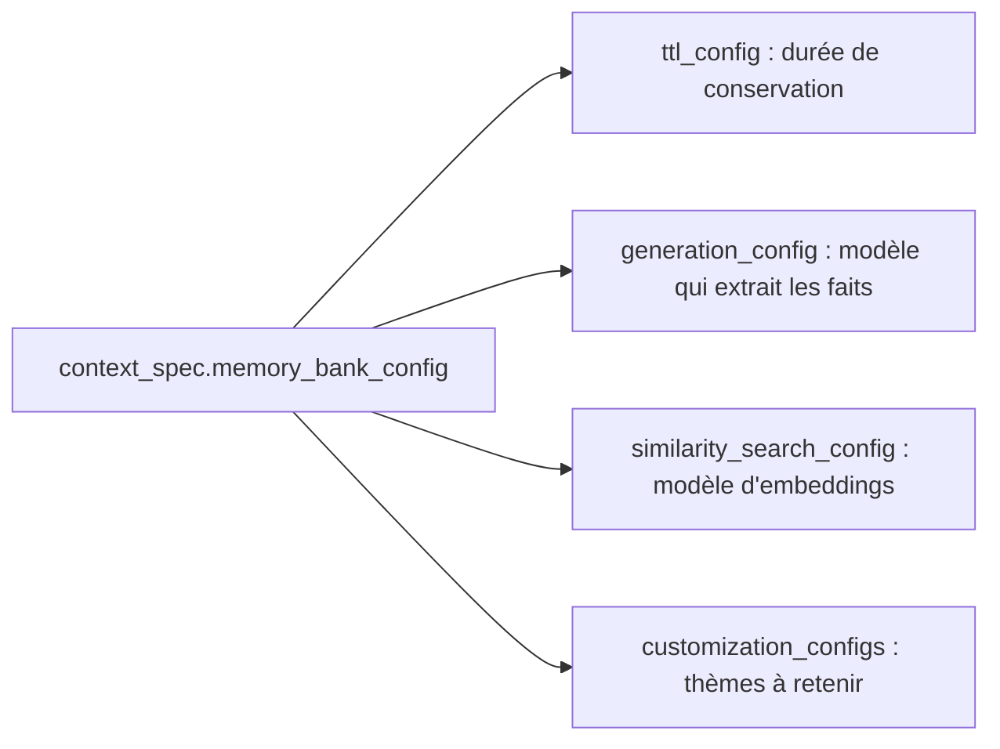

# Préparer le déploiement

> [!NOTE]
> Dans cette leçon, vous allez préparer `deployer.py` : emballer l'agent dans un `AdkApp`, écrire une configuration Agent Engine **sobre** (une seule instance, 1 vCPU, rien au repos), configurer Memory Bank avec une durée de conservation, et rendre le nettoyage possible même si le déploiement échoue.

## Ce que le SDK installé propose

Le lab utilise le SDK installé, `google-cloud-aiplatform` 1.165.1, module `vertexai` :

```python title="files/deployer.py"
import vertexai
from vertexai.agent_engines import AdkApp

client = vertexai.Client(project=PROJET, location=REGION)
distant = client.agent_engines.create(agent=AdkApp(agent=root_agent, app_name="assistant_it"),
                                      config=configuration(bucket))
```

> [!TIP]
> La documentation de Google Cloud d'octobre 2026 présente le même service sous le nom **Agent Runtime** (plateforme Gemini Enterprise Agent Platform), avec un nouveau paquet `agentplatform` et des appels `client.runtimes.create(...)`. Les concepts (AdkApp, staging bucket, Memory Bank, `delete(force=True)`) sont identiques ; adaptez les noms si vous utilisez ce paquet plus récent.

`AdkApp` est un **modèle d'application** (*template*) qui sait faire tourner un agent ADK : en local, il utilise des services en mémoire ; une fois déployé sur Agent Engine, il utilise par défaut `VertexAiSessionService` et `VertexAiMemoryBankService`, rattachés à la ressource créée. Notre agent n'a donc **rien à changer**.

## Une configuration sobre

```python title="files/deployer.py"
def configuration(bucket: str) -> dict:
    """Configuration Agent Engine sobre : 1 instance au plus, 1 vCPU, 1 Gio, 0 au repos."""
    return {
        "display_name": f"lab-{SLUG}",
        "description": "Lab formation : assistant IT avec Memory Bank (à supprimer).",
        "labels": LABELS,                                # formation-lab=agent-engine-memory-bank
        "staging_bucket": bucket,
        "requirements": ["google-cloud-aiplatform[agent_engines,adk]==1.165.1",
                         "google-adk==2.10.0"],
        "extra_packages": ["agent_memoire.py"],          # le module de l'agent, envoyé tel quel
        "env_vars": {"MODEL": os.environ.get("MODEL", "gemini-2.5-flash")},
        "min_instances": 0, "max_instances": 1,
        "resource_limits": {"cpu": "1", "memory": "1Gi"},
        "context_spec": {"memory_bank_config": {
            "ttl_config": {"default_ttl": f"{30 * 24 * 3600}s"},   # oubli automatique : 30 jours
        }},
    }
```

| Paramètre | Valeur du lab | Valeur par défaut documentée | Pourquoi |
| --- | --- | --- | --- |
| `min_instances` | 0 | 1 | aucune instance gardée au repos |
| `max_instances` | 1 | 100 | un lab n'a pas besoin de monter en charge ; plafonne le coût |
| `resource_limits` | 1 vCPU, 1 Gio | 4 vCPU, 4 Gio | l'agent attend surtout le modèle : peu de calcul local |
| `requirements` | versions **figées** | — | le conteneur distant doit avoir les mêmes versions que vos tests |
| `extra_packages` | `agent_memoire.py` | — | l'agent est sérialisé ; son module doit être présent à distance |
| `labels` | `formation-lab=...` | — | retrouver et supprimer ce que le lab a créé |
| `ttl_config.default_ttl` | 30 jours | aucun TTL | un souvenir non mis à jour disparaît seul |

> [!WARNING]
> Le **staging bucket** (un bucket Cloud Storage où le SDK dépose l'agent sérialisé et ses dépendances avant la construction du conteneur) est une ressource à part entière : il ne disparaît pas avec l'Agent Engine. `nettoyer.py` le supprime explicitement.

```quiz
question: "Pourquoi figer les versions dans requirements (google-adk==2.10.0) ?"
options:
  - "Pour accélérer le déploiement"
  - "Parce que l'agent est sérialisé en local : le conteneur distant doit avoir des versions compatibles, sinon la désérialisation ou le comportement peuvent différer"
  - "Parce qu'Agent Engine refuse les versions non figées"
answer: 1
explanation: "L'objet agent est sérialisé (cloudpickle) avec votre version d'ADK, puis rechargé dans le conteneur. Une autre version d'ADK à distance peut casser ce rechargement ou changer le comportement testé en local."
```

## Memory Bank : ce qui se configure



Le lab ne règle que le **TTL** (*time to live*, durée de vie) : par défaut, Memory Bank garde les souvenirs sans limite, ce qui pose une question de **minimisation des données** (ne conserver que ce qui est nécessaire, aussi longtemps que nécessaire). Les autres réglages gardent leurs valeurs par défaut : un modèle Gemini pour extraire les faits et un modèle d'embeddings (`text-embedding-005` par défaut selon la documentation) pour la recherche.

## Nettoyable, même en cas d'échec

```python title="files/deployer.py"
def main():
    ...
    bucket = creer_bucket()                       # lab-agent-engine-memory-bank-<6 hex>, étiqueté
    ETAT.write_text(json.dumps({"bucket": bucket}))       # noté AVANT : nettoyable même si échec
    distant = client.agent_engines.create(...)
    ETAT.write_text(json.dumps({"bucket": bucket, "agent_engine": distant.api_resource.name}))
```

Et `nettoyer.py` ne se fie pas seulement à ce fichier : il **recherche** aussi les Agent Engines dont le nom affiché commence par `lab-agent-engine-memory-bank` et les buckets portant le label du lab.

```quiz
question: "Le déploiement échoue au bout de 8 minutes (erreur de dépendance). Qu'est-ce qui a déjà été créé ?"
options:
  - "Rien : un déploiement échoué est annulé entièrement"
  - "Au moins le bucket de staging et son contenu ; selon le moment de l'échec, une ressource Agent Engine peut aussi exister"
  - "Seulement des journaux"
answer: 1
explanation: "Le bucket est créé et rempli avant la construction du conteneur. C'est pour cela que deployer.py note le bucket avant d'appeler create(), et que nettoyer.py cherche aussi par nom et par label."
```

## Exercice : choisir ce que Memory Bank retient

Vous voulez que Memory Bank ne retienne que le site, l'équipement et les préférences de contact, jamais le contenu des incidents. Où le régler ?

<details>
<summary>Voir la solution</summary>

Dans `context_spec.memory_bank_config.customization_configs` : on y décrit des **thèmes de mémoire** (*memory topics*), prédéfinis ou personnalisés, que Memory Bank doit extraire. Par exemple un thème personnalisé « environnement de travail : site, équipement » et le thème prédéfini des préférences utilisateur. Ce qui ne correspond à aucun thème n'est pas retenu.

Voir la page « Set up Memory Bank » citée en références pour la syntaxe exacte de votre version de SDK ; ajoutez ensuite un test qui vérifie la présence de ces thèmes dans `configuration()`, comme pour le TTL.

</details>

## Résultat obtenu

Déploiement réel le 2026-10-15 (`python deployer.py`, projet de test, `europe-west1`) : un peu moins de 5 minutes entre le lancement et la fin, puis contenu du bucket de staging pendant la construction.

```text
The following requirements are missing: {'cloudpickle', 'pydantic'}
Bucket de staging : gs://lab-agent-engine-memory-bank-13550c
Agent Engine déployé : projects/<numéro-projet>/locations/europe-west1/reasoningEngines/2373526745996328960

$ gcloud storage ls gs://lab-agent-engine-memory-bank-13550c/ --recursive
gs://lab-agent-engine-memory-bank-13550c/agent_engine/agent_engine.pkl
gs://lab-agent-engine-memory-bank-13550c/agent_engine/dependencies.tar.gz
gs://lab-agent-engine-memory-bank-13550c/agent_engine/requirements.txt
```

L'avertissement sur `cloudpickle` et `pydantic` signale des dépendances non listées dans `requirements` ; le déploiement a réussi et l'agent a répondu normalement. Pour un déploiement de production, ajoutez-les explicitement avec des versions figées.

## Je sais faire

- [ ] Emballer un agent ADK dans `AdkApp` et le déployer avec `client.agent_engines.create`
- [ ] Écrire une configuration Agent Engine sobre (instances, CPU, mémoire, labels)
- [ ] Configurer la durée de conservation des souvenirs dans Memory Bank
- [ ] Rendre un déploiement nettoyable même s'il échoue
