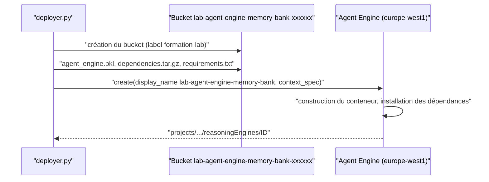

# Déployer et interroger à distance

> [!NOTE]
> Dans cette leçon, vous allez déployer réellement l'assistant sur Agent Engine, l'interroger depuis votre poste dans deux sessions distinctes, observer les souvenirs que Memory Bank a extraits entre les deux, et vérifier que la seconde session s'en sert.

## Avant de lancer

- [ ] `pytest` est vert (sinon, inutile de payer un déploiement)
- [ ] `python local.py` fonctionne avec Vertex AI
- [ ] vous avez lu la leçon [Coûts et nettoyage](./02-couts-et-nettoyage.md) et vous savez lancer `nettoyer.py`

```bash title="terminal"
export GOOGLE_GENAI_USE_VERTEXAI=TRUE GOOGLE_CLOUD_PROJECT=votre-projet GOOGLE_CLOUD_LOCATION=europe-west1
python deployer.py        # 5 à 15 minutes
python interroger.py      # 2 sessions distantes + lecture des souvenirs
python nettoyer.py        # supprime tout, puis vérifie
```

## Le déploiement



Les trois fichiers déposés dans le bucket sont l'agent **sérialisé** (`agent_engine.pkl`), le code local nécessaire (`dependencies.tar.gz`, qui contient `agent_memoire.py`) et la liste des dépendances.

Dans notre essai du 2026-10-15, le déploiement a pris un peu moins de 5 minutes. Pendant ce temps, rien n'est encore interrogeable : `create()` rend la main quand le conteneur est prêt.

```quiz
question: "Que contient dependencies.tar.gz dans le bucket de staging ?"
options:
  - "Toutes les bibliothèques Python installées sur votre poste"
  - "Les fichiers listés dans extra_packages (ici agent_memoire.py), nécessaires pour recharger l'agent sérialisé"
  - "Les journaux du déploiement"
answer: 1
explanation: "Les bibliothèques PyPI sont installées à distance d'après requirements. dependencies.tar.gz transporte votre propre code (extra_packages), dont l'agent sérialisé a besoin pour être rechargé."
```

## Interroger à distance

`client.agent_engines.get(name=...)` renvoie un objet dont les méthodes correspondent aux opérations exposées par `AdkApp` : `async_create_session`, `async_stream_query`, `async_search_memory`…

```python title="files/interroger.py"
async def tour(distant, texte: str) -> str:
    session = await distant.async_create_session(user_id=UTILISATEUR)
    morceaux = []
    async for ev in distant.async_stream_query(user_id=UTILISATEUR, session_id=session["id"],
                                               message=texte):
        for part in (ev.get("content") or {}).get("parts", []):
            if part.get("function_call"):
                print("   [outil]", part["function_call"]["name"], part["function_call"]["args"])
            if part.get("text"):
                morceaux.append(part["text"])
    return "".join(morceaux)
```

À distance, les événements arrivent sous forme de **dictionnaires** (JSON), pas d'objets `Event` : on lit `ev["content"]["parts"]`.

Entre les deux sessions, on attend que Memory Bank ait fini d'extraire les souvenirs : la génération est **asynchrone**, elle se fait en arrière-plan après l'appel de `add_session_to_memory()`.

```python title="files/interroger.py"
for _ in range(18):                       # 3 minutes au plus
    faits = souvenirs(client, nom)        # [m.fact for m in client.agent_engines.memories.list(name=nom)]
    if faits:
        break
    time.sleep(10)
```

```quiz
question: "Pourquoi interroger.py attend-il avant d'ouvrir la session 2 ?"
options:
  - "Pour respecter un quota de requêtes"
  - "Parce que Memory Bank génère les souvenirs en arrière-plan : sans attendre, la session 2 pourrait démarrer avant que les faits de la session 1 existent"
  - "Parce que l'Agent Engine doit redémarrer entre deux sessions"
answer: 1
explanation: "add_session_to_memory déclenche une génération asynchrone (un LLM extrait et fusionne les faits). En production, quelques secondes séparent en général deux conversations ; dans un test enchaîné, il faut attendre explicitement."
```

## Exercice : chercher dans la mémoire sans passer par l'agent

Écrivez quelques lignes qui interrogent directement la mémoire de Camille avec la question « quel ordinateur ? », sans lancer de conversation.

<details>
<summary>Voir la solution</summary>

`AdkApp` expose `async_search_memory`, qui appelle le `MemoryService` (ici Memory Bank) :

```python title="chercher.py"
import asyncio, json, vertexai
from deployer import ETAT, PROJET, REGION

async def main():
    client = vertexai.Client(project=PROJET, location=REGION)
    distant = client.agent_engines.get(name=json.loads(ETAT.read_text())["agent_engine"])
    print(await distant.async_search_memory(user_id="camille", query="quel ordinateur ?"))

asyncio.run(main())
```

La recherche est limitée à l'utilisateur et à l'application (`app_name`) : les souvenirs de Camille ne remontent jamais pour un autre `user_id`. En production, l'`user_id` doit venir de l'authentification, jamais d'un champ saisi par l'utilisateur.

</details>

## Résultat obtenu

Exécution réelle le 2026-10-15 (`python interroger.py`, agent déployé dans `europe-west1`, `gemini-2.5-flash`), environ 1 minute au total :

```text
Session 1 > Bonjour, je suis Camille, je travaille sur le site de Nantes avec un MacBook.
Assistant < Bonjour Camille, je prends note que vous travaillez sur le site de Nantes avec un
            MacBook. Comment puis-je vous aider aujourd'hui ?
Souvenirs dans Memory Bank : ['My name is Camille, I work at the Nantes site, and I use a MacBook.']
Session 2 > Mon ordinateur ne démarre plus depuis ce matin. Tu peux créer un ticket ?
   [outil] creer_ticket {'priorite': 'haute', 'sujet': "L'ordinateur de Camille (Nantes) ne démarre plus."}
Assistant < Bien sûr, je viens de créer un ticket de support pour votre problème de démarrage
            d'ordinateur. Le numéro de votre ticket est IT-46114. Notre équipe va examiner cela
            en priorité.
```

Trois observations :

- le sujet du ticket de la session 2 contient « Camille (Nantes) » : l'information vient **uniquement** de Memory Bank, la session étant neuve ;
- Memory Bank a écrit le souvenir **en anglais** et à la première personne, alors que la conversation était en français : c'est le comportement par défaut observé ce jour-là ; la configuration de génération (thèmes, exemples) permet de l'orienter ;
- la recherche de l'exercice (`async_search_memory`) a renvoyé ce souvenir pour `camille`, et une liste **vide** pour un autre utilisateur (`dominique`).

## Je sais faire

- [ ] Déployer un agent ADK sur Agent Engine et retrouver son nom de ressource
- [ ] Ouvrir une session distante et lire les événements en streaming
- [ ] Lister les souvenirs générés par Memory Bank
- [ ] Vérifier qu'une nouvelle session utilise les souvenirs d'une session précédente
