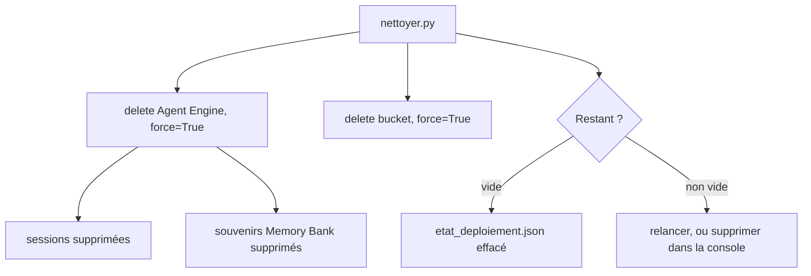

# Coûts et nettoyage

> [!NOTE]
> Dans cette leçon, vous allez identifier tout ce qui est facturé dans ce lab, supprimer l'Agent Engine (avec ses sessions et ses souvenirs) et le bucket de staging, puis **prouver** qu'il ne reste rien, avec les commandes de vérification.

## Ce qui est facturé

| Élément | Facturé quand | Levier dans ce lab |
| --- | --- | --- |
| Agent Engine (calcul) | vCPU et mémoire pendant le traitement des requêtes | 1 vCPU, 1 Gio, `max_instances=1`, `min_instances=0` |
| Gemini (vos requêtes) | tokens d'entrée et de sortie | réponses de 3 phrases, quelques tours seulement |
| Memory Bank | stockage et opérations sur les souvenirs, plus le modèle qui les extrait | TTL de 30 jours, peu de conversations |
| Sessions gérées | stockage des événements | supprimées avec l'Agent Engine |
| Bucket de staging | stockage (quelques Mo) | supprimé à la fin |

> [!WARNING]
> La documentation d'Agent Runtime indique qu'**en préversion**, le temps d'inactivité n'est pas facturé même avec des instances minimales, et précise que ce comportement peut changer. Ne comptez pas dessus : supprimez l'instance dès que le lab est fini, et consultez la page des tarifs avant tout usage prolongé.

Pour ce lab (un déploiement, deux conversations, quelques minutes d'activité), le coût reste de l'ordre de **quelques centimes** ; le poste le plus incertain est le temps pendant lequel vous laissez l'instance exister.

```quiz
question: "Vous supprimez l'Agent Engine mais oubliez le bucket de staging. Que se passe-t-il ?"
options:
  - "Rien : le bucket est supprimé avec l'Agent Engine"
  - "Le bucket reste et continue d'être facturé (faiblement) pour son stockage, et il contient l'agent sérialisé"
  - "L'Agent Engine est recréé automatiquement"
answer: 1
explanation: "Le bucket est une ressource Cloud Storage indépendante. Il coûte peu, mais il contient votre code et vos dépendances : à supprimer pour des raisons de coût et d'hygiène."
```

## Supprimer : `nettoyer.py`

```python title="files/nettoyer.py"
# 1. Agent Engine : force=True supprime aussi sessions et souvenirs (Memory Bank).
noms = {etat["agent_engine"]} if etat.get("agent_engine") else set()
noms |= {e.api_resource.name for e in client.agent_engines.list()
         if (e.api_resource.display_name or "").startswith(f"lab-{SLUG}")}
for nom in noms:
    for essai in range(20):  # 10 minutes au plus
        try:
            client.agent_engines.delete(name=nom, force=True)
            break
        except Exception as e:  # ex. génération de souvenirs encore en cours
            if "other operations running" not in str(e) or essai == 19:
                raise
            time.sleep(30)

# 2. Buckets de staging du lab (repérés par leur label).
for b in gcs.list_buckets():
    if (b.labels or {}).get("formation-lab") == LABELS["formation-lab"]:
        b.delete(force=True)       # force : supprime d'abord les objets (< 256)

# 3. Vérification, après la fin effective de la suppression (opération longue).
print("Restant :", {"agent_engines": restants, "buckets": buckets})
```

- `force=True` est **nécessaire** dès que l'instance a des ressources enfants (sessions, souvenirs) : sans lui, la suppression échoue avec `FAILED_PRECONDITION`.
- La recherche par **nom affiché** et par **label** rattrape un déploiement interrompu dont le nom n'a pas été noté.
- `bucket.delete(force=True)` supprime d'abord les objets ; il refuse au-delà de 256 objets (largement suffisant pour un bucket de staging).



```quiz
question: "La suppression renvoie 400 FAILED_PRECONDITION « There are other operations running ». Que faire ?"
options:
  - "Supprimer le projet entier"
  - "Attendre la fin de l'opération en cours et relancer la suppression (le script réessaie toutes les 30 s), puis vérifier que l'instance a disparu"
  - "Considérer que l'instance est supprimée"
answer: 1
explanation: "Une seule opération à la fois peut modifier l'instance. L'erreur ne supprime rien : il faut réessayer, puis vérifier par une commande indépendante (404 sur la ressource)."
```

## Vérifier avec gcloud

Ne vous contentez pas du message du script : vérifiez avec des outils indépendants.

```bash title="terminal"
# Agent Engines (reasoningEngines) restants dans la région
curl -s -H "Authorization: Bearer $(gcloud auth print-access-token)" \
  "https://europe-west1-aiplatform.googleapis.com/v1/projects/VOTRE_PROJET/locations/europe-west1/reasoningEngines" \
  | grep -c "lab-agent-engine-memory-bank"           # attendu : 0

# Buckets du lab
gcloud storage buckets list --project VOTRE_PROJET \
  --filter="labels.formation-lab=agent-engine-memory-bank" --format="value(name)"   # attendu : vide
```

## Exercice : un garde-fou contre l'oubli

Vous craignez qu'un participant oublie `nettoyer.py`. Proposez deux mécanismes, l'un dans le code, l'autre côté Google Cloud.

<details>
<summary>Voir la solution</summary>

1. **Dans le code** : `interroger.py` peut appeler le nettoyage dans un bloc `try/finally`, ou afficher en fin d'exécution un rappel avec la commande exacte. Pour un atelier, un script unique `deployer.py && interroger.py; nettoyer.py` (le `;` lance le nettoyage même si l'interrogation échoue).
2. **Côté Google Cloud** : une **alerte budgétaire** sur le projet (Billing, Budgets et alertes) avec un seuil bas, et une règle de cycle de vie sur les buckets étiquetés `formation-lab` (suppression des objets après 1 jour). Un job planifié peut aussi lister les ressources portant le label et les supprimer chaque nuit.

</details>

## Résultat obtenu

Nettoyage réel le 2026-10-15 (`python nettoyer.py`), lancé une minute après `interroger.py`, puis vérifications indépendantes :

```text
Opération en cours sur l'instance, nouvel essai dans 30 s
[... 9 fois au total, environ 4 min 30 ...]
Suppression demandée : projects/<numéro-projet>/locations/europe-west1/reasoningEngines/2373526745996328960
Bucket supprimé : lab-agent-engine-memory-bank-13550c
Restant : {'agent_engines': [], 'buckets': []}

$ curl ... /reasoningEngines | grep -c "lab-agent-engine-memory-bank"
0
$ curl ... /reasoningEngines/2373526745996328960
{ "error": { "code": 404, "message": "The ReasoningEngine does not exist.", "status": "NOT_FOUND" } }
$ gcloud storage buckets list --filter="labels.formation-lab=agent-engine-memory-bank"
(aucun bucket)
```

> [!WARNING]
> La première version de `nettoyer.py` a **échoué** : `400 FAILED_PRECONDITION ... There are other operations running on the ReasoningEngine`. Juste après des conversations, une opération (probablement liée à la génération des souvenirs) était encore en cours sur l'instance, et la suppression était refusée. D'où la boucle de réessai (jusqu'à 10 minutes) et l'attente de la disparition effective avant la vérification. Un script de nettoyage doit être **rejouable** : relancez-le tant que « Restant » n'est pas vide.

## Je sais faire

- [ ] Lister ce qui est facturé dans un déploiement Agent Engine avec Memory Bank
- [ ] Supprimer un Agent Engine avec ses sessions et ses souvenirs (`force=True`)
- [ ] Retrouver par nom et par label les ressources d'un déploiement interrompu
- [ ] Vérifier la suppression avec des commandes indépendantes du script
