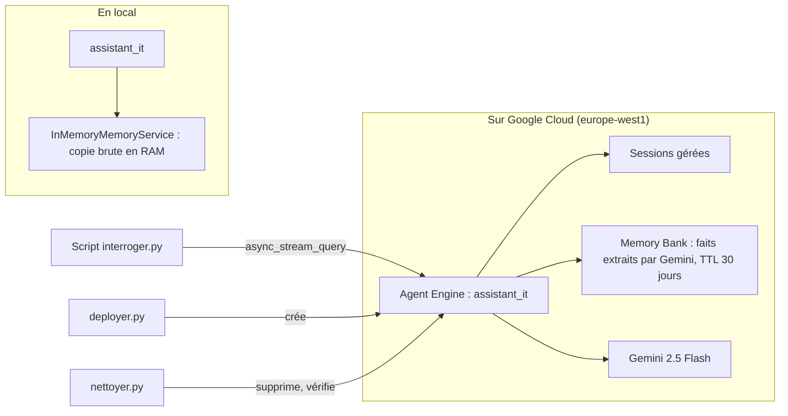

Un assistant interne qui oublie tout entre deux conversations agace vite : « je vous l'ai déjà dit, je suis à Nantes et j'ai un MacBook ». La **mémoire long terme** règle ce problème : l'agent retient des faits durables sur chaque personne et les retrouve dans les conversations suivantes.

Dans ce lab, vous construisez un **assistant de support IT** avec **Google ADK**, vous le testez en local avec une mémoire en RAM, puis vous le déployez sur **Vertex AI Agent Engine** (le service géré de Google Cloud qui héberge des agents ; la documentation récente l'appelle aussi *Agent Runtime*) avec **Memory Bank**, le service qui extrait et stocke les souvenirs. Vous l'interrogez à distance, vérifiez qu'il se souvient, puis vous **supprimez tout**.

## Ce que vous construisez

- `agent_memoire.py` : l'agent (un outil `creer_ticket`, `PreloadMemoryTool`, un callback qui envoie la conversation à la mémoire) ;
- `local.py` : deux sessions successives en local, la seconde se souvient de la première ;
- `deployer.py`, `interroger.py`, `nettoyer.py` : déployer, interroger à distance, supprimer et vérifier ;
- `test_agent_memoire.py` : 3 tests **sans compte Google Cloud**.

## Pour qui ?

- Développeurs qui ont déjà construit et testé un agent ADK, et veulent le mettre en production sur Google Cloud.
- Niveau expert : déploiement, ressources facturées, nettoyage. Lisez la leçon de coûts **avant** de lancer `deployer.py`.

## Prérequis

- Un projet Google Cloud avec facturation et l'API **Vertex AI** activée.
- Rôles IAM : `Vertex AI User` (ou plus large pour créer des Agent Engines), `Storage Admin` sur le projet pour le bucket de staging.
- `gcloud auth application-default login` (identifiants ADC).
- Python 3.10 à 3.14, `pip install -r files/requirements.txt` (google-adk 2.10.0, google-cloud-aiplatform 1.165.1).

## Programme

| Module | Leçon | Ce que vous faites |
| --- | --- | --- |
| 1. Cas d'usage et architecture | [Sessions, mémoire et Agent Engine](./01-cas-d-usage-et-architecture/01-sessions-memoire-agent-engine.md) | Distinguer état de session et mémoire long terme ; choisir où l'agent tourne |
| 2. Construire pas à pas | [Un agent qui se souvient, en local](./02-construire-pas-a-pas/01-agent-qui-se-souvient.md) | `PreloadMemoryTool`, callback de mémorisation, tests sans Google Cloud |
| | [Préparer le déploiement](./02-construire-pas-a-pas/02-preparer-le-deploiement.md) | `AdkApp`, configuration sobre, Memory Bank et TTL |
| 3. Tester, déployer, nettoyer | [Déployer et interroger à distance](./03-tester-deployer-nettoyer/01-deployer-et-interroger.md) | Déploiement réel, deux sessions distantes, souvenirs générés |
| | [Coûts et nettoyage](./03-tester-deployer-nettoyer/02-couts-et-nettoyage.md) | Ce qui est facturé, suppression complète et vérification |

## En local ou sur Google Cloud ?

| | En local | Sur Agent Engine |
| --- | --- | --- |
| où tourne l'agent | votre processus Python | conteneur géré par Google Cloud |
| sessions | `InMemorySessionService` (perdues à l'arrêt) | sessions gérées, persistantes |
| mémoire | `InMemoryMemoryService` : copie brute, recherche par mots | Memory Bank : faits extraits par un LLM, recherche sémantique |
| coût | appels au modèle seulement | modèle + temps de calcul + Memory Bank (voir la leçon de coûts) |

## Le code

Tout est dans [`files/`](./files/) : [agent_memoire.py](./files/agent_memoire.py), [local.py](./files/local.py), [deployer.py](./files/deployer.py), [interroger.py](./files/interroger.py), [nettoyer.py](./files/nettoyer.py) et [test_agent_memoire.py](./files/test_agent_memoire.py).
