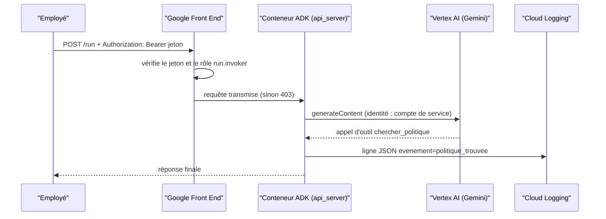

# Un assistant interne qui reste privé

> [!NOTE]
> Dans cette leçon, vous allez poser le cas d'usage (un assistant RH/IT pour les employés), identifier ce qui peut mal tourner une fois l'agent en ligne, et choisir l'architecture qui y répond : Cloud Run privé, compte de service dédié, jeton d'identité, journaux structurés.

## Le besoin

Une entreprise (fictive) veut un assistant qui :

- répond aux questions courantes à partir des **politiques internes** (« Combien de jours de télétravail ? ») ;
- **ouvre un ticket** quand l'employé a un problème qu'il ne peut pas régler seul (« Mon VPN ne marche plus ») ;
- est utilisable depuis une appli interne, sans que personne d'extérieur ne puisse l'appeler.

L'agent ADK lui-même est simple : deux outils Python. Tout l'intérêt du lab est **autour** de l'agent : où il tourne, qui peut l'appeler, avec quels droits il agit, et comment on voit ce qu'il fait.

## Ce qui peut mal tourner en production

| Risque | Exemple concret | Parade dans ce lab |
|---|---|---|
| Accès anonyme | quelqu'un trouve l'URL et consomme votre quota Gemini | service **privé** : `--no-allow-unauthenticated` |
| Droits trop larges | le service tourne avec le compte par défaut, qui a souvent le rôle Éditeur sur tout le projet | **compte de service dédié** avec un seul rôle |
| Secret qui fuit | une clé d'API copiée dans l'image Docker | **aucune clé** : Vertex AI + identité du service |
| Boîte noire | « l'agent a ouvert un ticket ? lequel ? » | **journaux structurés** JSON lus dans Cloud Logging |
| Facture fantôme | un service oublié, une image qui dort dans un dépôt | `--max-instances 1` + script de **nettoyage** vérifié |

Quelques termes, expliqués une fois pour toutes :

- **Cloud Run** : service Google Cloud qui exécute un conteneur derrière une URL HTTPS et le met à l'échelle (jusqu'à zéro instance quand personne ne l'appelle).
- **IAM** (Identity and Access Management) : le système qui dit *qui* (un utilisateur, un compte de service) a *quel rôle* sur *quelle ressource*.
- **Compte de service** : une identité pour un programme, pas pour une personne. Le service Cloud Run « est » ce compte quand il appelle d'autres API.
- **Jeton d'identité** (*ID token*) : un jeton signé par Google qui prouve qui vous êtes ; Cloud Run le vérifie avant même que votre code ne reçoive la requête.
- **ADC** (*Application Default Credentials*) : la façon standard dont les bibliothèques Google trouvent des identifiants (votre compte en local, le compte de service sur Cloud Run).

```quiz
question: "Votre service Cloud Run tourne avec le compte de service par défaut du projet, qui a le rôle Éditeur. Quel est le risque principal si l'agent est détourné (injection de prompt, faille dans un outil) ?"
options:
  - "Aucun, Cloud Run isole le conteneur"
  - "Le code compromis peut agir avec les droits d'Éditeur sur presque toutes les ressources du projet"
  - "Le service devient public"
answer: 1
explanation: "Le conteneur est isolé, mais les appels API qu'il fait portent l'identité de son compte de service. Avec Éditeur, cette identité peut créer, modifier ou supprimer la plupart des ressources du projet. Un compte dédié avec roles/aiplatform.user limite les dégâts à des appels de modèle."
```

## L'architecture retenue



Deux contrôles d'accès distincts, à ne pas confondre :

1. **Qui peut appeler le service ?** Vérifié par Cloud Run (rôle `roles/run.invoker`), **avant** votre code.
2. **Que peut faire le service ?** Déterminé par les rôles de **son** compte de service (ici, seulement `roles/aiplatform.user`).

```quiz
question: "Un employé reçoit une erreur 403 en appelant l'agent. Que pouvez-vous en déduire ? (plusieurs réponses)"
options:
  - "Son jeton est absent, expiré, ou il n'a pas le rôle run.invoker sur le service"
  - "Le compte de service de l'agent n'a pas le droit d'appeler Gemini"
  - "La requête n'a pas atteint le code Python de l'agent"
answer: [0, 2]
explanation: "Le 403 de Cloud Run est renvoyé par l'infrastructure avant le conteneur. Un problème de droits du compte de service vers Vertex AI produirait une erreur dans la réponse (ou un 500) après exécution du code, et serait visible dans les journaux de l'agent."
```

## Pourquoi Cloud Run plutôt qu'autre chose ?

| Option | Avantage | Limite pour ce cas |
|---|---|---|
| Cloud Run + `adk deploy cloud_run` | une commande, conteneur standard, IAM natif | sessions en mémoire par défaut (voir leçon 4) |
| Vertex AI Agent Engine | sessions et mémoire gérées | moins de contrôle sur le conteneur et le réseau |
| VM | contrôle total | à patcher, surveiller, sécuriser vous-même ; hors sujet ici |

> [!TIP]
> Cloud Run descend à zéro instance quand personne ne l'utilise : pour un assistant interne peu sollicité, vous ne payez presque que les appels Gemini.

## Résultat obtenu

Voici ce que donne l'architecture une fois déployée (test réel du 2026-10-15, identifiants masqués) : sans jeton, Cloud Run refuse ; avec un jeton d'identité, l'API ADK répond et liste l'agent.

```text title="terminal (2026-10-15)"
$ curl -s -o /dev/null -w "sans jeton : HTTP %{http_code}\n" -X POST "$URL/run"
sans jeton : HTTP 403
$ curl -s -H "Authorization: Bearer $(gcloud auth print-identity-token)" "$URL/list-apps"
["assistant_interne"]
$ gcloud run services describe lab-agent-cloud-run-iam ... --format 'value(spec.template.spec.serviceAccountName)'
lab-agent-cloud-run-iam@mon-projet-gcp.iam.gserviceaccount.com
```

## Exercice

Pour chacun de ces trois événements, dites lequel des deux contrôles d'accès (« qui peut appeler » ou « que peut faire le service ») est en jeu, et quel rôle IAM serait concerné :

1. Une appli interne doit pouvoir interroger l'assistant.
2. L'assistant doit écrire les tickets dans une table BigQuery.
3. Un stagiaire ne doit pas pouvoir appeler l'assistant.

<details>
<summary>Voir la solution</summary>

1. **Qui peut appeler** : donner `roles/run.invoker` sur **ce service** au compte de service de l'appli interne (pas sur tout le projet).
2. **Que peut faire le service** : ajouter au compte de service de l'agent `roles/bigquery.dataEditor` **sur le seul dataset des tickets**, plus `roles/bigquery.jobUser` sur le projet. Ne jamais lui donner Éditeur.
3. **Qui peut appeler** : ne pas lui accorder `run.invoker` ; vérifier qu'il n'en hérite pas par un groupe ou un rôle large (Propriétaire, Éditeur et Administrateur Cloud Run incluent l'invocation).

</details>

## Je sais faire

- [ ] Expliquer ce que protège `--no-allow-unauthenticated`
- [ ] Distinguer « qui peut appeler le service » et « ce que le service peut faire »
- [ ] Justifier un compte de service dédié plutôt que le compte par défaut
- [ ] Lister les ressources que le lab va créer (et donc supprimer)
