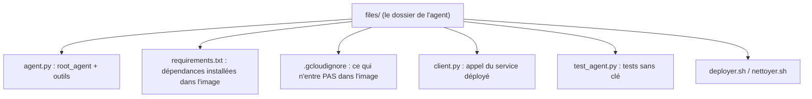

# L'agent et ses journaux structurés

> [!NOTE]
> Dans cette leçon, vous allez écrire l'agent ADK (deux outils), lui faire produire des **journaux structurés** que Cloud Logging saura filtrer, le préparer au déploiement (dossier, `requirements.txt`, `.gcloudignore`) et le tester **sans clé ni projet**.

## Le dossier est l'agent

`adk deploy cloud_run` prend un **dossier** et cherche dedans un fichier `agent.py` qui définit `root_agent`. Ici, ce dossier est directement [files/](../files/agent.py) :



## Les outils

Un outil ADK est une fonction Python ordinaire : ADK lit sa **signature** et sa **docstring** pour décrire l'outil au modèle. Les politiques sont fictives et tiennent dans un dictionnaire ; dans un vrai projet, ce serait un intranet ou une base.

```python title="files/agent.py"
def chercher_politique(sujet: str) -> dict:
    """Cherche la politique interne sur un sujet (congés, télétravail, notes de frais, VPN, mot de passe).

    Args:
        sujet: le thème de la question, en quelques mots.
    """
    cle = _normaliser(sujet)          # minuscules, sans accents : « Télétravail » -> « teletravail »
    for nom, texte in POLITIQUES.items():
        if nom in cle or cle in nom:
            journal("politique_trouvee", sujet=nom)
            return {"trouve": True, "sujet": nom, "politique": texte}
    journal("politique_absente", sujet=cle)
    return {"trouve": False, "sujets_connus": sorted(POLITIQUES)}
```

Quand rien n'est trouvé, l'outil renvoie la **liste des sujets connus** plutôt qu'une erreur : le modèle peut alors reformuler ou dire honnêtement qu'il ne sait pas.

```quiz
question: "Pourquoi chercher_politique renvoie-t-il sujets_connus quand il ne trouve rien, plutôt que lever une exception ?"
options:
  - "Pour que le modèle ait de quoi réagir : reformuler, ou répondre qu'aucune règle n'existe, sans inventer"
  - "Parce qu'ADK interdit les exceptions dans les outils"
  - "Pour réduire le nombre de tokens"
answer: 0
explanation: "Le résultat d'un outil est relu par le modèle. Une réponse structurée et explicite (trouve=false + sujets connus) l'aide à rester honnête. Une exception remonterait comme une erreur peu exploitable."
```

## Des journaux que Cloud Logging comprend

Sur Cloud Run, tout ce que le conteneur écrit sur la sortie standard part dans Cloud Logging. Si la ligne est un **objet JSON**, elle devient une entrée *structurée* : le champ `severity` fixe la sévérité, `message` le texte affiché, et chaque autre champ devient filtrable (`jsonPayload.evenement="ticket_ouvert"`).

```python title="files/agent.py"
def journal(evenement: str, **champs) -> None:
    print(json.dumps({"severity": "INFO", "message": evenement, "evenement": evenement, **champs},
                     ensure_ascii=False), file=sys.stdout, flush=True)
```

| Écrire… | Ce que vous obtenez dans Cloud Logging |
|---|---|
| `print("ticket ouvert TCK-0001")` | une ligne de texte (`textPayload`), recherche plein texte seulement |
| `print(json.dumps({...}))` | `jsonPayload` avec des champs filtrables et une vraie sévérité |
| `logging.info(...)` sans configuration | du texte, souvent avec la sévérité par défaut |

```quiz
question: "Le conteneur écrit la ligne {\"severity\": \"INFO\", \"message\": \"ticket_ouvert\", \"ticket_id\": \"TCK-0001\"} sur stdout. Quel filtre Cloud Logging la retrouve ?"
options:
  - "textPayload:\"TCK-0001\""
  - "jsonPayload.ticket_id=\"TCK-0001\""
  - "labels.ticket_id=\"TCK-0001\""
answer: 1
explanation: "Une ligne JSON devient un jsonPayload : ses champs se filtrent avec jsonPayload.<champ>. textPayload ne concerne que les lignes de texte brut, et labels désigne les libellés de l'entrée, pas son contenu."
```

> [!WARNING]
> Ne journalisez jamais le contenu complet des messages des employés ni de données personnelles : journalisez des **événements** (sujet, identifiant de ticket, catégorie). Les journaux sont lus par plus de monde que l'agent lui-même.

## L'agent

Le modèle vient d'une variable d'environnement (`MODEL`, défaut `gemini-2.5-flash`, validé sur Vertex AI en `europe-west1` le 2026-10-15). Les **réessais** sur 429/503 sont confiés au client Gemini d'ADK : le quota Vertex AI est partagé par tout le projet.

```python title="files/agent.py"
root_agent = Agent(
    name="assistant_interne",
    model=Gemini(model=MODEL, retry_options=types.HttpRetryOptions(attempts=5, initial_delay=2)),
    description="Assistant interne qui répond sur les politiques RH/IT et ouvre des tickets.",
    instruction=(
        "Tu es l'assistant interne d'une entreprise fictive. Tu réponds en français, en 3 phrases maximum. "
        "Pour toute question sur une règle interne, appelle d'abord chercher_politique et cite la règle. "
        "Si la personne signale un problème qu'elle ne peut pas résoudre seule, appelle ouvrir_ticket ..."
    ),
    tools=[chercher_politique, ouvrir_ticket],
)
```

## Ce qui entre dans l'image

`adk deploy cloud_run` copie le dossier dans l'image en respectant `.gcloudignore`. On exclut le `.env`, les tests et les scripts :

```text title="files/.gcloudignore"
.env
test_*.py
*.sh
__pycache__/
```

> [!CAUTION]
> `adk deploy cloud_run` lit aussi un éventuel `files/.env` et en fait des **variables d'environnement du service**. En mode Vertex AI, ce fichier ne contient aucune clé ; ne mettez jamais `GOOGLE_API_KEY` dans un dossier que vous déployez.

## Tester sans clé

Les tests vérifient les outils (fonctions pures), le format du journal, et le client HTTP grâce à `httpx.MockTransport`, qui simule le serveur :

```bash title="terminal"
cd files
python -m venv .venv && . .venv/bin/activate
pip install -r requirements.txt pytest
pytest -q
```

## Résultat obtenu

```text title="pytest (2026-10-15)"
......                                                                   [100%]
6 passed, 1 warning in 0.47s
```

## Exercice

Ajoutez un champ `duree_ms` au journal de `chercher_politique` (durée de la recherche), puis écrivez le filtre Cloud Logging qui retrouve les recherches **sans résultat** de l'assistant.

<details>
<summary>Voir la solution</summary>

```python title="files/agent.py (extrait modifié)"
import time

def chercher_politique(sujet: str) -> dict:
    debut = time.perf_counter()
    cle = _normaliser(sujet)
    for nom, texte in POLITIQUES.items():
        if nom in cle or cle in nom:
            journal("politique_trouvee", sujet=nom, duree_ms=round((time.perf_counter() - debut) * 1000, 2))
            return {"trouve": True, "sujet": nom, "politique": texte}
    journal("politique_absente", sujet=cle, duree_ms=round((time.perf_counter() - debut) * 1000, 2))
    return {"trouve": False, "sujets_connus": sorted(POLITIQUES)}
```

Filtre (langage de requête de Cloud Logging) :

```text
resource.type="cloud_run_revision"
resource.labels.service_name="lab-agent-cloud-run-iam"
jsonPayload.evenement="politique_absente"
```

Ces sujets sans réponse sont votre liste de politiques à rédiger en priorité.

</details>

## Je sais faire

- [ ] Organiser un dossier d'agent prêt pour `adk deploy cloud_run`
- [ ] Écrire un journal structuré JSON filtrable dans Cloud Logging
- [ ] Exclure `.env` et tests de l'image avec `.gcloudignore`
- [ ] Tester outils et client sans clé ni projet
