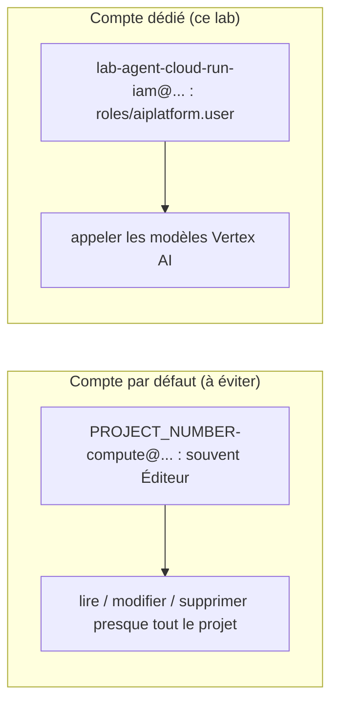

# Compte de service au moindre privilège

> [!NOTE]
> Dans cette leçon, vous allez créer l'identité de l'agent : un compte de service dédié, nommé et étiqueté pour le lab, auquel on accorde **un seul rôle**, `roles/aiplatform.user`. Vous verrez pourquoi ce rôle suffit, ce qu'il permet, et comment le vérifier.

## Le principe du moindre privilège

Donner à chaque identité **uniquement** les droits nécessaires à sa tâche, sur le **plus petit périmètre** possible. Pour notre agent, la tâche est : appeler Gemini sur Vertex AI. Rien d'autre.



Sans option `--service-account`, Cloud Run utilise le **compte de service Compute Engine par défaut**. Selon l'âge et la configuration du projet, ce compte peut avoir le rôle Éditeur : c'est pratique pour démarrer, dangereux en production.

## Ce que contient `roles/aiplatform.user`

| Permission (exemples) | Utile à l'agent ? |
|---|---|
| `aiplatform.endpoints.predict` | **oui** : c'est elle qu'utilise `generateContent` sur les modèles Gemini |
| lecture des ressources Vertex AI | rarement, sans danger |
| création de ressources Vertex AI (jeux de données, jobs…) | non ; c'est le prix d'un rôle prédéfini |

> [!TIP]
> Si même `roles/aiplatform.user` vous paraît trop large, créez un **rôle personnalisé** qui ne contient que `aiplatform.endpoints.predict`. C'est plus strict, mais il faut le maintenir quand les API évoluent. Pour un lab, le rôle prédéfini est le bon compromis.

```quiz
question: "Pourquoi n'accorde-t-on PAS roles/logging.logWriter au compte de service de l'agent ?"
options:
  - "Parce que l'agent n'écrit aucun journal"
  - "Parce que Cloud Run collecte lui-même stdout et stderr du conteneur : le code n'appelle pas l'API Logging"
  - "Parce que ce rôle n'existe pas"
answer: 1
explanation: "Les journaux écrits sur la sortie standard sont collectés par l'infrastructure Cloud Run, sans passer par l'identité du service. Le rôle d'écriture n'est nécessaire que si le code appelle directement l'API Cloud Logging (bibliothèque google-cloud-logging)."
```

## Les commandes

Extrait de [deployer.sh](../files/deployer.sh). Le nom du compte reprend le préfixe du lab (`lab-agent-cloud-run-iam`, 30 caractères au plus) pour qu'on le retrouve et le supprime sans ambiguïté :

```bash title="files/deployer.sh"
SERVICE="lab-agent-cloud-run-iam"
SA="${SERVICE}@${PROJECT_ID}.iam.gserviceaccount.com"

# 1. Compte de service dédié, sans aucun rôle au départ
gcloud iam service-accounts describe "$SA" --project "$PROJECT_ID" >/dev/null 2>&1 || \
  gcloud iam service-accounts create "$SERVICE" --project "$PROJECT_ID" \
    --display-name "Lab agent-cloud-run-iam : identité de l'agent"

# 2. Un seul rôle : appeler Gemini sur Vertex AI
gcloud projects add-iam-policy-binding "$PROJECT_ID" \
  --member "serviceAccount:${SA}" --role roles/aiplatform.user --condition None
```

Pour déployer un service avec ce compte, **vous** (la personne qui déploie) devez avoir le droit d'« agir en tant que » ce compte (`iam.serviceAccounts.actAs`, inclus dans Propriétaire, Éditeur ou `roles/iam.serviceAccountUser`). C'est une protection : sans elle, n'importe quel développeur pourrait lancer du code sous une identité plus puissante que la sienne.

```quiz
question: "Alice a le rôle Développeur Cloud Run mais pas iam.serviceAccountUser sur le compte lab-agent-cloud-run-iam. Que se passe-t-il si elle déploie avec --service-account sur ce compte ?"
options:
  - "Le déploiement réussit, Cloud Run ignore le compte"
  - "Le déploiement est refusé : elle ne peut pas faire tourner du code sous une identité qu'elle n'a pas le droit d'utiliser"
  - "Le service démarre avec le compte par défaut"
answer: 1
explanation: "Attacher un compte de service à une ressource exige la permission iam.serviceAccounts.actAs sur ce compte. Sans elle, gcloud renvoie une erreur de permission et rien n'est déployé."
```

> [!WARNING]
> Ne créez **jamais** de clé JSON pour ce compte de service. Sur Cloud Run, l'identité est fournie par le serveur de métadonnées ; une clé téléchargée est un secret permanent qui finit tôt ou tard dans un dépôt.

## Vérifier ce qui a été accordé

```bash title="terminal"
gcloud projects get-iam-policy "$PROJECT_ID" \
  --flatten="bindings[].members" \
  --filter="bindings.members:serviceAccount:lab-agent-cloud-run-iam@" \
  --format="value(bindings.role)"
```

## Résultat obtenu

Sortie réelle du 2026-10-15, après `deployer.sh` (identifiants masqués) :

```text title="terminal (2026-10-15)"
Created service account [lab-agent-cloud-run-iam].
Updated IAM policy for project [mon-projet-gcp].
$ gcloud projects get-iam-policy ... --format="value(bindings.role)"
roles/aiplatform.user
```

Un seul rôle, comme prévu. Et l'agent répond bien (leçon suivante) : la preuve que ce rôle **suffit**.

## Exercice

Votre assistant doit maintenant lire un fichier de politiques dans un bucket `gs://politiques-internes`. Quelles commandes ajoutez-vous, et lesquelles évitez-vous ?

<details>
<summary>Voir la solution</summary>

Accorder la **lecture seule**, **sur ce seul bucket** :

```bash
gcloud storage buckets add-iam-policy-binding gs://politiques-internes \
  --member "serviceAccount:lab-agent-cloud-run-iam@${PROJECT_ID}.iam.gserviceaccount.com" \
  --role roles/storage.objectViewer
```

À éviter :

- `gcloud projects add-iam-policy-binding ... --role roles/storage.objectViewer` : lecture de **tous** les buckets du projet ;
- `roles/storage.admin` ou `roles/storage.objectAdmin` : droit d'écrire et de supprimer, inutile pour lire.

Et pensez à retirer ce droit dans `nettoyer.sh` (ou à supprimer le bucket).

</details>

## Je sais faire

- [ ] Créer un compte de service dédié, nommé avec le préfixe du lab
- [ ] Accorder un rôle unique et vérifier les rôles effectifs
- [ ] Expliquer le rôle de `iam.serviceAccounts.actAs`
- [ ] Restreindre un droit à une ressource précise plutôt qu'au projet
