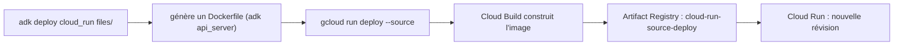

# Déployer et appeler avec un jeton

> [!NOTE]
> Dans cette leçon, vous allez déployer l'agent avec `adk deploy cloud_run` (ADK 2.10), en service privé et sous son compte de service dédié, vérifier qu'un appel sans jeton est refusé, puis l'appeler avec un jeton d'identité, en `curl` et avec [client.py](../files/client.py).

## Ce que fait `adk deploy cloud_run`



La commande génère un `Dockerfile` qui installe `google-adk` (même version que votre poste, ici 2.10.0) et vos `requirements.txt`, puis lance `adk api_server`. Tout ce qui suit `--` est passé tel quel à `gcloud run deploy`. Vérifiez les options de votre version avec `adk deploy cloud_run --help`.

```bash title="files/deployer.sh (extrait)"
adk deploy cloud_run \
  --project "$PROJECT_ID" --region "$REGION" \
  --service_name "$SERVICE" --app_name assistant_interne \
  --env GOOGLE_GENAI_USE_VERTEXAI=TRUE --env MODEL="${MODEL:-gemini-2.5-flash}" \
  . \
  -- --no-allow-unauthenticated --service-account "$SA" \
     --max-instances 1 --memory 1Gi --labels "formation-lab=${SLUG}"
```

| Option | Rôle |
|---|---|
| `--app_name assistant_interne` | nom de l'application dans l'API ADK (sinon : nom du dossier, ici `files`) |
| `--env GOOGLE_GENAI_USE_VERTEXAI=TRUE` | Gemini via Vertex AI, donc via l'identité du service, sans clé ; ADK ajoute lui-même `GOOGLE_CLOUD_PROJECT` et `GOOGLE_CLOUD_LOCATION` |
| `--no-allow-unauthenticated` | service privé : IAM obligatoire |
| `--service-account` | le compte dédié de la leçon précédente |
| `--max-instances 1` | plafond de coût et de charge pour un lab |
| `--labels formation-lab=...` | retrouver et facturer par lab ; ADK ajoute `created-by=adk` |

Lancez le tout :

```bash title="terminal"
cd files
export PROJECT_ID="mon-projet-gcp"
./deployer.sh
```

> [!TIP]
> Au premier déploiement « depuis les sources » dans une région, `gcloud` propose de créer le dépôt Artifact Registry `cloud-run-source-deploy`. Répondez oui. Il est réutilisé par les déploiements suivants ; la dernière leçon dit quand le supprimer.

```quiz
question: "Vous oubliez --app_name dans la commande. Quel chemin devez-vous utiliser dans l'URL de l'API ?"
options:
  - "/apps/assistant_interne/..."
  - "/apps/files/... (le nom du dossier déployé)"
  - "/apps/root_agent/..."
answer: 1
explanation: "Sans --app_name, ADK prend le nom du dossier passé en argument. Ici le dossier s'appelle files, donc l'application serait files. Le nom de l'agent (assistant_interne) n'intervient pas dans le chemin."
```

## Prouver que le service est privé

```bash title="terminal"
URL=$(gcloud run services describe lab-agent-cloud-run-iam --region europe-west1 \
      --project "$PROJECT_ID" --format 'value(status.url)')
curl -s -o /dev/null -w "sans jeton : HTTP %{http_code}\n" -X POST "$URL/run"
curl -s -H "Authorization: Bearer $(gcloud auth print-identity-token)" "$URL/list-apps"
```

`gcloud auth print-identity-token` fournit un **jeton d'identité** de votre compte, valable environ une heure. Cloud Run l'accepte si vous avez `roles/run.invoker` sur le service (inclus dans Propriétaire).

## Appeler l'agent

L'API ADK attend deux requêtes : créer une session, puis `POST /run` avec le message. Le client les enchaîne et extrait les outils appelés et la réponse finale :

```python title="files/client.py"
with httpx.Client(base_url=url, headers={"Authorization": f"Bearer {jeton}"}, timeout=120) as http:
    http.post(f"/apps/{APP_NAME}/users/{user}/sessions/{session}", json={}).raise_for_status()
    r = http.post("/run", json={
        "app_name": APP_NAME, "user_id": user, "session_id": session,
        "new_message": {"role": "user", "parts": [{"text": question}]},
    })
for ev in r.json():   # liste des événements : appels d'outils, réponses d'outils, texte
    ...
```

```bash title="terminal"
export SERVICE_URL="$URL" ID_TOKEN=$(gcloud auth print-identity-token)
python client.py "Combien de jours de télétravail par semaine ai-je droit ?"
python client.py "Mon VPN refuse de se connecter depuis ce matin, j'ai déjà redémarré."
```

```quiz
question: "Une appli interne tourne elle-même sur Cloud Run et doit appeler l'assistant. Comment obtient-elle un jeton d'identité ?"
options:
  - "Avec gcloud auth print-identity-token dans son conteneur"
  - "En demandant au serveur de métadonnées un jeton dont l'audience est l'URL de l'assistant (google.oauth2.id_token.fetch_id_token)"
  - "En copiant le jeton d'un développeur dans une variable d'environnement"
answer: 1
explanation: "Un service Cloud Run obtient un jeton signé pour son propre compte de service auprès du serveur de métadonnées, avec l'URL du service cible comme audience. Son compte doit avoir run.invoker sur l'assistant. Un jeton de développeur expire en une heure et n'a rien à faire en production."
```

## Résultat obtenu

Sorties réelles du 2026-10-15 (identifiants masqués) :

```text title="deployer.sh (2026-10-15)"
Reading ignore patterns from .gcloudignore...
Creating Dockerfile complete: /tmp/deploy_src/20261015_163218/Dockerfile
Building using Dockerfile and deploying container to Cloud Run service [lab-agent-cloud-run-iam] in project [mon-projet-gcp] region [europe-west1]
Creating Container Repository....done
Building Container....done
Creating Revision....done
Routing traffic.....done
Service [lab-agent-cloud-run-iam] revision [lab-agent-cloud-run-iam-00001-sd6] has been deployed and is serving 100 percent of traffic.
Service URL: https://lab-agent-cloud-run-iam-123456789012.europe-west1.run.app
```

```text title="client.py (2026-10-15)"
sans jeton : HTTP 403
["assistant_interne"]
OUTILS  : chercher_politique
REPONSE : La politique de télétravail de l'entreprise indique que vous avez droit à jusqu'à 2 jours de télétravail par semaine. Vous devez en informer votre responsable le lundi.
OUTILS  : ouvrir_ticket
REPONSE : J'ai ouvert un ticket "TCK-0001" auprès du support informatique pour votre problème de VPN. Ils vous contacteront bientôt.
```

Le déploiement complet a pris quelques minutes (essentiellement la construction de l'image).

> [!WARNING]
> Les sessions sont **en mémoire** (option par défaut `memory://`) : elles disparaissent quand l'instance s'arrête, et ne sont pas partagées entre instances. C'est acceptable avec `--max-instances 1` pour un lab ; en production, utilisez `--session_service_uri` vers une base ou Agent Engine.

## Exercice

Donnez l'accès à l'assistant à **une seule** personne, `alice@exemple.com`, sans lui donner aucun autre droit sur le projet, puis expliquez comment elle l'appelle.

<details>
<summary>Voir la solution</summary>

Le rôle d'invocation, **sur ce service uniquement** :

```bash
gcloud run services add-iam-policy-binding lab-agent-cloud-run-iam \
  --region europe-west1 --project "$PROJECT_ID" \
  --member "user:alice@exemple.com" --role roles/run.invoker
```

Alice se connecte avec `gcloud auth login`, puis :

```bash
export SERVICE_URL="https://lab-agent-cloud-run-iam-....run.app"
export ID_TOKEN=$(gcloud auth print-identity-token)
python client.py "Comment poser mes congés ?"
```

Ou plus simplement `gcloud run services proxy lab-agent-cloud-run-iam --region europe-west1`, qui ouvre un tunnel local authentifié sur `http://localhost:8080`.

</details>

## Je sais faire

- [ ] Déployer un agent ADK avec `adk deploy cloud_run` et des options `gcloud` après `--`
- [ ] Prouver qu'un service est privé (403 sans jeton, 200 avec)
- [ ] Appeler l'API ADK (`/apps/.../sessions/...` puis `/run`) avec un jeton d'identité
- [ ] Donner l'accès à une personne sur un seul service
