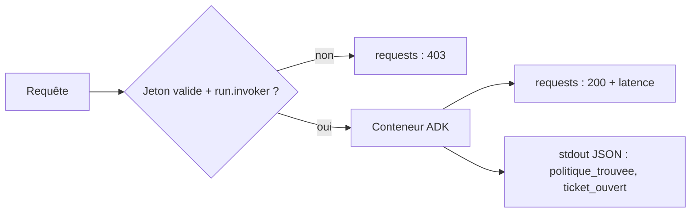

# Journaux, coûts et nettoyage

> [!NOTE]
> Dans cette leçon, vous allez lire les journaux de l'agent déployé (événements métier et refus d'accès), repérer les postes de coût, puis **tout supprimer** avec [nettoyer.sh](../files/nettoyer.sh) et prouver qu'il ne reste rien.

## Lire les journaux

Deux familles d'entrées arrivent dans Cloud Logging pour un service Cloud Run :

| Journal | Contenu | Exemple de filtre |
|---|---|---|
| `run.googleapis.com/requests` | une entrée par requête HTTP : méthode, statut, latence | `httpRequest.status=403` |
| `run.googleapis.com/stdout` | ce que votre code écrit ; JSON = structuré | `jsonPayload.evenement="ticket_ouvert"` |

```bash title="terminal"
# Les événements métier de l'agent (nos lignes JSON)
gcloud logging read \
  'resource.type="cloud_run_revision" AND resource.labels.service_name="lab-agent-cloud-run-iam" AND jsonPayload.evenement:*' \
  --project "$PROJECT_ID" --freshness 30m --limit 5 \
  --format 'table(timestamp, severity, jsonPayload.evenement, jsonPayload.ticket_id, jsonPayload.sujet)'

# Les requêtes refusées par IAM
gcloud logging read \
  'resource.type="cloud_run_revision" AND resource.labels.service_name="lab-agent-cloud-run-iam" AND httpRequest.status=403' \
  --project "$PROJECT_ID" --freshness 1h --limit 5 \
  --format 'table(timestamp, httpRequest.requestMethod, httpRequest.status, httpRequest.requestUrl)'
```

`jsonPayload.evenement:*` signifie « le champ existe » : on ne garde que nos événements, pas le bruit de démarrage d'ADK.



```quiz
question: "Vous voyez des 403 sur /favicon.ico dans les journaux de requêtes alors que personne n'a utilisé de navigateur dans l'équipe. Que faut-il en penser ?"
options:
  - "Le service est piraté"
  - "Quelqu'un (ou un robot) a ouvert l'URL sans jeton ; IAM l'a bloqué avant votre code, c'est exactement le comportement attendu"
  - "Le compte de service n'a pas assez de droits"
answer: 1
explanation: "Une URL run.app est publique au sens DNS : n'importe qui peut tenter de l'ouvrir. Le 403 prouve que la requête a été arrêtée par Cloud Run. Surveiller le volume de 403 reste utile pour détecter une appli mal configurée ou une tentative insistante."
```

## Résultat obtenu

Sortie réelle du 2026-10-15, une minute après les appels de la leçon précédente :

```text title="gcloud logging read (2026-10-15)"
TIMESTAMP                    SEVERITY  EVENEMENT          TICKET_ID  SUJET
2026-10-15T14:40:08.504102Z  INFO      ticket_ouvert      TCK-0001
2026-10-15T14:39:34.989269Z  INFO      politique_trouvee             teletravail

TIMESTAMP                    REQUEST_METHOD  STATUS  REQUEST_URL
2026-10-15T14:38:07.454979Z  GET             403     https://lab-agent-cloud-run-iam-xxxxxxxxxx-ew.a.run.app/favicon.ico
```

Les journaux arrivent avec quelques secondes de retard : si la requête ne renvoie rien, relancez-la.

## Les postes de coût du lab

| Poste | Quand | Ordre de grandeur |
|---|---|---|
| Cloud Build | à chaque déploiement (quelques minutes de build) | faible, avec un quota gratuit quotidien |
| Artifact Registry | stockage de l'image tant qu'elle existe | quelques centaines de Mo par image |
| Cloud Run | seulement pendant les requêtes (zéro instance au repos) | négligeable pour quelques appels |
| Vertex AI | chaque appel Gemini | quelques appels par question |
| Cloud Logging | volume ingéré | négligeable à cette échelle |

> [!TIP]
> Le poste qu'on oublie, c'est le **stockage d'images** : chaque déploiement « depuis les sources » pousse une nouvelle image, et elles restent après la suppression du service.

## Tout supprimer

```bash title="files/nettoyer.sh (extrait)"
gcloud run services delete "$SERVICE" --region "$REGION" --project "$PROJECT_ID" --quiet
gcloud projects remove-iam-policy-binding "$PROJECT_ID" \
  --member "serviceAccount:${SA}" --role roles/aiplatform.user --condition None
gcloud iam service-accounts delete "$SA" --project "$PROJECT_ID" --quiet
gcloud artifacts docker images delete "${REPO}/${SERVICE}" --delete-tags --quiet
gcloud storage rm -r "gs://run-sources-${PROJECT_ID}-${REGION}/services/${SERVICE}/"
```

L'ordre compte : on retire le rôle **avant** de supprimer le compte. Supprimer d'abord le compte laisse une liaison orpheline (`deleted:serviceAccount:...`) dans la stratégie IAM du projet.

```quiz
question: "Après gcloud run services delete, que reste-t-il qui peut encore coûter ou poser problème ? (plusieurs réponses)"
options:
  - "L'image dans Artifact Registry"
  - "Le compte de service et son rôle"
  - "Les instances Cloud Run"
  - "Les archives de sources dans le bucket run-sources-..."
answer: [0, 1, 3]
explanation: "Supprimer le service arrête toutes ses instances. Mais l'image, les sources envoyées à Cloud Build et l'identité IAM sont des ressources séparées : il faut les supprimer explicitement."
```

```bash title="terminal"
PROJECT_ID="mon-projet-gcp" ./nettoyer.sh
```

## Résultat obtenu (nettoyage)

Sortie réelle du 2026-10-15 ; les trois vérifications finales ne renvoient rien :

```text title="nettoyer.sh (2026-10-15)"
Deleted service [lab-agent-cloud-run-iam].
Updated IAM policy for project [mon-projet-gcp].
deleted service account [lab-agent-cloud-run-iam@mon-projet-gcp.iam.gserviceaccount.com]
--- Vérification (doit être vide) ---
$ gcloud artifacts docker images list .../cloud-run-source-deploy --include-tags
Listed 0 items.
$ gcloud run services list --project mon-projet-gcp
Listed 0 items.
```

> [!WARNING]
> Le dépôt `cloud-run-source-deploy` et le bucket `run-sources-<projet>-<région>` sont **partagés** par tous les déploiements « depuis les sources » de la région. `nettoyer.sh` ne supprime que ce qui appartient au lab ; ne supprimez le dépôt et le bucket entiers que si personne d'autre ne s'en sert (commandes en commentaire à la fin du script). Lors de notre test, le dépôt vidé gardait encore des couches d'image orphelines : seule la suppression du dépôt les efface.

## Exercice

Écrivez **une** commande qui liste toutes les ressources encore étiquetées `formation-lab=agent-cloud-run-iam` dans le projet, quel que soit leur type.

<details>
<summary>Voir la solution</summary>

Cloud Asset Inventory interroge tous les types de ressources à la fois (API `cloudasset.googleapis.com` à activer) :

```bash
gcloud asset search-all-resources \
  --scope "projects/${PROJECT_ID}" \
  --query 'labels.formation-lab:agent-cloud-run-iam' \
  --format 'table(assetType, name)'
```

Un résultat vide confirme le nettoyage des ressources étiquetables. Les comptes de service ne portent pas de labels : vérifiez-les à part avec `gcloud iam service-accounts list`.

</details>

## Je sais faire

- [ ] Filtrer les journaux d'un service par champ JSON et par statut HTTP
- [ ] Identifier les postes de coût d'un agent sur Cloud Run
- [ ] Supprimer service, rôle, compte de service, image et sources, dans le bon ordre
- [ ] Prouver par des commandes que rien ne reste
