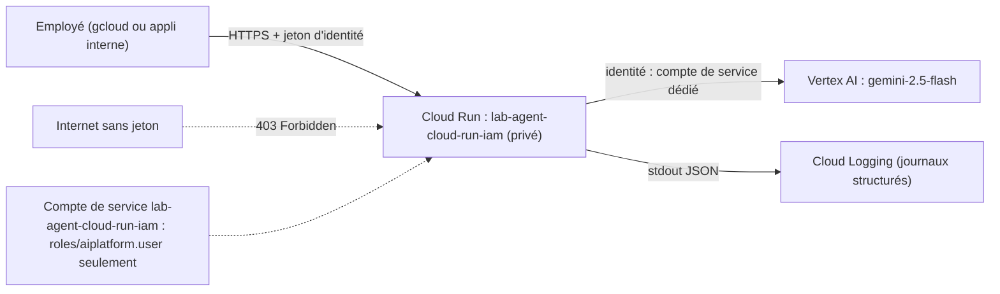

# Un agent ADK privé sur Cloud Run, au moindre privilège

Un assistant interne répond aux employés sur les règles RH et IT (congés, télétravail, VPN…) et ouvre des tickets. Il ne doit **jamais** être joignable par Internet sans authentification, et s'il est compromis, il ne doit **rien pouvoir faire d'autre** qu'appeler Gemini. Ce lab vous fait construire exactement cela, de bout en bout, sur un vrai projet Google Cloud, puis tout supprimer.

## Pour qui ?

Vous savez déjà écrire un agent ADK simple (un `Agent`, un ou deux outils) et vous avez un projet Google Cloud avec la facturation activée. Vous voulez passer de « ça marche sur mon poste » à « c'est en ligne, privé et propre ».

## Ce que vous construisez

## Prérequis

- Python 3.10+ et `gcloud` installé, connecté (`gcloud auth login` et `gcloud auth application-default login`).
- Un projet avec les API `run`, `aiplatform`, `cloudbuild`, `artifactregistry` activées et le rôle Propriétaire (ou Éditeur + Administrateur IAM) pour **créer** les ressources.
- Le code du lab : [files/](./files/agent.py) (agent, client, tests, scripts de déploiement et de nettoyage).

## Programme

| Module | Leçon | Ce que vous faites |
|---|---|---|
| 1. Cas d'usage et architecture | [Un assistant interne qui reste privé](./01-cas-d-usage/01-assistant-interne-prive.md) | menaces, choix d'architecture, rôle de chaque brique |
| 2. Construire pas à pas | [L'agent et ses journaux structurés](./02-construire/01-agent-et-journaux.md) | outils, journal JSON, tests sans clé |
| | [Compte de service au moindre privilège](./02-construire/02-compte-de-service.md) | un compte, un rôle, pourquoi pas le compte par défaut |
| 3. Déployer et exploiter | [Déployer et appeler avec un jeton](./03-deployer-exploiter/01-deployer-et-appeler.md) | `adk deploy cloud_run`, test 403 / 200, client Python |
| | [Journaux, coûts et nettoyage](./03-deployer-exploiter/02-journaux-et-nettoyage.md) | `gcloud logging read`, tout supprimer et le prouver |

## En local ou sur GCP ?

| | En local | Sur GCP (ce lab) |
|---|---|---|
| Modèle | Vertex AI via vos identifiants ADC | Vertex AI via le compte de service du service |
| Accès | votre machine seulement | URL HTTPS privée, IAM obligatoire |
| Journaux | votre terminal | Cloud Logging, filtrables |
| Coût | appels Gemini | appels Gemini + Cloud Build + quelques secondes de Cloud Run (ordre de grandeur : quelques centimes pour le lab) |

> [!WARNING]
> Ce lab crée de vraies ressources facturables. La dernière leçon les supprime toutes avec `nettoyer.sh` et montre comment le vérifier. Ne la sautez pas.
