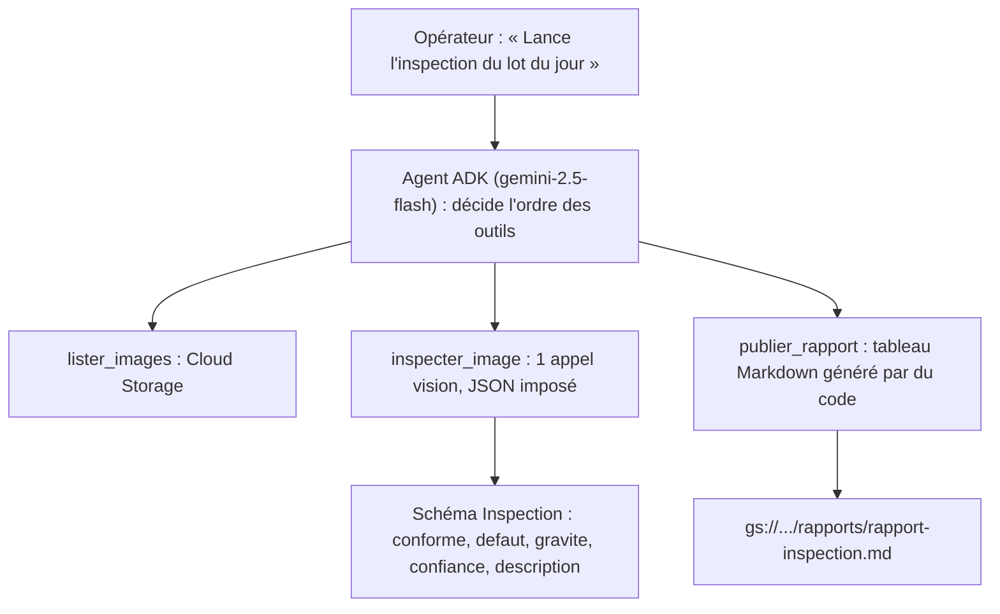

# Inspecter des pièces avec un agent

> [!NOTE]
> Dans cette leçon, vous allez découper le problème « inspecter un lot de photos et produire un rapport » en trois rôles : l'**agent** qui orchestre, le **modèle de vision** qui regarde une image à la fois avec une réponse imposée, et le **code déterministe** qui compte, rédige le tableau et évalue. C'est ce découpage qui rend le système fiable.

## Le besoin de l'atelier

Chaque matin, un lot de photos de rondelles est déposé dans `gs://<bucket>/images/`. L'atelier veut :

1. savoir **quelles pièces rejeter**, et pourquoi (type de défaut, gravité) ;
2. un **rapport** lisible, toujours au même format, stocké à côté des images ;
3. une **confiance** dans le résultat : combien d'erreurs ? une pièce défectueuse est-elle passée ?

Quatre défauts sont connus (données fictives) :

| Défaut | À l'image | Gravité |
|---|---|---|
| rayure | trait clair et fin | mineure |
| fissure | trait sombre irrégulier | majeure |
| tache | zone brune (rouille) | mineure |
| manque | morceau absent du bord | majeure |

## Qui fait quoi ?



- L'**agent** (un `Agent` ADK) reçoit la demande en langage naturel et enchaîne les outils. Il rédige la synthèse finale.
- Le **modèle de vision** n'est appelé que dans l'outil `inspecter_image`, une image à la fois, avec un **schéma de réponse** : il ne peut répondre que l'un des cinq défauts prévus.
- Le **code** construit le rapport (comptages, tableau) : pas de LLM pour additionner des nombres.

```quiz
question: "Pourquoi le tableau du rapport est-il construit par une fonction Python plutôt que rédigé par l'agent ?"
options:
  - "Parce qu'un LLM ne sait pas écrire de Markdown"
  - "Parce que le comptage et le format doivent être exacts et identiques à chaque exécution : c'est le rôle du code déterministe"
  - "Pour économiser des appels à Cloud Storage"
answer: 1
explanation: "Un LLM peut se tromper dans un comptage ou changer le format d'un jour à l'autre. Une fonction pure produit toujours le même tableau à partir des mêmes inspections, et se teste sans modèle."
```

## Pourquoi un appel de vision par image ?

| Option | Avantage | Inconvénient |
|---|---|---|
| Toutes les images dans le prompt de l'agent | un seul appel | contexte énorme, réponses mélangées, difficile à vérifier image par image |
| **Un outil = une image = une réponse JSON** (ce lab) | résultat traçable par pièce, réessayable, comparable à une vérité terrain | un appel par image |
| Modèle de classification entraîné sur mesure (AutoML…) | rapide et peu coûteux à grande échelle | demande des centaines d'images étiquetées |

Pour démarrer sans données d'entraînement, un modèle multimodal généraliste avec une consigne précise est un bon point de départ. Si les volumes deviennent importants, la vérité terrain construite dans ce lab servira justement à comparer avec un modèle spécialisé.

> [!TIP]
> Gardez les **noms de fichiers neutres** (`piece-04.png`, pas `piece-fissuree.png`). Sinon le modèle peut « tricher » en lisant le nom, et votre évaluation ne mesure plus rien.

```quiz
question: "Quelle erreur coûte le plus cher à l'atelier ?"
options:
  - "Rejeter une pièce conforme (faux positif)"
  - "Accepter une pièce défectueuse (faux négatif)"
  - "Les deux coûtent exactement pareil"
answer: 1
explanation: "Une pièce conforme rejetée coûte une pièce. Une pièce fissurée acceptée peut partir chez le client et casser en service. C'est pourquoi lancer.py mesure à part les « défectueuses acceptées », en plus de l'exactitude globale."
```

## Résultat obtenu

Le lot fictif utilisé dans tout le lab, généré par `generer_images.py` (les six photos réduites, de `piece-01` à `piece-06`) :


Et la synthèse que l'agent a rendue sur ce lot lors du test réel du 2026-10-15 :

```text title="lancer.py (2026-10-15)"
Sur un total de 6 pièces inspectées, 4 pièces sont à rejeter.
- `images/piece-02.png` : défaut de type 'rayure'
- `images/piece-04.png` : défaut de type 'fissure'
- `images/piece-05.png` : défaut de type 'tache'
- `images/piece-06.png` : défaut de type 'manque'
```

## Exercice

L'atelier ajoute un cinquième défaut, la **bavure** (excès de métal sur le bord, gravité mineure). Listez tout ce qu'il faut modifier dans le système, du générateur d'images à l'évaluation.

<details>
<summary>Voir la solution</summary>

1. `generer_images.py` : dessiner la bavure (par exemple un petit arc épais qui dépasse du bord) et ajouter une ou deux pièces `"bavure"` dans `PIECES`.
2. `agent.py` : ajouter `"bavure"` au `Literal` du champ `defaut` du schéma `Inspection` et au tuple `DEFAUTS` ; décrire la bavure et sa gravité dans `CONSIGNE_VISION`.
3. Le rapport suit automatiquement (il itère sur `DEFAUTS`).
4. Tests : vérifier qu'une pièce `bavure` est bien comptée ; relancer l'évaluation réelle pour voir si le modèle distingue bavure et manque.

Le point clé : le schéma est la **liste fermée** des réponses possibles. Un défaut absent du schéma ne peut pas être détecté.

</details>

## Je sais faire

- [ ] Répartir un problème entre agent, modèle de vision et code déterministe
- [ ] Justifier un appel de vision par image avec réponse structurée
- [ ] Choisir quelles erreurs mesurer en priorité
- [ ] Expliquer pourquoi les noms de fichiers doivent rester neutres
