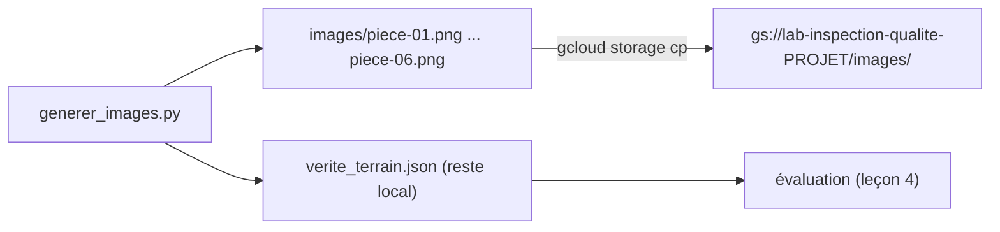

# Des images fictives dans un bucket temporaire

> [!NOTE]
> Dans cette leçon, vous allez générer avec Pillow six photos **fictives** de rondelles (deux conformes, quatre défectueuses) et leur vérité terrain, créer un bucket Cloud Storage privé, nommé et étiqueté pour le lab, et y déposer les images avec [preparer.sh](../files/preparer.sh).

## Pourquoi des images synthétiques ?

- **Aucune donnée réelle** : pas de photo d'usine, pas de secret industriel, rien à anonymiser.
- **Vérité terrain gratuite** : puisque c'est le code qui dessine le défaut, on sait exactement ce que contient chaque image.
- **Reproductible** : une graine aléatoire fixe par pièce donne les mêmes images à chaque exécution.

La limite est évidente : de vraies photos ont des reflets, du flou, des cadrages variables. Ce lab valide la **chaîne** (bucket, outils, schéma, évaluation) ; la précision réelle se mesure ensuite sur de vraies photos étiquetées.

## Dessiner une rondelle et ses défauts

**Pillow** est la bibliothèque Python de référence pour créer et modifier des images. `ImageDraw` dessine des formes, `ImageFilter` applique un léger flou pour éviter des bords trop parfaits.

```python title="files/generer_images.py"
def dessiner_piece(defaut: str, graine: int) -> Image.Image:
    rnd = random.Random(graine)
    img = Image.new("RGB", (TAILLE, TAILLE), (235, 235, 230))  # fond du convoyeur
    d = ImageDraw.Draw(img)
    c, r_ext, r_int = TAILLE // 2, 190, 70
    d.ellipse([c - r_ext, c - r_ext, c + r_ext, c + r_ext], fill=(150, 155, 160), outline=(90, 90, 95), width=4)
    d.ellipse([c - r_int, c - r_int, c + r_int, c + r_int], fill=(235, 235, 230), outline=(90, 90, 95), width=4)
    ...
    if defaut == "rayure":
        d.line([(c - 160, c - 60), (c - 40, c - 150)], fill=(225, 225, 230), width=5)
    elif defaut == "fissure":
        ...  # ligne brisée sombre
    elif defaut == "tache":
        d.ellipse([c + 60, c + 70, c + 130, c + 125], fill=(120, 75, 35))  # rouille
    elif defaut == "manque":
        d.pieslice([c - r_ext, c - r_ext, c + r_ext, c + r_ext], 300, 330, fill=(235, 235, 230))
    return img.filter(ImageFilter.GaussianBlur(0.6))
```

La correspondance « fichier → défaut » est écrite dans `verite_terrain.json`, **à côté** du dossier `images/` : ce fichier ne part pas dans le bucket, l'agent ne peut donc pas le lire.



```quiz
question: "Pourquoi verite_terrain.json n'est-il pas copié dans le bucket ?"
options:
  - "Parce que Cloud Storage refuse les fichiers JSON"
  - "Pour que l'agent ne puisse pas lire la réponse : l'évaluation doit mesurer ce que voit le modèle, pas ce qu'il lit"
  - "Pour économiser de l'espace de stockage"
answer: 1
explanation: "Les outils de l'agent lisent le bucket. Si la vérité terrain y était, un outil mal écrit (ou un futur outil de recherche) pourrait la remonter au modèle, et l'exactitude mesurée serait artificiellement parfaite."
```

## Le bucket temporaire

Un **bucket** est un conteneur d'objets (fichiers) dans Cloud Storage. Son nom est **unique au monde** : on y ajoute l'identifiant du projet.

```bash title="files/preparer.sh"
BUCKET="${BUCKET:-lab-inspection-qualite-${PROJECT_ID}}"   # nom unique au monde

gcloud storage buckets create "gs://${BUCKET}" --project "$PROJECT_ID" --location "$REGION" \
  --uniform-bucket-level-access --public-access-prevention
gcloud storage buckets update "gs://${BUCKET}" --update-labels formation-lab=inspection-qualite-vision-gcs
python generer_images.py images
gcloud storage cp images/*.png "gs://${BUCKET}/images/"
```

| Option | Pourquoi |
|---|---|
| `--location europe-west1` | données et modèle dans la même région |
| `--uniform-bucket-level-access` | droits gérés par IAM seulement, pas d'ACL objet par objet |
| `--public-access-prevention` | interdit tout partage public, même par erreur |
| `--update-labels formation-lab=...` | `buckets create` n'accepte pas de labels dans notre version de `gcloud` : on les pose juste après |

> [!WARNING]
> Pour l'agent, vos identifiants ADC (votre compte) suffisent en local. Si vous déployez l'agent, donnez à son compte de service `roles/storage.objectViewer` pour lire **et** `roles/storage.objectCreator` pour écrire le rapport, **sur ce bucket uniquement** (`gcloud storage buckets add-iam-policy-binding`), jamais au niveau du projet.

```quiz
question: "Un collègue propose d'activer l'accès public au bucket « pour que l'atelier voie les photos plus facilement ». Que répondez-vous ?"
options:
  - "D'accord, ce sont des rondelles"
  - "Non : on donne roles/storage.objectViewer sur ce bucket au groupe de l'atelier ; un bucket public est lisible par n'importe qui sur Internet"
  - "D'accord, si le nom du bucket reste secret"
answer: 1
explanation: "Un nom de bucket n'est pas un secret, et les photos de production sont des données de l'entreprise. L'accès se donne à des identités précises via IAM ; --public-access-prevention empêche justement l'erreur."
```

## Lancer la préparation

```bash title="terminal"
cd files
export PROJECT_ID="mon-projet-gcp"
./preparer.sh
gcloud storage ls "gs://lab-inspection-qualite-${PROJECT_ID}/images/"
```

## Résultat obtenu

Sortie réelle du 2026-10-15 (nom du projet masqué) :

```text title="preparer.sh (2026-10-15)"
Creating gs://lab-inspection-qualite-mon-projet-gcp/...
6 images écrites dans images/
Average throughput: 2.9MiB/s
gs://lab-inspection-qualite-mon-projet-gcp/images/piece-01.png
gs://lab-inspection-qualite-mon-projet-gcp/images/piece-02.png
gs://lab-inspection-qualite-mon-projet-gcp/images/piece-03.png
gs://lab-inspection-qualite-mon-projet-gcp/images/piece-04.png
gs://lab-inspection-qualite-mon-projet-gcp/images/piece-05.png
gs://lab-inspection-qualite-mon-projet-gcp/images/piece-06.png
```

## Exercice

Rendez le lot plus difficile : ajoutez une pièce `piece-07.png` qui porte **deux** défauts (rayure et tache), et dites ce que cela change pour le schéma de réponse.

<details>
<summary>Voir la solution</summary>

Dans `generer_images.py`, laissez `dessiner_piece` accepter une liste :

```python
def dessiner_piece(defauts, graine):
    defauts = [defauts] if isinstance(defauts, str) else defauts
    ...
    if "rayure" in defauts:
        d.line([(c - 160, c - 60), (c - 40, c - 150)], fill=(225, 225, 230), width=5)
    if "tache" in defauts:
        d.ellipse([c + 60, c + 70, c + 130, c + 125], fill=(120, 75, 35))
    ...

PIECES["piece-07.png"] = ["rayure", "tache"]
```

Le schéma actuel n'a qu'un champ `defaut` : le modèle devra choisir **un** des deux. Deux options :

- garder un seul champ mais demander le défaut **le plus grave** (règle à écrire dans la consigne) ;
- passer à `defauts: list[Literal[...]]` et adapter le rapport et l'évaluation (comparer des ensembles).

</details>

## Je sais faire

- [ ] Générer des images synthétiques reproductibles avec Pillow
- [ ] Tenir une vérité terrain hors de portée de l'agent
- [ ] Créer un bucket privé, régional, étiqueté
- [ ] Limiter les droits d'un agent à un seul bucket
