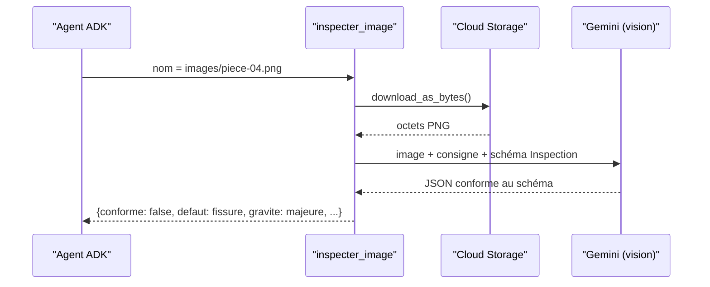

# Vision structurée et outils de l'agent

> [!NOTE]
> Dans cette leçon, vous allez écrire l'appel de vision Gemini avec une **sortie structurée** (schéma Pydantic imposé), les trois outils qui lisent et écrivent dans Cloud Storage, la fonction déterministe qui construit le rapport, et l'agent ADK qui orchestre le tout. Code complet : [agent.py](../files/agent.py).

## Une réponse imposée : le schéma `Inspection`

Une **sortie structurée** oblige le modèle à répondre en JSON conforme à un schéma. Avec le SDK `google-genai`, on passe directement une classe **Pydantic** (bibliothèque de validation de données) dans `response_schema`.

```python title="files/agent.py"
class Inspection(BaseModel):
    """Sortie structurée imposée au modèle de vision."""
    conforme: bool
    defaut: Literal["aucun", "rayure", "fissure", "tache", "manque"]
    gravite: Literal["aucune", "mineure", "majeure"]
    confiance: float = Field(ge=0, le=1)
    description: str = Field(description="une phrase factuelle sur ce qui est visible")
```

Le `Literal` est essentiel : il transforme une question ouverte (« que vois-tu ? ») en **classification** sur une liste fermée.

## L'appel de vision

```python title="files/agent.py"
def classer_image(image: bytes, mime: str = "image/png") -> Inspection:
    r = _genai().models.generate_content(
        model=VISION_MODEL,
        contents=[types.Part.from_bytes(data=image, mime_type=mime), CONSIGNE_VISION],
        config=types.GenerateContentConfig(
            temperature=0, response_mime_type="application/json", response_schema=Inspection),
    )
    return r.parsed if isinstance(r.parsed, Inspection) else Inspection.model_validate_json(r.text)
```

- `Part.from_bytes` envoie l'image brute, sans URL publique ; `temperature=0` réduit la variabilité.
- `r.parsed` contient déjà l'objet `Inspection` validé ; le repli `model_validate_json` lève une erreur claire si le JSON est invalide.
- Le client est créé avec des **réessais** sur 429/503 (`HttpRetryOptions`), car le quota Vertex AI est partagé.



```quiz
question: "Sans le Literal sur le champ defaut, quel problème risquez-vous ?"
options:
  - "Le modèle refuse de répondre"
  - "Le modèle peut écrire « fêlure », « crack » ou « petite fissure » : impossible à compter et à comparer à la vérité terrain"
  - "L'image n'est plus envoyée"
answer: 1
explanation: "Une chaîne libre accepte n'importe quelle formulation. La liste fermée garantit des valeurs comparables, ce dont ont besoin le rapport, les statistiques et l'évaluation."
```

## Les outils de l'agent

| Outil | Lit | Écrit | Garde-fou |
|---|---|---|---|
| `lister_images()` | les objets sous `images/` | rien | ignore ce qui n'est pas `.png`/`.jpg` |
| `inspecter_image(nom)` | un objet | le résultat en mémoire | refuse tout chemin hors `images/` ou contenant `..` |
| `publier_rapport()` | les résultats en mémoire | `rapports/rapport-inspection.md` | refuse s'il n'y a rien à publier |

```python title="files/agent.py"
def inspecter_image(nom: str) -> dict:
    """Inspecte une photo du bucket et renvoie le défaut détecté.

    Args:
        nom: chemin de l'objet dans le bucket, par exemple « images/piece-01.png ».
    """
    if not nom.startswith(PREFIXE_IMAGES) or ".." in nom:
        return {"erreur": f"seuls les objets sous {PREFIXE_IMAGES} sont inspectables"}
    blob = _bucket().blob(nom)
    mime = "image/jpeg" if nom.endswith(".jpg") else "image/png"
    resultat = classer_image(blob.download_as_bytes(), mime).model_dump()
    _resultats[nom] = resultat
    return {"image": nom, **resultat}
```

> [!WARNING]
> Le nom d'objet vient du **modèle**, donc indirectement de l'utilisateur. Le contrôle du préfixe empêche l'agent de lire autre chose que les images (par exemple un rapport précédent ou un fichier déposé là par erreur). Validez toujours les arguments d'un outil comme une entrée externe.

## Le rapport : du code, pas du LLM

```python title="files/agent.py"
def construire_rapport(resultats: dict[str, dict]) -> str:
    compte = Counter(r["defaut"] for r in resultats.values())
    rejets = sum(not r["conforme"] for r in resultats.values())
    lignes = ["# Rapport d'inspection qualité", "",
              f"- Pièces inspectées : {len(resultats)}",
              f"- Pièces à rejeter : {rejets}", ...]
```

`publier_rapport` appelle cette fonction, envoie le texte dans le bucket (`upload_from_string`, type `text/markdown`) et ne renvoie à l'agent qu'un résumé : l'URI du rapport et la liste des rejets.

## L'agent

```python title="files/agent.py"
root_agent = Agent(
    name="inspecteur_qualite",
    model=Gemini(model=MODEL, retry_options=types.HttpRetryOptions(attempts=5, initial_delay=2)),
    instruction=(
        "Procédure : 1) lister_images ; 2) inspecter_image pour CHAQUE image listée ; "
        "3) publier_rapport ; 4) termine par une synthèse de 5 lignes maximum ... "
        "Ne déduis jamais un défaut du nom du fichier : seul inspecter_image fait foi."
    ),
    tools=[lister_images, inspecter_image, publier_rapport],
)
```

```quiz
question: "L'agent appelle publier_rapport après n'avoir inspecté que 3 images sur 6. Où le voyez-vous immédiatement ?"
options:
  - "Nulle part, il faut relire toutes les images"
  - "Dans la réponse de publier_rapport (inspectees = 3) et dans la ligne « Pièces inspectées : 3 » du rapport, à comparer au nombre renvoyé par lister_images"
  - "Dans les journaux de Cloud Storage uniquement"
answer: 1
explanation: "Les sorties des outils sont structurées : comparer « nombre » de lister_images et « inspectees » de publier_rapport suffit. C'est aussi un excellent test automatique à ajouter."
```

## Résultat obtenu

Extrait réel du rapport publié dans le bucket le 2026-10-15 (`gcloud storage cat gs://.../rapports/rapport-inspection.md`) :

```text title="rapport-inspection.md (2026-10-15)"
# Rapport d'inspection qualité

- Pièces inspectées : 6
- Pièces à rejeter : 4
- Répartition : aucun = 2, rayure = 1, fissure = 1, tache = 1, manque = 1

| Image | Verdict | Défaut | Gravité | Confiance | Observation |
|---|---|---|---|---|---|
| images/piece-04.png | REJET | fissure | majeure | 0.95 | Une fissure sombre et irrégulière est visible sur la rondelle grise, s'étendant de l'intérieur vers l'extérieur. |
```

## Exercice

Ajoutez une règle métier : toute pièce dont la `confiance` est inférieure à 0,7 doit être marquée « À REVOIR » dans le rapport, quel que soit le verdict du modèle.

<details>
<summary>Voir la solution</summary>

La règle va dans le code déterministe, pas dans la consigne du modèle :

```python
SEUIL_CONFIANCE = 0.7

def verdict(r: dict) -> str:
    if r["confiance"] < SEUIL_CONFIANCE:
        return "À REVOIR"
    return "conforme" if r["conforme"] else "REJET"

# dans construire_rapport :
lignes.append(f"| {nom} | {verdict(r)} | {r['defaut']} | ...")
```

Et un test : un résultat à `confiance: 0.5` doit produire une ligne contenant `| À REVOIR |`.

Attention : la confiance déclarée par un LLM n'est pas une probabilité calibrée. C'est un signal utile pour trier, à valider sur vos propres données.

</details>

## Je sais faire

- [ ] Imposer un schéma de réponse Pydantic à un appel de vision Gemini
- [ ] Envoyer une image depuis Cloud Storage sans l'exposer publiquement
- [ ] Valider les arguments d'un outil comme une entrée externe
- [ ] Séparer ce qui relève du modèle et ce qui relève du code
