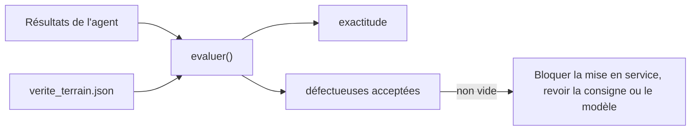

# Évaluer, publier, supprimer

> [!NOTE]
> Dans cette leçon, vous allez tester toute la chaîne **sans clé ni bucket** (faux bucket, faux modèle), lancer une inspection réelle sur Vertex AI et Cloud Storage, la **mesurer** contre la vérité terrain, puis supprimer le bucket et vérifier qu'il n'existe plus.

## Tester sans GCP

Les tests remplacent Cloud Storage par un `FauxBucket` (un dictionnaire) et le modèle de vision par une fonction qui renvoie un `Inspection` prévisible, grâce à `monkeypatch` de pytest :

```python title="files/test_inspection.py"
monkeypatch.setattr(agent, "_bucket", lambda: bucket)
monkeypatch.setattr(agent, "classer_image", faux_classer)
...
assert agent.lister_images() == {"nombre": 2, "images": ["images/piece-01.png", "images/piece-02.png"]}
assert agent.inspecter_image("autre/notes.txt")["erreur"]          # garde-fou du préfixe
r = agent.publier_rapport()
assert r["rejets"] == ["images/piece-02.png"]
```

| Test | Ce qu'il protège |
|---|---|
| `test_images_generees` | le générateur couvre bien les 5 classes, en 512 × 512 |
| `test_parcours_complet_avec_faux_bucket` | lister → inspecter → publier, garde-fou de chemin, contenu du rapport |
| `test_evaluer_signale_une_piece_defectueuse_acceptee` | la métrique la plus importante pour l'atelier |
| `test_schema_refuse_un_defaut_inconnu` | la liste fermée du schéma |

```bash title="terminal"
cd files && pip install -r requirements.txt && pytest -q
```

## Mesurer : deux chiffres, pas un

```python title="files/lancer.py"
def evaluer(resultats, verite):
    justes = sum(resultats.get(f"images/{nom}", {}).get("defaut") == d for nom, d in verite.items())
    manques = [n for n, d in verite.items() if d != "aucun" and resultats.get(f"images/{n}", {}).get("conforme")]
    return {"exactitude": justes / len(verite), "defectueuses_acceptees": manques}
```

- **Exactitude** : part des pièces dont le défaut est correctement identifié.
- **Défectueuses acceptées** : la liste des pièces défectueuses déclarées conformes. L'objectif est une liste **vide**.



```quiz
question: "Sur 100 pièces dont 5 défectueuses, un « agent » qui déclare tout conforme obtient quelle exactitude ?"
options:
  - "5 %"
  - "50 %"
  - "95 %, alors qu'il laisse passer toutes les pièces défectueuses"
answer: 2
explanation: "Quand les défauts sont rares, l'exactitude globale est trompeuse. C'est pour cela que lancer.py rapporte aussi la liste des pièces défectueuses acceptées, qui serait ici de 5 sur 5."
```

## Le run réel

```bash title="terminal"
export GOOGLE_GENAI_USE_VERTEXAI=TRUE GOOGLE_CLOUD_PROJECT="mon-projet-gcp" GOOGLE_CLOUD_LOCATION=europe-west1
export BUCKET="lab-inspection-qualite-${GOOGLE_CLOUD_PROJECT}"
python lancer.py
```

## Résultat obtenu

Les tests sans clé :

```text title="pytest (2026-10-15)"
....                                                                     [100%]
4 passed, 1 warning in 0.55s
```

Puis la sortie réelle du 2026-10-15 (Vertex AI, `gemini-2.5-flash`, europe-west1). Un premier essai s'était arrêté sur une erreur **429 RESOURCE_EXHAUSTED** (quota partagé) : c'est ce qui nous a fait ajouter les réessais au modèle de l'agent. Le second passage :

```text title="lancer.py (2026-10-15)"
OUTIL  lister_images {}
OUTIL  inspecter_image {'nom': 'images/piece-01.png'}
OUTIL  inspecter_image {'nom': 'images/piece-02.png'}
OUTIL  inspecter_image {'nom': 'images/piece-03.png'}
OUTIL  inspecter_image {'nom': 'images/piece-04.png'}
OUTIL  inspecter_image {'nom': 'images/piece-05.png'}
OUTIL  inspecter_image {'nom': 'images/piece-06.png'}
OUTIL  publier_rapport {}

SYNTHESE
L'inspection du lot est terminée.
Sur un total de 6 pièces inspectées, 4 pièces sont à rejeter.
...
Il est recommandé à l'atelier de vérifier les causes de ces défauts, en particulier les fissures et les manques, pour améliorer la qualité de la production.

EVALUATION {'exactitude': 1.0, 'defectueuses_acceptees': []}
```

Soit 6 appels de vision et quelques appels de l'agent. Ne surinterprétez pas le 100 % : six images synthétiques aux défauts bien visibles, c'est un **test de fumée** (la chaîne fonctionne), pas une mesure de précision industrielle.

> [!TIP]
> Pour une vraie mesure, constituez quelques centaines de photos réelles étiquetées par un contrôleur, avec des défauts **rares et discrets**, et suivez les deux chiffres à chaque changement de consigne ou de modèle.

## Supprimer le bucket

```bash title="files/nettoyer.sh"
gcloud storage rm -r "gs://${BUCKET}" --project "$PROJECT_ID"
gcloud storage buckets list --project "$PROJECT_ID" --filter "name=${BUCKET}" --format 'value(name)'  # doit être vide
```

`rm -r` sur le bucket supprime d'abord tous les objets (images **et** rapport), puis le bucket lui-même.

```quiz
question: "Après nettoyer.sh, que reste-t-il de ce lab sur Google Cloud ?"
options:
  - "Les images, car elles sont en cache"
  - "Rien : le bucket et tous ses objets sont supprimés ; les appels Vertex AI ne laissent aucune ressource"
  - "Le rapport, car il est dans un autre dossier"
answer: 1
explanation: "Le lab n'a créé qu'une ressource : le bucket. Les appels Gemini sont facturés à l'usage mais ne créent rien de persistant. Les fichiers locaux (images/, verite_terrain.json) restent sur votre poste."
```

## Résultat obtenu (nettoyage)

```text title="nettoyer.sh (2026-10-15)"
Removing objects: ......
$ gcloud storage buckets list --project mon-projet-gcp --format="value(name)" | grep lab-inspection || echo "bucket supprimé"
bucket supprimé
```

## Exercice

Transformez `lancer.py` en **garde-fou de non-régression** : le script doit se terminer avec un code d'erreur si l'exactitude passe sous 0,8 ou si une pièce défectueuse est acceptée, pour pouvoir le lancer avant chaque changement de consigne.

<details>
<summary>Voir la solution</summary>

À la fin de `main()` :

```python
import sys

resultat = evaluer(agent._resultats, verite)
print("\nEVALUATION", resultat)
if resultat["defectueuses_acceptees"] or resultat["exactitude"] < 0.8:
    print("ÉCHEC : régression de qualité", file=sys.stderr)
    sys.exit(1)
```

Dans une CI, ce script ne doit tourner que sur demande (il appelle le vrai modèle et coûte quelques appels) ; les tests `pytest` sans clé, eux, tournent à chaque commit.

</details>

## Je sais faire

- [ ] Tester un agent qui utilise Cloud Storage et Gemini sans aucun accès réel
- [ ] Mesurer exactitude **et** pièces défectueuses acceptées
- [ ] Interpréter honnêtement un résultat sur un petit jeu synthétique
- [ ] Supprimer un bucket et vérifier sa disparition
