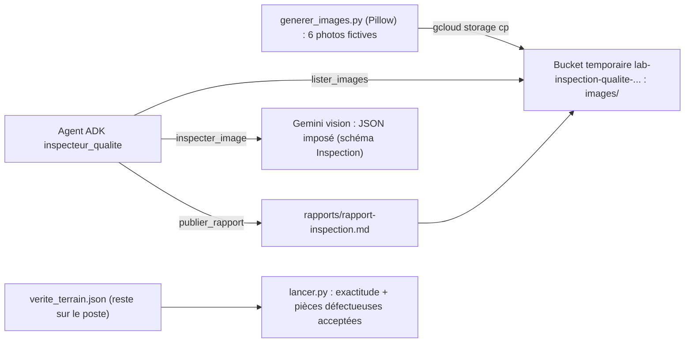

# Inspection qualité par vision : un agent ADK, Gemini et Cloud Storage

Sur une ligne de production, un opérateur photographie chaque rondelle métallique qui sort de la presse. Ces photos atterrissent dans un bucket. Il faut repérer les pièces rayées, fissurées, tachées ou ébréchées, décider lesquelles rejeter, et produire un rapport pour l'atelier. Ce lab construit l'agent qui fait ce travail, et surtout **mesure s'il le fait bien**.

## Pour qui ?

Vous connaissez les bases d'ADK (agent, outils, runner) et vous voulez traiter des **images** de façon fiable : réponse structurée, contrôlable, évaluée, sur des données qui vivent dans Google Cloud.

## Ce que vous construisez

## Prérequis

- Python 3.10+, `gcloud` connecté (`gcloud auth application-default login`), un projet avec Vertex AI et Cloud Storage activés.
- Le code : [files/](./files/agent.py) — `generer_images.py`, `agent.py`, `lancer.py`, `test_inspection.py`, `preparer.sh`, `nettoyer.sh`.

## Programme

| Module | Leçon | Ce que vous faites |
|---|---|---|
| 1. Cas d'usage et architecture | [Inspecter des pièces avec un agent](./01-cas-d-usage/01-inspection-visuelle.md) | rôles de l'agent, du modèle de vision et du code déterministe |
| 2. Construire pas à pas | [Des images fictives dans un bucket temporaire](./02-construire/01-images-et-bucket.md) | Pillow, vérité terrain, bucket privé étiqueté |
| | [Vision structurée et outils de l'agent](./02-construire/02-vision-structuree-et-agent.md) | schéma Pydantic, outils Cloud Storage, rapport |
| 3. Tester, évaluer, exploiter | [Évaluer, publier, supprimer](./03-tester-exploiter/01-evaluer-et-nettoyer.md) | tests sans clé, run réel, mesure, nettoyage |

## En local ou sur GCP ?

| | Variante locale (exercice) | Ce lab (GCP) |
|---|---|---|
| Images | un dossier `images/` | un bucket Cloud Storage privé |
| Modèle | Gemini via clé d'API | Gemini sur Vertex AI, identifiants ADC |
| Rapport | un fichier local | un objet `rapports/rapport-inspection.md` |
| Nettoyage | `rm -r images` | `nettoyer.sh` supprime le bucket et tout son contenu |

> [!WARNING]
> Le bucket est facturé (très peu pour quelques Ko) tant qu'il existe. La dernière leçon le supprime ; vérifiez-le avec la commande fournie.
