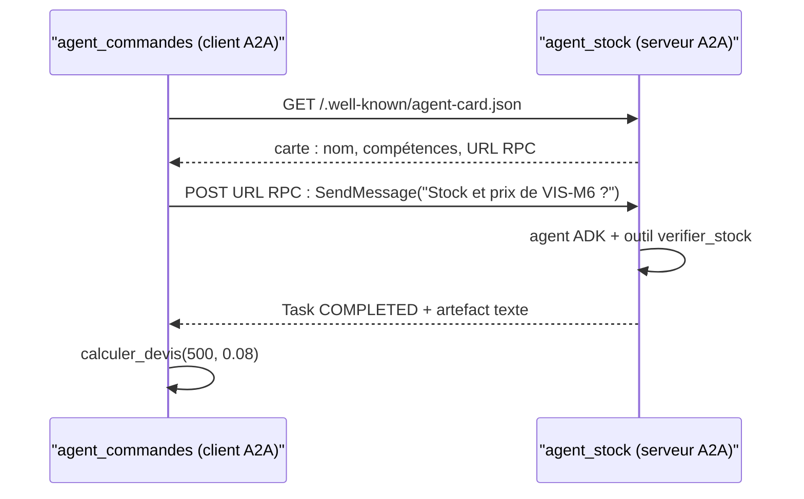
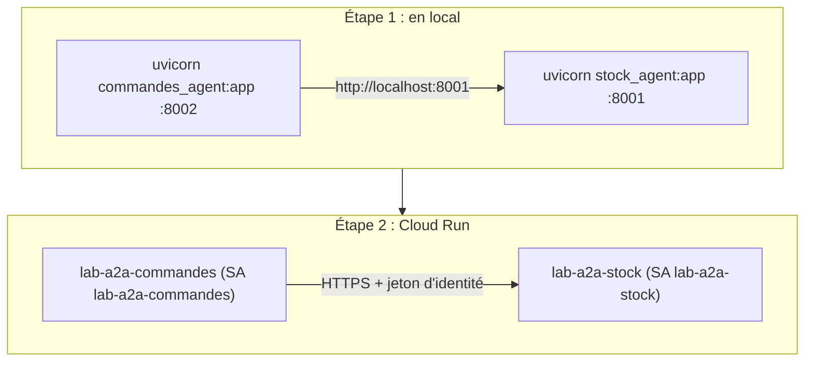

# Deux agents, un protocole

> [!NOTE]
> Dans cette leçon, vous allez comprendre ce qu'apporte A2A par rapport à un simple sous-agent ADK, découvrir les trois objets du protocole (carte d'agent, message, tâche) et poser l'architecture du lab : un agent « commandes » qui consulte un agent « stock » distant.

## Le scénario

Un commercial demande : « Je voudrais un devis pour 500 VIS-M6. » Pour répondre, il faut :

1. connaître la **disponibilité** et le **prix unitaire** : c'est le domaine de la logistique (agent `agent_stock`) ;
2. calculer **HT, TVA, TTC** et proposer une livraison partielle si besoin : c'est le domaine des ventes (agent `agent_commandes`).

Les références (`VIS-M6`, `ECR-M6`, `RON-M6`) et les prix sont fictifs.

## Sous-agent local ou agent distant ?

| | Sous-agent ADK (même processus) | Agent distant en A2A |
|---|---|---|
| Code | dans le même dépôt, même déploiement | n'importe où, n'importe quel langage ou framework compatible A2A |
| Équipe | une seule | chacune garde son agent, ses données, son rythme de déploiement |
| Sécurité | partage des droits du processus | chaque agent a **sa** identité et **ses** droits |
| Coût | aucun saut réseau | un appel HTTP par délégation (latence, à surveiller) |
| Quand ? | découper un agent trop gros | faire coopérer des agents **indépendants** |

```quiz
question: "Dans quel cas A2A est-il le meilleur choix ?"
options:
  - "Découper un agent de 500 lignes en trois sous-agents dans le même dépôt"
  - "Faire appeler, par l'agent des ventes, un agent du stock maintenu et déployé par une autre équipe, avec ses propres données et droits"
  - "Accélérer un agent unique"
answer: 1
explanation: "A2A sert à faire coopérer des agents indépendants à travers le réseau, chacun avec son identité. Pour découper un agent au sein d'une même application, des sous-agents locaux suffisent et évitent un saut réseau."
```

## Les trois objets du protocole A2A

- **Carte d'agent** (*Agent Card*) : un document JSON publié à `/.well-known/agent-card.json`. Il donne le nom, la description, les compétences (*skills*) et l'**URL** où envoyer les messages. C'est l'équivalent d'une fiche de contact.
- **Message** : ce qu'un client envoie, avec un rôle (`ROLE_USER`) et des parties (*parts*) : texte, données, fichiers.
- **Tâche** (*Task*) : ce que l'agent renvoie, avec un **état** (`TASK_STATE_COMPLETED`, `TASK_STATE_FAILED`…), un historique et des **artefacts** (le résultat).

Le transport utilisé ici est **JSON-RPC 2.0** sur HTTP : un `POST` avec `{"method": "SendMessage", "params": {...}}`.



```quiz
question: "Que fait un client A2A avant d'envoyer son premier message à un agent qu'il ne connaît que par son adresse ?"
options:
  - "Il télécharge le code source de l'agent"
  - "Il lit la carte d'agent à /.well-known/agent-card.json pour connaître ses compétences et l'URL d'envoi"
  - "Il ouvre une connexion WebSocket"
answer: 1
explanation: "La carte d'agent est le point d'entrée de la découverte : elle annonce ce que sait faire l'agent et où lui écrire. ADK vérifie aussi que l'URL annoncée a la même origine que la carte, pour éviter qu'une carte détournée n'envoie vos messages ailleurs."
```

## L'architecture du lab



Le **même code** tourne dans les deux cas : seules les variables d'environnement changent (`STOCK_URL`, `PUBLIC_URL`). Quand `STOCK_URL` commence par `https://`, le client HTTP ajoute automatiquement un jeton d'identité.

> [!TIP]
> Toujours valider l'échange A2A **en local** avant de déployer : une erreur de carte ou d'URL se corrige en secondes sur votre poste, en minutes sur Cloud Run.

## Résultat obtenu

La carte réelle servie par `agent_stock` en local le 2026-10-15 (extrait, ADK 2.10 / a2a-sdk 1.2.2) :

```json title="GET http://localhost:8001/.well-known/agent-card.json (2026-10-15)"
{"name":"agent_stock",
 "description":"Connaît le stock de l'entrepôt : disponibilité et prix unitaire d'une référence.",
 "supportedInterfaces":[{"url":"http://localhost:8001","protocolBinding":"JSONRPC","protocolVersion":"1.0"}],
 "capabilities":{"streaming":true},
 "skills":[{"id":"agent_stock","name":"model", "...": "..."},
           {"id":"agent_stock-verifier_stock","name":"verifier_stock", "...": "..."}]}
```

ADK a construit la carte tout seul à partir de l'agent : sa description et ses outils deviennent des compétences.

## Exercice

L'équipe logistique veut ajouter un agent « transport » qui donne un délai de livraison. Faut-il en faire un sous-agent de `agent_stock`, un sous-agent de `agent_commandes`, ou un troisième service A2A ? Justifiez avec les critères du tableau.

<details>
<summary>Voir la solution</summary>

Tout dépend de **qui** le maintient et de **quelles données** il utilise :

- s'il est maintenu par la logistique et lit les mêmes données que le stock, un **sous-agent local de `agent_stock`** (ou un simple outil) suffit : pas de saut réseau, une seule identité logistique ;
- s'il est maintenu par une autre équipe (un transporteur, un autre service), ou s'il a besoin de droits différents (API d'un partenaire), un **troisième service A2A** avec son propre compte de service est le bon choix ;
- en faire un sous-agent de `agent_commandes` mélangerait des responsabilités de deux équipes dans le même déploiement : à éviter.

</details>

## Je sais faire

- [ ] Choisir entre sous-agent local et agent distant A2A
- [ ] Décrire carte d'agent, message et tâche
- [ ] Lire une carte d'agent et y trouver l'URL d'envoi
- [ ] Expliquer pourquoi on teste d'abord en local
