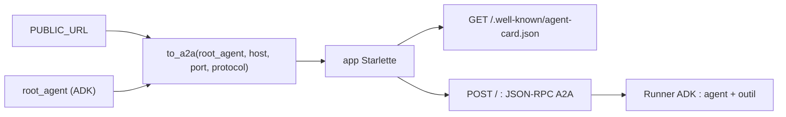

# L'agent stock exposé en A2A

> [!NOTE]
> Dans cette leçon, vous allez écrire l'agent `agent_stock` (un outil, des données fictives), l'exposer comme **serveur A2A** avec `to_a2a` d'ADK, régler l'URL que sa carte annonce, puis lui envoyer un message A2A brut avec `curl`. Code complet : [stock_agent.py](../files/stock_agent.py).

## L'agent et son outil

```python title="files/stock_agent.py"
STOCK = {  # référence -> (désignation, quantité disponible, prix unitaire HT en euros)
    "VIS-M6": ("Vis inox M6 x 20", 1200, 0.08),
    "ECR-M6": ("Écrou inox M6", 300, 0.05),
    "RON-M6": ("Rondelle plate M6", 0, 0.02),
}

def verifier_stock(reference: str) -> dict:
    """Donne la quantité disponible et le prix unitaire d'une référence."""
    ref = reference.strip().upper()
    if ref not in STOCK:
        return {"trouve": False, "references_connues": sorted(STOCK)}
    nom, qte, prix = STOCK[ref]
    return {"trouve": True, "reference": ref, "designation": nom, "disponible": qte, "prix_unitaire_ht": prix}

root_agent = Agent(
    name="agent_stock",
    model=modele(),   # Gemini (MODEL, défaut gemini-2.5-flash) avec réessais sur 429/503
    description="Connaît le stock de l'entrepôt : disponibilité et prix unitaire d'une référence.",
    instruction="Tu gères le stock d'un entrepôt fictif. Utilise verifier_stock pour toute question. ...",
    tools=[verifier_stock],
)
```

La `description` n'est pas décorative : elle devient la description publique de l'agent dans sa carte A2A, et c'est elle que lit le modèle de l'agent client pour décider de l'appeler.

## `to_a2a` : un agent ADK devient un serveur A2A

`to_a2a` (module `google.adk.a2a.utils.agent_to_a2a`) fabrique une application **Starlette** (un framework web Python asynchrone) qui :

- sert la carte à `/.well-known/agent-card.json`, construite à partir de l'agent ;
- reçoit les appels JSON-RPC (`SendMessage`…) et les exécute avec un `Runner` ADK en mémoire ;
- convertit les événements ADK en **tâche** A2A (état, historique, artefacts).

```python title="files/stock_agent.py"
PUBLIC_URL = os.environ.get("PUBLIC_URL", "http://localhost:8001")
_u = urlparse(PUBLIC_URL)
# La carte A2A annonce cette URL : elle doit être celle que voient les clients.
app = to_a2a(root_agent, host=_u.hostname, port=_u.port or (443 if _u.scheme == "https" else 80),
             protocol=_u.scheme)
```



> [!WARNING]
> Par défaut, `to_a2a` annonce `http://localhost:8000`. Derrière Cloud Run, il faut annoncer l'URL **publique** du service. Et le client `RemoteA2aAgent` d'ADK refuse une carte dont l'URL n'a pas **la même origine** (schéma, hôte, port) que l'adresse d'où la carte a été lue : une mauvaise `PUBLIC_URL` fait échouer l'appel avec `AgentCardResolutionError`.

```quiz
question: "Vous déployez stock_agent sur Cloud Run sans définir PUBLIC_URL. Que se passe-t-il quand agent_commandes lit la carte ?"
options:
  - "Tout fonctionne, Cloud Run réécrit l'URL"
  - "La carte annonce http://localhost:8001 : ADK la rejette (origine différente et http hors boucle locale), l'appel échoue"
  - "La carte est vide"
answer: 1
explanation: "La carte est construite à partir de PUBLIC_URL, qui vaut localhost par défaut. Le client vérifie que l'URL annoncée est en https (sauf boucle locale) et a la même origine que la carte : il refuse donc de l'utiliser."
```

## Démarrer en local

```bash title="terminal 1"
cd files
export GOOGLE_GENAI_USE_VERTEXAI=TRUE GOOGLE_CLOUD_PROJECT="mon-projet-gcp" GOOGLE_CLOUD_LOCATION=europe-west1
uvicorn stock_agent:app --port 8001
```

**uvicorn** est le serveur web qui exécute l'application Starlette. Dans un autre terminal, lisez la carte puis envoyez un message A2A « à la main » :

```bash title="terminal 2"
curl -s localhost:8001/.well-known/agent-card.json

curl -s localhost:8001/ -H 'Content-Type: application/json' -H 'A2A-Version: 1.0' -d '{
  "jsonrpc": "2.0", "id": "1", "method": "SendMessage",
  "params": {"message": {"messageId": "m1", "role": "ROLE_USER", "parts": [{"text": "Stock de VIS-M6 ?"}]}}}'
```

| Champ | Sens |
|---|---|
| `method: "SendMessage"` | méthode A2A 1.0 : envoyer un message et attendre la tâche |
| `messageId` | identifiant unique choisi par le client |
| `role: "ROLE_USER"` | le message vient du demandeur |
| `parts` | contenu : ici une partie texte |

```quiz
question: "Dans la réponse, où se trouve le texte final de l'agent stock ?"
options:
  - "Dans result.task.artifacts[].parts[].text"
  - "Dans l'en-tête HTTP X-Answer"
  - "Uniquement dans result.task.history[0]"
answer: 0
explanation: "Le résultat d'une tâche A2A est porté par ses artefacts. L'historique contient aussi les étapes (message de l'utilisateur, appel d'outil, réponse d'outil, texte), utiles pour le débogage."
```

## Résultat obtenu

Réponse réelle du 2026-10-15 (extrait, la signature de pensée du modèle est tronquée) :

```json title="SendMessage sur localhost:8001 (2026-10-15)"
{"result": {"task": {
  "status": {"state": "TASK_STATE_COMPLETED", "timestamp": "2026-10-15T14:38:30.320556Z"},
  "artifacts": [{"parts": [{"text": "La référence VIS-M6 a 1200 unités disponibles au prix unitaire de 0.08€."}]}],
  "history": [
    {"role": "ROLE_USER", "parts": [{"text": "Stock de VIS-M6 ?"}]},
    {"role": "ROLE_AGENT", "parts": [{"data": {"name": "verifier_stock", "args": {"reference": "VIS-M6"}},
                                      "metadata": {"adk_type": "function_call"}}]},
    {"role": "ROLE_AGENT", "parts": [{"data": {"name": "verifier_stock", "response": {"disponible": 1200.0, "prix_unitaire_ht": 0.08, "...": "..."}},
                                      "metadata": {"adk_type": "function_response"}}]},
    {"role": "ROLE_AGENT", "parts": [{"text": "La référence VIS-M6 a 1200 unités disponibles au prix unitaire de 0.08€."}]}]}}}
```

On voit l'appel d'outil ADK traduit en parties `data` A2A, avec `adk_type` en métadonnée.

## Exercice

Ajoutez à `agent_stock` un outil `references_disponibles()` qui liste les références dont la quantité est strictement positive, puis vérifiez qu'il apparaît dans la carte.

<details>
<summary>Voir la solution</summary>

```python
def references_disponibles() -> dict:
    """Liste les références en stock (quantité strictement positive)."""
    return {"references": sorted(ref for ref, (_, qte, _) in STOCK.items() if qte > 0)}

root_agent = Agent(..., tools=[verifier_stock, references_disponibles])
```

Relancez `uvicorn`, puis :

```bash
curl -s localhost:8001/.well-known/agent-card.json | python -m json.tool | grep '"name"'
```

Vous devez voir `"name": "references_disponibles"` dans les compétences, avec la docstring en description. Ajoutez le test : `assert stock_agent.references_disponibles()["references"] == ["ECR-M6", "VIS-M6"]`.

</details>

## Je sais faire

- [ ] Exposer un agent ADK en serveur A2A avec `to_a2a`
- [ ] Régler l'URL annoncée par la carte selon l'environnement
- [ ] Envoyer un `SendMessage` A2A brut et lire la tâche renvoyée
- [ ] Relier outils ADK et compétences de la carte
