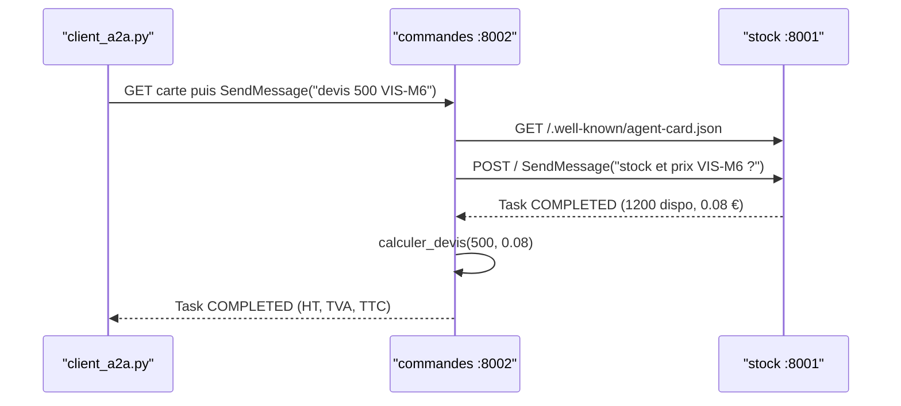

# L'agent commandes et le test sur 2 ports

> [!NOTE]
> Dans cette leçon, vous allez écrire `agent_commandes`, qui consulte l'agent stock **distant** via `RemoteA2aAgent` utilisé comme outil (`AgentTool`), préparer le client HTTP qui ajoutera plus tard un jeton d'identité, puis faire tourner les deux agents en local sur les ports 8001 et 8002 et les tester avec [client_a2a.py](../files/client_a2a.py).

## Un agent distant, vu comme un agent local

`RemoteA2aAgent` est un agent ADK dont l'exécution se fait **ailleurs** : il lit la carte, envoie un message A2A et transforme la tâche reçue en événements ADK.

```python title="files/commandes_agent.py"
STOCK_URL = os.environ.get("STOCK_URL", "http://localhost:8001").rstrip("/")

agent_stock_distant = RemoteA2aAgent(
    name="agent_stock",
    description="Agent distant (A2A) qui connaît la disponibilité et le prix unitaire des références.",
    agent_card=f"{STOCK_URL}/.well-known/agent-card.json",
    httpx_client=client_http(STOCK_URL),
)
```

## Outil ou sous-agent ?

On pourrait le placer dans `sub_agents=[...]`. Mais un sous-agent ADK reçoit le **contrôle** de la conversation par transfert : c'est lui qui répondrait au commercial, et `agent_commandes` ne calculerait pas le devis. On l'enveloppe donc dans un `AgentTool` : l'agent distant est appelé comme une fonction, puis `agent_commandes` **reprend la main**.

```python title="files/commandes_agent.py"
root_agent = Agent(
    name="agent_commandes",
    model=modele(),
    instruction=(
        "Tu prépares des devis pour une entreprise fictive, en français. "
        "Pour connaître la disponibilité et le prix unitaire d'une référence, appelle l'outil agent_stock (un agent distant). "
        "Ensuite, si la quantité demandée est disponible, appelle calculer_devis et donne HT, TVA et TTC ; "
        "sinon, indique la quantité disponible et propose une livraison partielle. N'invente aucun prix."
    ),
    tools=[calculer_devis, AgentTool(agent=agent_stock_distant)],
)
```

| | `sub_agents=[distant]` | `tools=[AgentTool(distant)]` |
|---|---|---|
| Qui répond à l'utilisateur ? | le sous-agent, après transfert | l'agent principal |
| Enchaîner avec un autre outil | non, l'agent principal a passé la main | oui (ici `calculer_devis`) |
| Bon pour | aiguiller vers un spécialiste | consulter un spécialiste et continuer |

```quiz
question: "Avec sub_agents=[agent_stock_distant], que risque-t-on sur la demande « devis pour 500 VIS-M6 » ?"
options:
  - "Une erreur de syntaxe"
  - "Que la conversation soit transférée à l'agent stock, qui répond avec la disponibilité mais sans calculer le devis"
  - "Que l'agent stock calcule la TVA"
answer: 1
explanation: "Le transfert vers un sous-agent lui donne la main pour la suite du tour. L'agent stock n'a que verifier_stock : il répond sur le stock, et calculer_devis n'est jamais appelé. AgentTool garde l'agent commandes aux commandes."
```

## Le client HTTP : prêt pour Cloud Run

```python title="files/commandes_agent.py"
class JetonIdentite(httpx.Auth):
    def __init__(self, audience: str):
        self.audience, self._jeton, self._expire = audience, None, 0.0

    def auth_flow(self, request):
        if time.time() > self._expire:
            self._jeton = id_token.fetch_id_token(google.auth.transport.requests.Request(), self.audience)
            self._expire = time.time() + 45 * 60  # les jetons d'identité vivent 1 h
        request.headers["Authorization"] = f"Bearer {self._jeton}"
        yield request

def client_http(url: str) -> httpx.AsyncClient:
    auth = JetonIdentite(url) if url.startswith("https://") else None
    return httpx.AsyncClient(auth=auth, timeout=120)
```

En local (`http://`), aucun jeton. Sur Cloud Run (`https://`), chaque requête porte un **jeton d'identité** dont l'**audience** est l'URL du service stock. On le détaille au module 3.

> [!TIP]
> Le paramètre `httpx_client` de `RemoteA2aAgent` est signalé comme déprécié au profit de `a2a_client_factory` dans ADK 2.10, mais il fonctionne et reste le plus lisible pour injecter une authentification. Vérifiez-le à chaque montée de version.

## Le test sur deux ports



```bash title="terminal 1"
uvicorn stock_agent:app --port 8001
```
```bash title="terminal 2"
STOCK_URL=http://localhost:8001 uvicorn commandes_agent:app --port 8002
```
```bash title="terminal 3"
python client_a2a.py http://localhost:8002 "Je voudrais un devis pour 500 VIS-M6."
python client_a2a.py http://localhost:8002 "Devis pour 100 rondelles RON-M6 ?"
```

`client_a2a.py` lit la carte, envoie `SendMessage` à l'URL annoncée, puis extrait l'état, les outils appelés et le texte des artefacts.

## Résultat obtenu

Sorties réelles du 2026-10-15 (Vertex AI, `gemini-2.5-flash`) :

```text title="terminal 3 (2026-10-15)"
AGENT   : agent_commandes
ETAT    : TASK_STATE_COMPLETED
OUTILS  : ['agent_stock', 'calculer_devis']
REPONSE : Voici votre devis pour 500 VIS-M6 :
*   Prix unitaire HT : 0.08€
*   Total HT : 40.00€
*   TVA (20%) : 8.00€
*   Total TTC : 48.00€
AGENT   : agent_commandes
ETAT    : TASK_STATE_COMPLETED
OUTILS  : ['agent_stock']
REPONSE : Il n'y a pas de rondelles RON-M6 en stock. Le prix unitaire est de 0.02€ HT.
```

Et le journal du serveur stock prouve que l'appel est bien passé par le réseau, en A2A :

```text title="terminal 1 (2026-10-15)"
INFO:     127.0.0.1:48030 - "GET /.well-known/agent-card.json HTTP/1.1" 200 OK
INFO:     127.0.0.1:48030 - "POST / HTTP/1.1" 200 OK
```

Les tests sans clé (`pytest -q`) : `6 passed, 6 warnings in 0.94s` (les avertissements sont les `[EXPERIMENTAL]` d'ADK A2A). Ils couvrent les deux outils, la carte servie par l'app Starlette, le choix « jeton seulement vers https », la lecture d'une tâche par le client et la structure de l'agent (la solution de l'exercice ci-dessous, déjà dans [test_a2a.py](../files/test_a2a.py)).

```quiz
question: "Sur la demande RON-M6, l'agent n'a pas appelé calculer_devis. Est-ce un bug ?"
options:
  - "Oui, il doit toujours calculer un devis"
  - "Non : la quantité disponible est 0, la consigne demande alors d'indiquer la disponibilité au lieu de chiffrer"
  - "Oui, l'agent stock a mal répondu"
answer: 1
explanation: "La consigne prévoit ce cas : si la quantité n'est pas disponible, on l'indique et on propose une livraison partielle. Ici 0 unité : rien à livrer. Le comportement est conforme, même si la proposition de livraison partielle n'a pas de sens à 0."
```

## Exercice

Écrivez un test **sans clé** qui vérifie que `agent_commandes` déclare bien deux outils, dont un `AgentTool` qui enveloppe un `RemoteA2aAgent` pointant vers la carte de `STOCK_URL`.

<details>
<summary>Voir la solution</summary>

```python
from google.adk.agents.remote_a2a_agent import RemoteA2aAgent
from google.adk.tools.agent_tool import AgentTool

import commandes_agent

def test_agent_stock_est_un_outil_distant():
    outils = commandes_agent.root_agent.tools
    assert len(outils) == 2
    distant = next(t for t in outils if isinstance(t, AgentTool))
    assert isinstance(distant.agent, RemoteA2aAgent)
    assert distant.agent.name == "agent_stock"
```

L'import ne contacte pas le réseau : la carte n'est lue qu'au premier appel de l'agent distant.

</details>

## Je sais faire

- [ ] Brancher un agent distant avec `RemoteA2aAgent`
- [ ] Choisir entre `sub_agents` et `AgentTool`
- [ ] Préparer un client HTTP qui s'authentifie seulement en https
- [ ] Tester deux agents A2A en local sur deux ports
