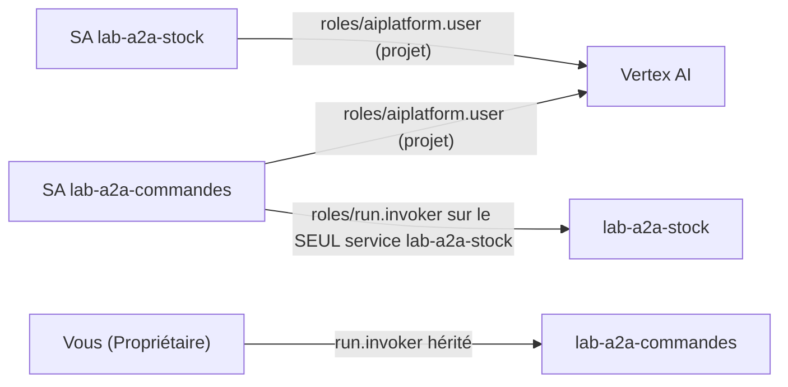
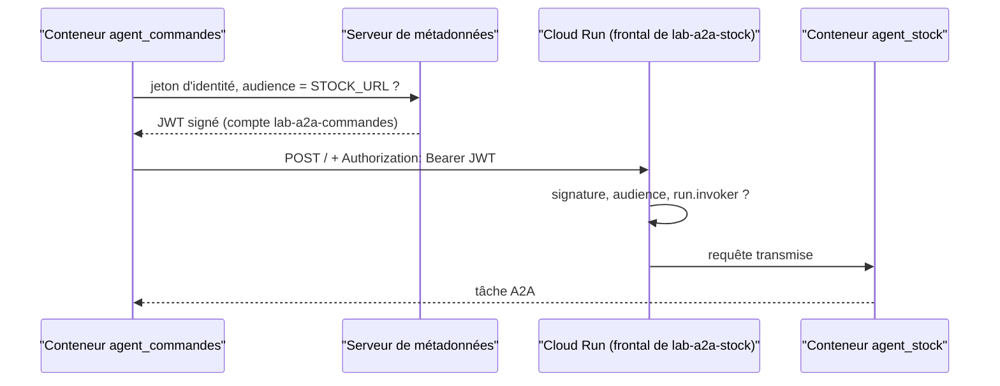

# Deux services privés et une seule autorisation

> [!NOTE]
> Dans cette leçon, vous allez construire **une** image pour les deux agents, créer **un compte de service par agent**, déployer deux services Cloud Run privés, et accorder une seule autorisation : le compte de `agent_commandes` peut invoquer `agent_stock`, personne d'autre. Script complet : [deployer.sh](../files/deployer.sh).

## Une image, deux services

Les deux agents partagent les mêmes dépendances. On construit donc une seule image ; la variable `MODULE` choisit l'application que lance `uvicorn` :

```dockerfile title="files/Dockerfile"
FROM python:3.11-slim
WORKDIR /app
COPY requirements.txt .
RUN pip install --no-cache-dir -r requirements.txt
COPY stock_agent.py commandes_agent.py ./
ENV MODULE=stock_agent PYTHONUNBUFFERED=1
# Cloud Run fournit $PORT (8080 par défaut)
CMD exec uvicorn ${MODULE}:app --host 0.0.0.0 --port ${PORT:-8080}
```

Ici on n'utilise **pas** `adk deploy cloud_run` : ce dernier lance `adk api_server`, alors que nous voulons servir nos applications A2A `to_a2a` telles quelles, avec une URL de carte maîtrisée. Un `Dockerfile` de huit lignes suffit.

```bash title="files/deployer.sh"
gcloud artifacts repositories create lab-agents-a2a --repository-format docker \
  --location "$REGION" --project "$PROJECT_ID" --labels "$LABEL"
gcloud builds submit --tag "$IMAGE" --project "$PROJECT_ID" --region "$REGION" .
```

## Connaître l'URL avant de déployer

La carte A2A doit annoncer l'URL publique du service, et `agent_commandes` doit connaître celle de `agent_stock`. Cloud Run attribue une **URL déterministe** de la forme `https://<service>-<numéro de projet>.<région>.run.app` : on peut la calculer avant même le premier déploiement.

```bash title="files/deployer.sh"
NUM=$(gcloud projects describe "$PROJECT_ID" --format 'value(projectNumber)')
STOCK_URL="https://${STOCK}-${NUM}.${REGION}.run.app"
CMD_URL="https://${CMD}-${NUM}.${REGION}.run.app"
```

> [!WARNING]
> Un service Cloud Run a aussi une **autre** URL, plus ancienne, du type `https://<service>-<hachage>-ew.a.run.app`. Utilisez **la même** partout (carte, `STOCK_URL`, audience du jeton) : la vérification d'origine d'ADK compare l'URL de la carte et l'adresse d'où elle a été lue.

## Une identité par agent, une seule autorisation



```bash title="files/deployer.sh"
for SA in $STOCK $CMD; do
  gcloud iam service-accounts create "$SA" --project "$PROJECT_ID" --display-name "Lab A2A : $SA"
  gcloud projects add-iam-policy-binding "$PROJECT_ID" --condition None \
    --member "serviceAccount:${SA}@${PROJECT_ID}.iam.gserviceaccount.com" --role roles/aiplatform.user
done

gcloud run deploy "$STOCK" --image "$IMAGE" --region "$REGION" --project "$PROJECT_ID" \
  --no-allow-unauthenticated --service-account "${STOCK}@${PROJECT_ID}.iam.gserviceaccount.com" \
  --set-env-vars "MODULE=stock_agent,PUBLIC_URL=${STOCK_URL},${VERTEX}" \
  --max-instances 1 --memory 1Gi --labels "$LABEL"

# Seul le compte de service de agent_commandes peut invoquer agent_stock
gcloud run services add-iam-policy-binding "$STOCK" --region "$REGION" --project "$PROJECT_ID" \
  --member "serviceAccount:${CMD}@${PROJECT_ID}.iam.gserviceaccount.com" --role roles/run.invoker
```

Le rôle `run.invoker` est accordé **sur le service** `lab-a2a-stock`, pas sur le projet : le compte de `agent_commandes` ne peut invoquer aucun autre service.

```quiz
question: "Pourquoi deux comptes de service plutôt qu'un seul partagé par les deux agents ?"
options:
  - "Cloud Run impose un compte par service"
  - "Pour que l'autorisation « peut appeler agent_stock » ne soit donnée qu'à agent_commandes ; avec un compte partagé, agent_stock pourrait s'appeler lui-même et tout service utilisant ce compte hériterait du droit"
  - "Pour doubler le quota Gemini"
answer: 1
explanation: "IAM raisonne par identité. Une identité par agent permet des droits distincts et des journaux d'audit lisibles (qui a appelé qui). Un compte partagé rend impossible de restreindre l'invocation à un seul appelant."
```

## Le jeton d'identité de service à service

Dans le conteneur de `agent_commandes`, `id_token.fetch_id_token(Request(), STOCK_URL)` interroge le **serveur de métadonnées** de Cloud Run, qui renvoie un jeton signé par Google pour le compte `lab-a2a-commandes`, avec `STOCK_URL` comme **audience** (le destinataire prévu du jeton). Cloud Run, devant `agent_stock`, vérifie la signature, l'audience et le rôle `run.invoker` avant de transmettre la requête.



```quiz
question: "Le jeton est demandé avec l'audience https://lab-a2a-commandes-... (l'URL du service appelant) au lieu de STOCK_URL. Que répond le service stock ?"
options:
  - "200, l'audience n'est pas vérifiée"
  - "401 ou 403 : le jeton n'est pas destiné à ce service"
  - "500"
answer: 1
explanation: "L'audience empêche de réutiliser un jeton obtenu pour un service auprès d'un autre. Cloud Run rejette un jeton dont l'audience ne correspond pas au service appelé."
```

## Résultat obtenu

Extraits réels de `deployer.sh` du 2026-10-15 (identifiants masqués) :

```text title="deployer.sh (2026-10-15)"
Created repository [lab-agents-a2a].
Successfully installed a2a-sdk-1.2.2 ... google-adk-2.10.0 ... uvicorn-0.54.0 ...
Successfully tagged europe-west1-docker.pkg.dev/mon-projet-gcp/lab-agents-a2a/agents:v1
ID                                    CREATE_TIME                DURATION  ...  STATUS
a568bda4-...                          2026-10-15T14:42:12+00:00  52S       ...  SUCCESS
Created service account [lab-a2a-stock].
Deploying container to Cloud Run service [lab-a2a-stock] in project [mon-projet-gcp] region [europe-west1]
Service URL: https://lab-a2a-stock-123456789012.europe-west1.run.app
Updated IAM policy for service [lab-a2a-stock].
bindings:
- members:
  - serviceAccount:lab-a2a-commandes@mon-projet-gcp.iam.gserviceaccount.com
  role: roles/run.invoker
Deploying container to Cloud Run service [lab-a2a-commandes] in project [mon-projet-gcp] region [europe-west1]
Service URL: https://lab-a2a-commandes-123456789012.europe-west1.run.app
```

L'URL affichée par Cloud Run est bien celle calculée à l'avance : la carte de `agent_stock` est correcte dès le premier déploiement. La construction de l'image a pris moins d'une minute.

## Exercice

Une équipe « facturation » déploie un troisième agent qui doit, lui aussi, consulter `agent_stock`, mais **jamais** `agent_commandes`. Quelles commandes IAM ajoutez-vous ?

<details>
<summary>Voir la solution</summary>

Un compte de service propre à l'agent facturation, puis une seule liaison, sur le service stock :

```bash
gcloud iam service-accounts create lab-a2a-facturation --project "$PROJECT_ID"
gcloud run services add-iam-policy-binding lab-a2a-stock --region "$REGION" --project "$PROJECT_ID" \
  --member "serviceAccount:lab-a2a-facturation@${PROJECT_ID}.iam.gserviceaccount.com" \
  --role roles/run.invoker
```

Rien sur `lab-a2a-commandes` : sans liaison, son frontal Cloud Run renverra 403 à l'agent facturation. Et le service facturation est déployé avec `--service-account lab-a2a-facturation@...`. Pensez à ajouter ces suppressions à `nettoyer.sh`.

</details>

## Je sais faire

- [ ] Servir deux agents depuis une seule image avec une variable `MODULE`
- [ ] Calculer l'URL déterministe d'un service Cloud Run avant de le déployer
- [ ] Donner `run.invoker` sur un seul service à un seul compte de service
- [ ] Expliquer le rôle de l'audience d'un jeton d'identité
