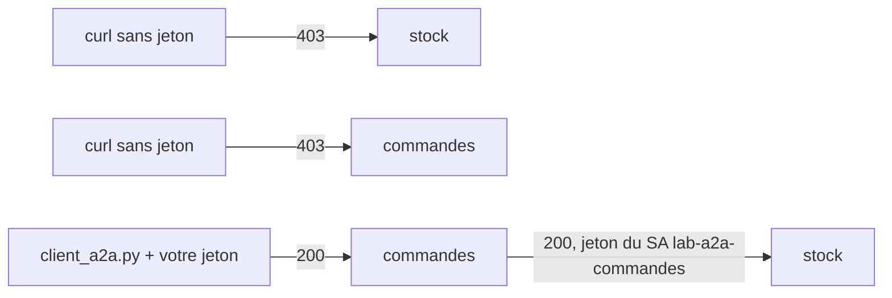

# Tester de bout en bout et nettoyer

> [!NOTE]
> Dans cette leçon, vous allez prouver que les deux services sont privés, appeler `agent_commandes` sur Cloud Run avec votre jeton d'identité et le voir consulter `agent_stock` avec **son** jeton, diagnostiquer l'erreur la plus fréquente (la propagation IAM), lire les journaux de requêtes, puis tout supprimer avec [nettoyer.sh](../files/nettoyer.sh).

## Les vérifications

```bash title="terminal"
NUM=$(gcloud projects describe "$PROJECT_ID" --format 'value(projectNumber)')
STOCK_URL="https://lab-a2a-stock-${NUM}.europe-west1.run.app"
CMD_URL="https://lab-a2a-commandes-${NUM}.europe-west1.run.app"

curl -s -o /dev/null -w "stock sans jeton : HTTP %{http_code}\n" "$STOCK_URL/.well-known/agent-card.json"
curl -s -o /dev/null -w "commandes sans jeton : HTTP %{http_code}\n" "$CMD_URL/.well-known/agent-card.json"

export ID_TOKEN=$(gcloud auth print-identity-token)
python client_a2a.py "$CMD_URL" "Je voudrais un devis pour 500 VIS-M6."
python client_a2a.py "$CMD_URL" "Devis pour 400 écrous ECR-M6 ?"
```



## L'erreur du premier essai : la propagation IAM

Notre premier appel, lancé juste après le déploiement, a renvoyé une tâche `TASK_STATE_FAILED`. Le message d'état de la tâche disait :

```text title="tâche A2A, champ status.message (2026-10-15, extrait)"
403 PERMISSION_DENIED. Permission 'aiplatform.endpoints.predict' denied on resource
'//aiplatform.googleapis.com/projects/mon-projet-gcp/locations/europe-west1/publishers/google/models/gemini-2.5-flash'
```

Le rôle `roles/aiplatform.user` venait d'être accordé au compte de service : un changement IAM met en général quelques minutes à se propager. Deux minutes plus tard, le même appel réussissait, sans rien changer.

| Symptôme | Cause probable | Que faire |
|---|---|---|
| `403` HTML de Cloud Run, sans tâche A2A | jeton absent, expiré, mauvaise audience, ou pas de `run.invoker` | vérifier le jeton et la liaison IAM du service |
| tâche `FAILED` avec `PERMISSION_DENIED` Vertex AI | rôle du compte de service pas encore propagé (ou absent) | attendre quelques minutes, puis vérifier les rôles |
| `AgentCardResolutionError` | URL de carte différente de l'URL utilisée | aligner `PUBLIC_URL` et `STOCK_URL` sur la même forme d'URL |

```quiz
question: "La tâche A2A est en TASK_STATE_FAILED avec PERMISSION_DENIED sur aiplatform.endpoints.predict, cinq minutes après le déploiement. Qu'est-ce que cela prouve ?"
options:
  - "Que l'authentification de service à service est cassée"
  - "Que votre requête a passé IAM Cloud Run et atteint le code de l'agent ; c'est son compte de service qui n'a pas (encore) le droit d'appeler Gemini"
  - "Que gemini-2.5-flash n'existe pas en europe-west1"
answer: 1
explanation: "Une tâche A2A n'est produite que par le code de l'agent : la requête est donc entrée. L'erreur vient de l'appel suivant, du conteneur vers Vertex AI, avec l'identité du service. Juste après une attribution de rôle, c'est presque toujours la propagation IAM."
```

> [!TIP]
> Amélioration possible de `deployer.sh` (tel que testé, il crée les comptes **après** la construction de l'image) : créez les comptes et accordez les rôles **en premier**, le temps de build couvrira souvent le délai de propagation.

## Résultat obtenu

Sorties réelles du 2026-10-15 (deuxième essai), identifiants masqués :

```text title="terminal (2026-10-15)"
stock sans jeton : HTTP 403
commandes sans jeton : HTTP 403
AGENT   : agent_commandes
ETAT    : TASK_STATE_COMPLETED
OUTILS  : ['agent_stock', 'calculer_devis']
REPONSE : Voici le devis pour 500 VIS-M6 :
*   **Total HT :** 40.00 €
*   **TVA (20%) :** 8.00 €
*   **Total TTC :** 48.00 €
AGENT   : agent_commandes
ETAT    : TASK_STATE_COMPLETED
OUTILS  : ['agent_stock']
REPONSE : Il n'y a que 300 unités de la référence ECR-M6 disponibles. Je peux vous faire un devis pour cette quantité, ou pour une livraison partielle de 300 unités.
```

Les journaux de requêtes du service stock montrent le refus sans jeton, puis les appels authentifiés :

```bash title="terminal"
gcloud logging read 'resource.type="cloud_run_revision" AND resource.labels.service_name="lab-a2a-stock" AND httpRequest.requestMethod:*' \
  --project "$PROJECT_ID" --freshness 20m --limit 6 \
  --format 'table(timestamp,httpRequest.requestMethod,httpRequest.status,httpRequest.requestUrl.basename())'
```

```text title="gcloud logging read (2026-10-15)"
TIMESTAMP                    REQUEST_METHOD  STATUS  REQUEST_URL
2026-10-15T14:45:06.240940Z  POST            200
2026-10-15T14:44:02.656985Z  GET             200     agent-card.json
2026-10-15T14:44:01.559036Z  GET             403     agent-card.json
```

```quiz
question: "Votre propre compte (Propriétaire du projet) peut-il appeler lab-a2a-stock directement ?"
options:
  - "Non, seul lab-a2a-commandes a run.invoker sur ce service"
  - "Oui : le rôle Propriétaire au niveau du projet inclut l'invocation de tous les services Cloud Run du projet"
  - "Seulement depuis la console"
answer: 1
explanation: "Les rôles se cumulent par héritage : Propriétaire sur le projet couvre run.invoker sur chaque service. C'est ce qui nous a permis de lire la carte du stock avec notre jeton (le GET 200). La liaison sur le service ajoute un appelant, elle n'enlève pas les droits hérités. En production, limitez qui a des rôles larges au niveau du projet."
```

## Tout supprimer

```bash title="files/nettoyer.sh (extrait)"
for S in lab-a2a-stock lab-a2a-commandes; do
  gcloud run services delete "$S" --region "$REGION" --project "$PROJECT_ID" --quiet
  gcloud projects remove-iam-policy-binding "$PROJECT_ID" --condition None \
    --member "serviceAccount:${S}@${PROJECT_ID}.iam.gserviceaccount.com" --role roles/aiplatform.user
  gcloud iam service-accounts delete "${S}@${PROJECT_ID}.iam.gserviceaccount.com" --project "$PROJECT_ID" --quiet
done
gcloud artifacts repositories delete lab-agents-a2a --location "$REGION" --project "$PROJECT_ID" --quiet
```

La liaison `run.invoker` disparaît avec le service. Le dépôt `lab-agents-a2a` étant propre au lab, on le supprime entièrement (image et couches comprises). Reste l'archive des sources envoyée par `gcloud builds submit` dans `gs://<projet>_cloudbuild/source/` (quelques Ko) : à supprimer si ce bucket ne sert qu'à vous.

## Résultat obtenu (nettoyage)

```text title="nettoyer.sh (2026-10-15)"
Deleted service [lab-a2a-stock].
deleted service account [lab-a2a-stock@mon-projet-gcp.iam.gserviceaccount.com]
Deleted service [lab-a2a-commandes].
deleted service account [lab-a2a-commandes@mon-projet-gcp.iam.gserviceaccount.com]
Deleted repository [lab-agents-a2a].
--- Vérification (doit être vide) ---
```

## Exercice

Ajoutez à `nettoyer.sh` une vérification qui échoue (code de sortie non nul) s'il reste un service, un compte de service ou un dépôt dont le nom commence par `lab-a2a-` ou `lab-agents-a2a`.

<details>
<summary>Voir la solution</summary>

```bash
RESTE=$( { gcloud run services list --project "$PROJECT_ID" --format 'value(metadata.name)';
           gcloud iam service-accounts list --project "$PROJECT_ID" --format 'value(email)';
           gcloud artifacts repositories list --project "$PROJECT_ID" --format 'value(name)'; } \
         | grep -E 'lab-a2a-|lab-agents-a2a' )
if [ -n "$RESTE" ]; then
  echo "Ressources restantes :"; echo "$RESTE"; exit 1
fi
echo "Nettoyage vérifié : rien ne reste."
```

`grep` sans résultat laisse `RESTE` vide : le script se termine normalement. Lancez-le dans votre CI après chaque test d'intégration.

</details>

## Je sais faire

- [ ] Prouver qu'un agent A2A déployé est privé
- [ ] Appeler un agent A2A sur Cloud Run avec un jeton d'identité
- [ ] Distinguer un refus IAM Cloud Run d'un refus Vertex AI dans une tâche A2A
- [ ] Supprimer services, comptes, rôles et dépôt, et le vérifier
