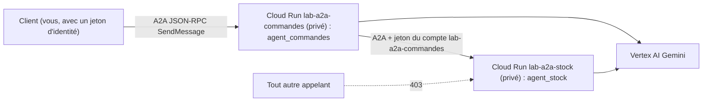

# Deux agents ADK qui coopèrent en A2A, privés sur Cloud Run

Une équipe ventes a un agent qui prépare des **devis**. Une équipe logistique a un agent qui connaît le **stock**. Elles ne partagent ni leur code ni leurs bases : elles veulent que leurs agents **se parlent** par un protocole standard, chacun restant déployé, sécurisé et maintenu par son équipe. C'est exactement le rôle du protocole **A2A** (Agent2Agent).

## Pour qui ?

Niveau expert : vous maîtrisez ADK (agents, outils, runner), Cloud Run et les bases d'IAM. Vous voulez une architecture multi-agents **répartie**, où l'appel entre agents est authentifié.

## Ce que vous construisez

## Prérequis

- Python 3.10+, `gcloud` connecté, un projet avec les API `run`, `aiplatform`, `cloudbuild`, `artifactregistry`.
- ADK 2.10 avec l'extra A2A (`pip install "google-adk[a2a]==2.10.0"`), qui installe `a2a-sdk` (1.2.2 lors de nos tests).
- Le code : [files/](./files/stock_agent.py) — deux agents, un client A2A, des tests, un `Dockerfile`, `deployer.sh`, `nettoyer.sh`.

## Programme

| Module | Leçon | Ce que vous faites |
|---|---|---|
| 1. Cas d'usage et architecture | [Deux agents, un protocole](./01-cas-d-usage/01-deux-agents-un-protocole.md) | A2A, carte d'agent, tâches ; sous-agent local ou agent distant |
| 2. Construire pas à pas | [L'agent stock exposé en A2A](./02-construire/01-agent-stock-a2a.md) | `to_a2a`, carte d'agent, URL annoncée |
| | [L'agent commandes et le test sur 2 ports](./02-construire/02-agent-commandes-test-local.md) | `RemoteA2aAgent`, `AgentTool`, client JSON-RPC |
| 3. Déployer et tester | [Deux services privés et une seule autorisation](./03-deployer-tester/01-deux-services-prives.md) | une image, deux comptes de service, `run.invoker`, jeton d'identité |
| | [Tester de bout en bout et nettoyer](./03-deployer-tester/02-tester-et-nettoyer.md) | appel réel, propagation IAM, journaux, suppression |

## En local ou sur GCP ?

| | En local (obligatoire d'abord) | Sur GCP |
|---|---|---|
| Agents | 2 processus `uvicorn`, ports 8001 et 8002 | 2 services Cloud Run |
| Transport | `http://localhost` | HTTPS, URL `*.run.app` |
| Authentification | aucune | jeton d'identité Google, vérifié par Cloud Run |
| Coût | appels Gemini | + Cloud Build, Artifact Registry, Cloud Run à la requête (ordre de grandeur : quelques centimes) |

> [!WARNING]
> L'implémentation A2A d'ADK est marquée **expérimentale** (avertissements `[EXPERIMENTAL]` au démarrage) : les API Python peuvent changer d'une version à l'autre. Le protocole A2A lui-même est stable. Épinglez vos versions.
