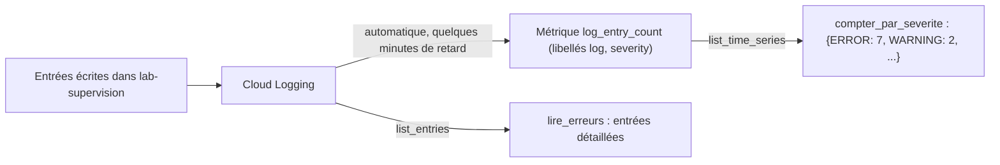

# Lire Cloud Logging et Cloud Monitoring

> [!NOTE]
> Dans cette leçon, vous allez écrire les deux outils de lecture de l'agent : `lire_erreurs`, qui interroge Cloud Logging avec un **filtre** borné, et `compter_par_severite`, qui lit la métrique système `logging.googleapis.com/log_entry_count` dans Cloud Monitoring. Code complet : [agent.py](../files/agent.py).

## Les bibliothèques

```bash title="terminal"
pip install google-adk==2.10.0 google-cloud-logging google-cloud-monitoring python-dotenv
```

Les deux clients trouvent seuls leurs identifiants (ADC). On les crée une seule fois, à la demande, avec `functools.lru_cache` :

```python title="files/agent.py"
@lru_cache
def _logging():
    from google.cloud import logging as cloud_logging
    return cloud_logging.Client(project=_projet())

@lru_cache
def _monitoring():
    from google.cloud import monitoring_v3
    return monitoring_v3.MetricServiceClient()
```

L'import à l'intérieur de la fonction permet aux tests de remplacer `_logging` et `_monitoring` sans jamais contacter Google Cloud.

## Le filtre Cloud Logging

Le **langage de requête de Cloud Logging** combine des conditions sur les champs d'une entrée. Notre outil construit un filtre simple et borné :

```python title="files/agent.py"
heures, max_entrees = max(1, min(int(heures), 72)), max(1, min(int(max_entrees), 1000))
depuis = (datetime.now(timezone.utc) - timedelta(hours=heures)).isoformat()
filtre = f'severity>=ERROR AND timestamp>="{depuis}"'
if journal:
    filtre += f' AND logName="projects/{_projet()}/logs/{journal}"'
entrees = _logging().list_entries(filter_=filtre, order_by=cloud_logging.DESCENDING,
                                  max_results=max_entrees, page_size=max_entrees)
```

| Élément | Rôle |
|---|---|
| `severity>=ERROR` | ERROR, CRITICAL, ALERT, EMERGENCY |
| `timestamp>="..."` | fenêtre de temps explicite : on ne dépend pas des valeurs par défaut de l'API ou de l'outil |
| `logName="projects/P/logs/J"` | un seul journal (ici `lab-supervision`) |
| `max_results` | plafond d'entrées lues, donc de tokens envoyés au modèle |

> [!TIP]
> Les bornes (`1 ≤ heures ≤ 72`, `max_entrees ≤ 1000`) sont appliquées **dans le code**, quelle que soit la demande du modèle. Un agent qui demanderait « les 10 dernières années » ne peut pas déclencher une lecture géante.

```quiz
question: "Le modèle appelle lire_erreurs(heures=500, max_entrees=1000000). Que lit réellement l'outil ?"
options:
  - "500 heures et un million d'entrées"
  - "72 heures et au plus 1 000 entrées"
  - "Rien, l'outil lève une erreur"
answer: 1
explanation: "Les arguments sont ramenés dans les bornes par min/max. C'est ce que vérifie test_lire_erreurs_construit_le_filtre_et_borne. Valider les arguments d'un outil, c'est protéger les coûts et le contexte du modèle."
```

## Tester le filtre à la main d'abord

Avant de le coder, essayez toujours un filtre avec `gcloud` :

```bash title="terminal"
gcloud logging read 'severity>=ERROR AND logName="projects/'"$PROJECT_ID"'/logs/lab-supervision"' \
  --project "$PROJECT_ID" --freshness 1h \
  --format 'table(timestamp,severity,jsonPayload.service,jsonPayload.message)'
```

## La métrique `log_entry_count`

Cloud Logging alimente automatiquement une métrique système dans Cloud Monitoring : `logging.googleapis.com/log_entry_count`, le nombre d'entrées écrites, avec les libellés `log` (nom du journal) et `severity`. Pas besoin de la créer.

```python title="files/agent.py"
series = _monitoring().list_time_series(request={
    "name": f"projects/{_projet()}",
    "filter": 'metric.type="logging.googleapis.com/log_entry_count" AND metric.labels.log="lab-supervision"',
    "interval": monitoring_v3.TimeInterval(start_time=fin - timedelta(hours=heures), end_time=fin),
    "view": monitoring_v3.ListTimeSeriesRequest.TimeSeriesView.FULL,
})
totaux = defaultdict(int)
for s in series:
    totaux[s.metric.labels.get("severity", "?")] += sum(int(p.value.int64_value) for p in s.points)
```



Pourquoi lire les deux ? Les journaux donnent le **détail** (quels messages) mais on n'en lit qu'un échantillon borné ; la métrique donne le **volume total** par sévérité, même quand il y a des milliers d'entrées.

```quiz
question: "Vous lancez compter_par_severite juste après avoir écrit des entrées de test, et le résultat est vide. Pourquoi ?"
options:
  - "La métrique n'existe que pour Cloud Run"
  - "Les points de la métrique arrivent avec quelques minutes de retard sur les entrées de journal"
  - "Il faut créer la métrique à la main"
answer: 1
explanation: "log_entry_count est une métrique système calculée à partir des entrées reçues ; ses points sont publiés avec un léger décalage. L'outil le signale dans son champ note, pour que le modèle ne conclue pas trop vite à l'absence d'erreurs."
```

## Résultat obtenu

Ce que les deux outils ont renvoyé lors du test réel du 2026-10-15, environ cinq minutes après l'écriture de l'incident fictif :

```text title="lancer.py (2026-10-15)"
OUTIL  lire_erreurs {'heures': 1, 'journal': 'lab-supervision'}
OUTIL  compter_par_severite {'heures': 1, 'journal': 'lab-supervision'}
  -> {'entrees_lues': 8} 2 corrélation(s)
  -> {'par_severite': {'CRITICAL': 1, 'DEFAULT': 2, 'ERROR': 7, 'INFO': 1, 'WARNING': 2}}
```

`lire_erreurs` a lu les 8 entrées `ERROR` et `CRITICAL` ; la métrique compte toutes les sévérités. Les 2 entrées `DEFAULT` sont des entrées de **diagnostic** que la bibliothèque `google-cloud-logging` ajoute automatiquement à la première écriture (champ `logging.googleapis.com/diagnostic`) : elles n'ont rien à voir avec l'incident.

## Exercice

Ajoutez un paramètre `service` à `lire_erreurs` pour ne garder que les entrées d'un service Cloud Run donné. Écrivez la partie de filtre correspondante.

<details>
<summary>Voir la solution</summary>

```python
def lire_erreurs(heures: int = 1, journal: str = "", max_entrees: int = 200, service: str = "") -> dict:
    """...
        service: nom d'un service Cloud Run à cibler ; vide = tous.
    """
    ...
    if service:
        if not re.fullmatch(r"[a-z0-9-]{1,63}", service):
            return {"erreur": "nom de service invalide"}
        filtre += f' AND resource.type="cloud_run_revision" AND resource.labels.service_name="{service}"'
```

La validation par expression régulière empêche le modèle d'injecter un morceau de filtre arbitraire (par exemple `x" OR severity>=DEBUG OR "`). Les noms de services Cloud Run ne contiennent que des minuscules, chiffres et tirets.

</details>

## Je sais faire

- [ ] Écrire un filtre Cloud Logging borné dans le temps et par sévérité
- [ ] Lire des entrées avec `google-cloud-logging`
- [ ] Lire la métrique système `log_entry_count` avec `google-cloud-monitoring`
- [ ] Borner et valider les arguments d'un outil de lecture
