# Regrouper, corréler, rédiger

> [!NOTE]
> Dans cette leçon, vous allez écrire les trois fonctions **pures** qui transforment des centaines d'entrées en quelques faits : `signature` (rendre comparables des messages qui ne diffèrent que par un nombre), `regrouper` (compter par source et signature) et `correler` (repérer quel groupe a commencé juste avant un autre). Puis vous écrirez la consigne qui oblige l'agent à s'appuyer sur ces faits.

## Pourquoi ne pas tout donner au modèle ?

| Approche | Problème |
|---|---|
| Envoyer les 1 000 entrées brutes au modèle | beaucoup de tokens, comptages approximatifs, faits noyés dans le bruit |
| **Regrouper et corréler en Python, puis faire rédiger** (ce lab) | comptages exacts, testables ; le modèle se concentre sur l'explication et les propositions |

## `signature` : un message, une famille

Deux messages `Timeout ... (requête 1040)` et `Timeout ... (requête 1041)` décrivent le même problème. On remplace ce qui varie :

```python title="files/agent.py"
def signature(message: str) -> str:
    s = re.sub(r"[0-9a-f]{8,}", "<id>", message.lower())   # identifiants hexadécimaux
    s = re.sub(r"\d+(\.\d+)?", "<n>", s)                    # nombres
    return s.strip()[:120]
```

Ainsi `"... après 30 s (requête 1040)"` devient `"... après <n> s (requête <n>)"`.

## `regrouper` : compter par (source, signature)

```python title="files/agent.py"
def regrouper(entrees: list[dict]) -> list[dict]:
    groupes = {}
    for e in entrees:
        cle = (e["source"], signature(e["message"]))
        g = groupes.setdefault(cle, {"source": e["source"], "signature": cle[1], "exemple": e["message"],
                                     "severite": e["severite"], "nombre": 0,
                                     "premier": e["horodatage"], "dernier": e["horodatage"]})
        g["nombre"] += 1
        g["premier"], g["dernier"] = min(g["premier"], e["horodatage"]), max(g["dernier"], e["horodatage"])
    return sorted(groupes.values(), key=lambda g: (-g["nombre"], g["premier"]))
```

La **source** vient de la ressource de l'entrée : le nom du service Cloud Run (`resource.labels.service_name`), à défaut un libellé `service`, à défaut le type de ressource.

## `correler` : qui a commencé en premier ?

```python title="files/agent.py"
FENETRE_CORRELATION = timedelta(minutes=5)

def correler(groupes):
    liens = []
    for a in groupes:
        for b in groupes:
            if a["source"] != b["source"] and a["premier"] <= b["premier"] \
                    and b["premier"] - a["premier"] <= FENETRE_CORRELATION and a is not b:
                liens.append({"cause_probable": ..., "consequence": ..., "ecart_secondes": ...})
    return liens
```

L'heuristique : deux familles d'erreurs de **sources différentes** qui démarrent à moins de cinq minutes d'écart sont probablement liées, et la plus ancienne est la **cause probable**.

```mermaid
gantt
  title "Incident fictif : début de chaque famille d'erreurs"
  dateFormat HH:mm
  axisFormat %H:%M
  section "api-commandes"
  "Timeout commandes-db (x4)" : 14:33, 4m
  "Pool épuisé (CRITICAL)" : 14:38, 1m
  section "passerelle"
  "HTTP 503 upstream (x3)" : 14:35, 3m
```



> [!WARNING]
> Corrélation n'est pas causalité. Cette règle produit aussi des **faux liens** : dans notre test, elle a relié « 503 de la passerelle » à « pool épuisé » (180 s plus tard) comme si la passerelle avait causé l'épuisement, alors que c'est l'inverse qui est plausible. C'est pourquoi la consigne oblige l'agent à présenter les corrélations comme des **indices**.

```quiz
question: "Les erreurs « Timeout commandes-db » commencent à 14:33 et les « HTTP 503 » de la passerelle à 14:35. Que renvoie correler ?"
options:
  - "Aucun lien, les messages sont différents"
  - "Un lien : cause probable api-commandes (Timeout), conséquence passerelle (503), écart 120 secondes"
  - "Un lien dans l'autre sens"
answer: 1
explanation: "Les deux groupes ont des sources différentes et démarrent à 2 minutes d'écart (sous la fenêtre de 5 minutes). Le plus ancien, le timeout de la base, est désigné comme cause probable. C'est exactement ce que vérifie test_regrouper_et_correler_le_scenario."
```

## La consigne : un rapport fondé sur les outils

```python title="files/agent.py"
root_agent = Agent(
    name="sre_lecture_seule",
    model=Gemini(model=MODEL, retry_options=types.HttpRetryOptions(attempts=5, initial_delay=2)),
    instruction=(
        "Tu es un ingénieur SRE (fiabilité des sites) en LECTURE SEULE sur un projet Google Cloud. Réponds en français. "
        "1) Appelle lire_erreurs puis compter_par_severite avec les mêmes paramètres. "
        "2) Rends un rapport court : « Résumé » (2 phrases), « Incidents » (un point par groupe : source, nombre, "
        "période), « Corrélations » (en t'appuyant uniquement sur le champ correlations, en disant que c'est un indice), "
        "« Remédiations proposées » (3 actions concrètes au plus, avec la commande gcloud à faire valider par un humain). "
        "Tu n'exécutes jamais rien et tu n'inventes aucune donnée absente des outils."
    ),
    tools=[lire_erreurs, compter_par_severite],
)
```

Sections fixes pour une lecture en dix secondes ; corrélations prises **uniquement** dans le champ `correlations` et qualifiées d'indices ; trois remédiations au plus, que l'humain valide.

```quiz
question: "Quel test garantit, sans appeler le modèle, que l'agent reste en lecture seule côté outils ?"
options:
  - "test_signature_ignore_les_nombres"
  - "test_agent_sans_outil_d_ecriture, qui vérifie que la liste des outils est exactement {lire_erreurs, compter_par_severite}"
  - "Aucun, il faut lire le code"
answer: 1
explanation: "Ce test échoue dès que quelqu'un ajoute un outil à l'agent, ce qui force une revue consciente : le nouvel outil écrit-il quelque chose ? A-t-il besoin de nouveaux rôles ?"
```

## Résultat obtenu

Les sections « Incidents » et « Corrélations » du rapport réel du 2026-10-15 :

```text title="lancer.py (2026-10-15, extrait)"
### Incidents
*   **Source**: api-commandes
    *   **Nombre**: 4 erreurs de sévérité ERROR
    *   **Période**: Du 2026-10-15T14:33:30 au 2026-10-15T14:36:30
    *   **Détails**: Timeout lors de la connexion à "commandes-db".
*   **Source**: passerelle
    *   **Nombre**: 3 erreurs de sévérité ERROR
    *   **Période**: Du 2026-10-15T14:35:30 au 2026-10-15T14:37:30
    *   **Détails**: HTTP 503, l'upstream "api-commandes" est indisponible.
*   **Source**: api-commandes
    *   **Nombre**: 1 erreur de sévérité CRITICAL
    *   **Période**: 2026-10-15T14:38:30
    *   **Détails**: Pool de connexions épuisé.

### Corrélations
Ces corrélations sont des indices potentiels et nécessitent une investigation plus approfondie pour confirmer les causes racines :
*   Le "Timeout: connexion à commandes-db expirée" de "api-commandes" pourrait être la cause du "HTTP 503 : upstream api-commandes indisponible" de la "passerelle" (écart de 120 secondes).
*   Le "HTTP 503 : upstream api-commandes indisponible" de la "passerelle" pourrait être lié à l'événement "Pool de connexions épuisé" de "api-commandes" (écart de 180 secondes).
```

Les nombres et les dates sont exacts : ils viennent des fonctions pures. Le second lien est le faux lien évoqué plus haut, correctement présenté comme un indice.

## Exercice

Réduisez les faux liens : ne gardez une corrélation que si le groupe « cause » contient **au moins 2 entrées** et a une sévérité au moins égale à celle du groupe « conséquence ». Modifiez `correler` et dites quel lien du test disparaît.

<details>
<summary>Voir la solution</summary>

```python
ORDRE = {"ERROR": 0, "CRITICAL": 1, "ALERT": 2, "EMERGENCY": 3}

def correler(groupes):
    liens = []
    for a in groupes:
        for b in groupes:
            if (a is not b and a["source"] != b["source"] and a["premier"] <= b["premier"]
                    and b["premier"] - a["premier"] <= FENETRE_CORRELATION
                    and a["nombre"] >= 2
                    and ORDRE.get(a["severite"], 0) >= ORDRE.get(b["severite"], 0)):
                liens.append(...)
    return liens
```

Le lien « 503 passerelle (ERROR) → pool épuisé (CRITICAL) » disparaît : la cause supposée est moins grave que la conséquence. Le lien « Timeout → 503 » reste (4 entrées, ERROR → ERROR). Ajoutez un test qui le vérifie, et gardez en tête que toute règle de ce type reste une heuristique.

</details>

## Je sais faire

- [ ] Normaliser des messages pour les regrouper
- [ ] Compter et dater des familles d'erreurs avec du code testable
- [ ] Écrire une corrélation temporelle simple et en connaître les limites
- [ ] Rédiger une consigne qui ancre le rapport dans les sorties des outils
