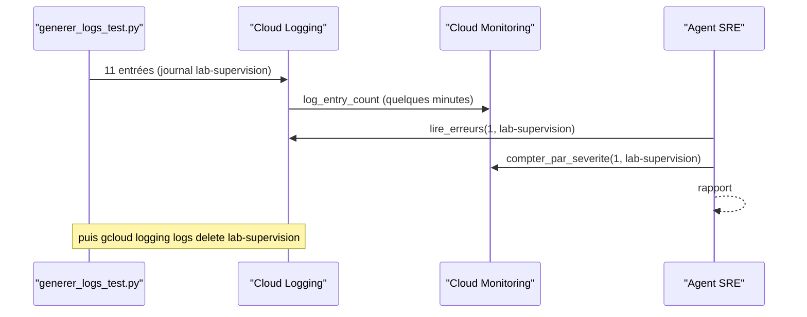

# Un incident de test, puis on efface tout

> [!NOTE]
> Dans cette leçon, vous allez tester l'agent **sans clé ni projet** (faux clients Logging et Monitoring), écrire un incident **fictif** de 11 entrées dans le journal `lab-supervision`, lancer l'agent réel dessus, juger son rapport, puis supprimer le journal et vérifier qu'il a disparu.

## Les tests sans GCP

Les outils sont testés avec des objets factices (`SimpleNamespace`) qui imitent juste ce que lit le code :

```python title="files/test_supervision.py"
def test_lire_erreurs_construit_le_filtre_et_borne(monkeypatch):
    vus = {}
    def list_entries(filter_, order_by, max_results, page_size):
        vus.update(filtre=filter_, max=max_results)
        return [NS(timestamp=T0, severity="ERROR", payload={"message": "Timeout 1"}, labels={"service": "api"},
                   resource=NS(type="global", labels={}))]
    monkeypatch.setenv("GOOGLE_CLOUD_PROJECT", "projet-test")
    monkeypatch.setattr(agent, "_logging", lambda: NS(list_entries=list_entries))
    r = agent.lire_erreurs(heures=500, journal="lab-supervision", max_entrees=10**6)
    assert 'logName="projects/projet-test/logs/lab-supervision"' in vus["filtre"]
    assert vus["max"] == 1000
```

| Test | Vérifie |
|---|---|
| `test_signature_ignore_les_nombres` | deux messages qui ne diffèrent que par un nombre ont la même signature |
| `test_regrouper_et_correler_le_scenario` | réutilise `scenario()` du générateur : 4 timeouts, 3 erreurs 503, lien de 120 s |
| `test_pas_de_correlation_au_dela_de_5_minutes`, `test_lire_erreurs_...`, `test_compter_par_severite` | fenêtre, filtre et bornes, addition des points |
| `test_agent_sans_outil_d_ecriture` | la liste fermée des outils |

## L'incident fictif

```python title="files/generer_logs_test.py"
def scenario(maintenant):
    t = []
    for i in range(4):
        t.append((timedelta(minutes=10 - i), "ERROR", "api-commandes",
                  f"Timeout: connexion à commandes-db expirée après 30 s (requête {1040 + i})"))
    for i in range(3):
        t.append((timedelta(minutes=8 - i), "ERROR", "passerelle",
                  f"HTTP 503 : upstream api-commandes indisponible (tentative {i + 1})"))
    t.append((timedelta(minutes=5), "CRITICAL", "api-commandes", "Pool de connexions épuisé : 50/50 utilisées"))
    ...

logger = client.logger("lab-supervision", labels={"formation-lab": "supervision-cloud-logging"})
logger.log_struct({"message": message, "service": service}, severity=severite,
                  timestamp=maintenant - decalage, labels={...}, resource=Resource(type="global", labels={}))
```

`log_struct` écrit une entrée JSON (`jsonPayload`) ; un `timestamp` dans le passé reconstitue une **chronologie** sur dix minutes ; la ressource `global` est générique, puisque ces « services » n'existent pas.



> [!WARNING]
> Écrire dans un journal exige un droit d'écriture (`roles/logging.logWriter`) : c'est **vous** qui le faites avec vos identifiants pour préparer le test, jamais l'agent. Le générateur et l'agent sont deux programmes distincts.

## Lancer l'ensemble

```bash title="terminal"
cd files
export GOOGLE_GENAI_USE_VERTEXAI=TRUE GOOGLE_CLOUD_PROJECT="mon-projet-gcp" GOOGLE_CLOUD_LOCATION=europe-west1
pytest -q
python generer_logs_test.py
# attendre 3 à 5 minutes pour que la métrique soit à jour
python lancer.py lab-supervision 1
```

## Résultat obtenu

Sorties réelles du 2026-10-15 :

```text title="pytest et générateur (2026-10-15)"
......                                                                   [100%]
6 passed, 5 warnings in 0.76s
11 entrées écrites dans le journal lab-supervision
```

```text title="gcloud logging read (2026-10-15, extrait)"
TIMESTAMP                       SEVERITY  SERVICE        MESSAGE
2026-10-15T14:38:30.483475Z     CRITICAL  api-commandes  Pool de connexions épuisé : 50/50 utilisées
2026-10-15T14:37:30.483475Z     ERROR     passerelle     HTTP 503 : upstream api-commandes indisponible (tentative 3)
2026-10-15T14:36:30.483475Z     ERROR     api-commandes  Timeout: connexion à commandes-db expirée après 30 s (requête 1043)
...
2026-10-15T14:33:30.483475Z     ERROR     api-commandes  Timeout: connexion à commandes-db expirée après 30 s (requête 1040)
```

Le rapport complet de l'agent est montré dans les leçons précédentes. Notre grille de lecture :

| Critère | Verdict sur ce run |
|---|---|
| Nombres et dates exacts | oui (4, 3, 1 ; fenêtres correctes) |
| Cause probable identifiée | oui : timeout de `commandes-db` avant les 503 |
| Corrélations présentées comme indices | oui, mais un faux lien (503 → pool épuisé) |
| Remédiations exécutables telles quelles | **non** : noms de ressources supposés (`commandes-db-instance`), à valider |

```quiz
question: "L'agent propose « gcloud sql instances patch commandes-db-instance --tier=db-n1-standard-2 ». Que faites-vous ?"
options:
  - "Je l'exécute, l'agent a analysé les journaux"
  - "Je vérifie d'abord que l'instance existe sous ce nom et que la base est bien saturée (métriques Cloud SQL) avant tout changement"
  - "Je l'ignore, les agents se trompent toujours"
answer: 1
explanation: "Le nom de l'instance a été déduit d'un message de journal, et la saturation n'est qu'une hypothèse. La proposition est un bon point de départ, à confirmer par des faits avant d'agir. C'est tout l'intérêt de la lecture seule."
```

## Supprimer le journal de test

```bash title="files/nettoyer.sh"
gcloud logging logs delete lab-supervision --project "$PROJECT_ID" --quiet
gcloud logging read 'logName:"logs/lab-supervision"' --project "$PROJECT_ID" --freshness 1d --format 'value(insertId)' | wc -l
```

`logs delete` supprime **toutes** les entrées du journal. Les points déjà calculés de la métrique `log_entry_count` restent dans Cloud Monitoring (une métrique système ne se supprime pas) : ce sont des compteurs, sans contenu.

```quiz
question: "Après nettoyer.sh, que reste-t-il de l'incident fictif ?"
options:
  - "Les 11 entrées, car Cloud Logging conserve tout 30 jours"
  - "Plus aucune entrée du journal ; seuls des compteurs agrégés subsistent dans la métrique système log_entry_count"
  - "Le journal est vidé mais l'agent continue de le lire"
answer: 1
explanation: "La suppression d'un journal efface ses entrées. Les métriques système, elles, sont des agrégats déjà calculés et ne contiennent aucun message : elles expirent selon la durée de conservation de Cloud Monitoring."
```

## Résultat obtenu (nettoyage)

```text title="nettoyer.sh (2026-10-15)"
Deleted [lab-supervision].
0
```

## Exercice

Ajoutez au générateur un second scénario « nuit calme » (uniquement des entrées `INFO` et `WARNING`), puis écrivez le test sans clé qui vérifie que `regrouper` et `correler` ne renvoient **rien** quand on ne garde que les sévérités `ERROR` et plus.

<details>
<summary>Voir la solution</summary>

```python title="generer_logs_test.py"
def scenario_calme(maintenant):
    return [(timedelta(minutes=9), "INFO", "api-commandes", "Démarrage du worker 1"),
            (timedelta(minutes=6), "WARNING", "passerelle", "Latence p95 élevée : 900 ms"),
            (timedelta(minutes=3), "INFO", "api-commandes", "Purge du cache terminée")]
```

```python title="test_supervision.py"
def test_nuit_calme_aucun_incident():
    entrees = [{"horodatage": T0 - d, "severite": s, "source": src, "message": m}
               for d, s, src, m in generer_logs_test.scenario_calme(T0) if s in ("ERROR", "CRITICAL")]
    assert agent.regrouper(entrees) == []
    assert agent.correler([]) == []
```

Testez aussi ce cas avec le vrai modèle : un bon agent d'astreinte doit savoir dire « rien d'anormal ».

</details>

## Je sais faire

- [ ] Tester des outils Cloud Logging et Monitoring sans aucun accès réel
- [ ] Écrire un incident fictif horodaté avec `log_struct`
- [ ] Évaluer un rapport d'agent avec une grille simple
- [ ] Supprimer un journal de test et vérifier sa disparition
