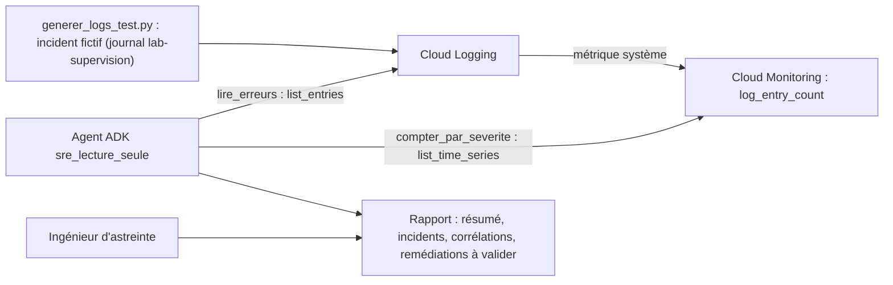

# Un agent SRE en lecture seule sur Cloud Logging et Cloud Monitoring

Trois heures du matin, une alerte sonne. Avant de toucher à quoi que ce soit, l'ingénieur d'astreinte veut savoir : **quelles erreurs ? depuis quand ? laquelle a commencé en premier ? que faire ?** Ce lab construit un agent qui prépare cette réponse en lisant Cloud Logging et Cloud Monitoring, **sans aucun droit de modification**. Il propose ; un humain décide.

## Pour qui ?

Vous connaissez ADK et les bases de Google Cloud. Vous voulez un agent utile en exploitation, dont la sécurité repose sur une règle simple : il ne peut **que lire**.

## Ce que vous construisez

## Prérequis

- Python 3.10+, `gcloud` connecté (`gcloud auth application-default login`), un projet avec Vertex AI, Cloud Logging et Cloud Monitoring activés.
- `pip install -r requirements.txt` (ADK 2.10, `google-cloud-logging`, `google-cloud-monitoring`).
- Le code : [files/](./files/agent.py) — `agent.py`, `generer_logs_test.py`, `lancer.py`, `test_supervision.py`, `nettoyer.sh`.

## Programme

| Module | Leçon | Ce que vous faites |
|---|---|---|
| 1. Cas d'usage et architecture | [Un SRE qui ne touche à rien](./01-cas-d-usage/01-sre-lecture-seule.md) | rôle, limites, droits en lecture seule |
| 2. Construire pas à pas | [Lire Cloud Logging et Cloud Monitoring](./02-construire/01-lire-logging-monitoring.md) | filtres, bibliothèques Python, métrique `log_entry_count` |
| | [Regrouper, corréler, rédiger](./02-construire/02-regrouper-correler-agent.md) | signatures, corrélation temporelle, consigne de l'agent |
| 3. Tester et exploiter | [Un incident de test, puis on efface tout](./03-tester-exploiter/01-incident-de-test-et-nettoyage.md) | tests sans clé, incident fictif, run réel, suppression du journal |

## En local ou sur GCP ?

| | Ce lab | En production |
|---|---|---|
| Où tourne l'agent | votre poste, identifiants ADC | Cloud Run ou Agent Engine, compte de service dédié |
| Droits | ceux de votre compte (attention : souvent bien plus que la lecture) | **uniquement** `roles/logging.viewer` + `roles/monitoring.viewer` |
| Données | un incident fictif dans le journal `lab-supervision` | tous les journaux du projet |

> [!WARNING]
> Le lab écrit 11 entrées de test dans un journal nommé `lab-supervision`, puis le supprime. Il ne crée aucune autre ressource. La dernière leçon montre comment vérifier que le journal a disparu.
