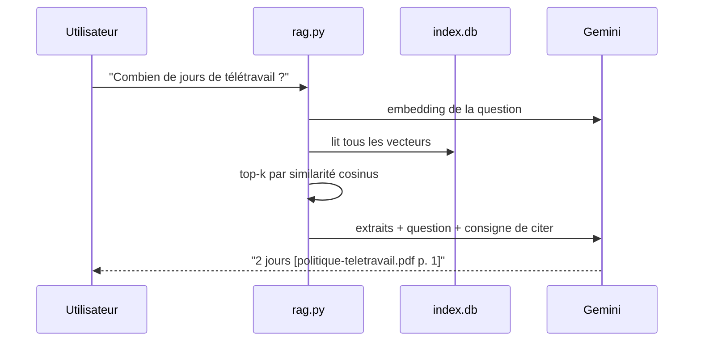

# Le cas d'usage et l'architecture

> [!NOTE]
> Dans cette leçon, vous allez comprendre pourquoi un RAG plutôt qu'un simple appel au modèle, découvrir les cinq briques du lab et générer les trois PDF fictifs qui serviront de corpus.

## Le problème

Atelier Nova (entreprise **fictive**) a trois PDF : un guide d'accueil, une politique de télétravail, une procédure de notes de frais. Si l'on pose la question « combien de jours de télétravail ? » directement à Gemini, il répondra quelque chose de plausible… mais il n'a jamais lu **vos** documents. Il risque d'**halluciner**, c'est-à-dire d'inventer une réponse crédible et fausse.

Le RAG règle ce problème en deux temps :

1. **Récupérer** (*retrieve*) les passages de vos documents qui parlent de la question ;
2. **Générer** une réponse en donnant ces passages au modèle, avec la consigne de ne rien ajouter.



## Les cinq briques

| Brique | Rôle | Outil dans ce lab | Alternative plus tard |
| --- | --- | --- | --- |
| Extraction | transformer le PDF en texte, page par page | `pypdf` | OCR (Document AI) pour les scans |
| Découpage (*chunking*) | couper le texte en morceaux de taille raisonnable | fonction `chunk()` maison | découpage par structure (lab 3) |
| Embeddings | transformer chaque morceau en vecteur | `gemini-embedding-2`, 768 dimensions | autre dimension (128 à 3072) |
| Index | stocker texte + page + vecteur | SQLite (fichier unique) | sqlite-vec, FAISS, Vector Search |
| Génération | rédiger la réponse citée | `gemini-3.5-flash` | `gemini-3.5-flash-lite` pour le volume |

> [!TIP]
> Garder le **numéro de page** dès l'extraction coûte une colonne en base et rapporte énormément : c'est ce qui permet au lecteur de vérifier la réponse en dix secondes.

```quiz
question: "Pourquoi le RAG réduit-il les hallucinations sur des documents internes ?"
options:
  - "Parce qu'il réentraîne le modèle sur vos documents"
  - "Parce qu'il fournit au modèle, à chaque question, les passages pertinents et lui demande de s'y limiter"
  - "Parce qu'il utilise un modèle plus gros"
answer: 1
explanation: "Le RAG ne modifie pas le modèle : il lui donne le bon contexte au moment de la question. C'est moins cher qu'un réentraînement et les documents peuvent changer à tout moment."
```

## Générer le corpus

Les PDF sont **fictifs** et produits par un script avec `reportlab` (une bibliothèque qui écrit des PDF). Chaque document est une liste de pages, chaque page un titre et des paragraphes :

```python title="files/make_pdfs.py (extrait)"
rl_config.invariant = 1  # PDF identiques octet pour octet d'une génération à l'autre (pas de date)

DOCS = {
    "politique-teletravail.pdf": [
        ("Politique de télétravail", [
            "Tout salarié en CDI ayant terminé sa période d'essai peut demander à télétravailler. ...",
            "Le télétravail est limité à 2 jours par semaine. Le mardi est un jour de présence obligatoire ...",
        ]),
        ("Équipement et indemnité", [...]),
    ],
    ...
}
```

La ligne `rl_config.invariant = 1` compte : sans elle, reportlab écrit la date de création dans le PDF, donc deux générations du même contenu donneraient deux fichiers différents. Notre réindexation incrémentale (leçon suivante) compare l'**empreinte** des fichiers : elle croirait à tort que tout a changé.

Le script complet : [make_pdfs.py](../files/make_pdfs.py).

```bash title="terminal"
cd files
python -m venv .venv && . .venv/bin/activate
pip install -r requirements.txt
cp .env.example .env        # puis mettez votre clé dans .env
python make_pdfs.py         # écrit docs/*.pdf
```

```quiz
question: "Que se passerait-il si les PDF contenaient leur date de génération et qu'on les régénérait sans changer le texte ?"
options:
  - "Rien : le hash ne dépend que du texte"
  - "Leur hash changerait, et l'indexation incrémentale recalculerait inutilement leurs embeddings"
  - "pypdf refuserait de les lire"
answer: 1
explanation: "Le SHA-256 est calculé sur les octets du fichier. Une date différente suffit à changer les octets, donc l'empreinte, donc à déclencher une réindexation (et des appels d'API) pour rien."
```

## Exercice : ajouter un document

Ajoutez au dictionnaire `DOCS` un quatrième PDF `charte-informatique.pdf` d'une page, qui dit que les clés USB personnelles sont interdites. Régénérez le corpus.

<details>
<summary>Voir la solution</summary>

```python title="files/make_pdfs.py (ajout dans DOCS)"
    "charte-informatique.pdf": [
        ("Charte informatique", [
            "Les clés USB personnelles sont interdites sur les postes de l'entreprise. "
            "Utilisez l'espace de partage interne pour échanger des fichiers.",
        ]),
    ],
```

Puis `python make_pdfs.py`. Les trois PDF existants sont réécrits à l'identique (même hash) grâce à `invariant = 1` : seul le nouveau sera indexé à la leçon suivante.

</details>

## Résultat obtenu

Exécution du 2026-10-15 :

```text
$ python make_pdfs.py
écrit docs/guide-accueil.pdf
écrit docs/politique-teletravail.pdf
écrit docs/notes-de-frais.pdf
```

Trois PDF de 3, 2 et 3 pages, soit 8 pages au total.

> [!WARNING]
> Ne mettez jamais de vrais documents confidentiels dans un prototype tant que vous n'avez pas vérifié les conditions d'utilisation de l'API (données envoyées pour les embeddings et la génération). Ici, tout est fictif.

## Je sais faire

- [ ] Expliquer en deux phrases ce que fait un RAG et pourquoi il limite les hallucinations
- [ ] Citer les cinq briques (extraction, découpage, embeddings, index, génération)
- [ ] Générer un corpus PDF fictif reproductible
