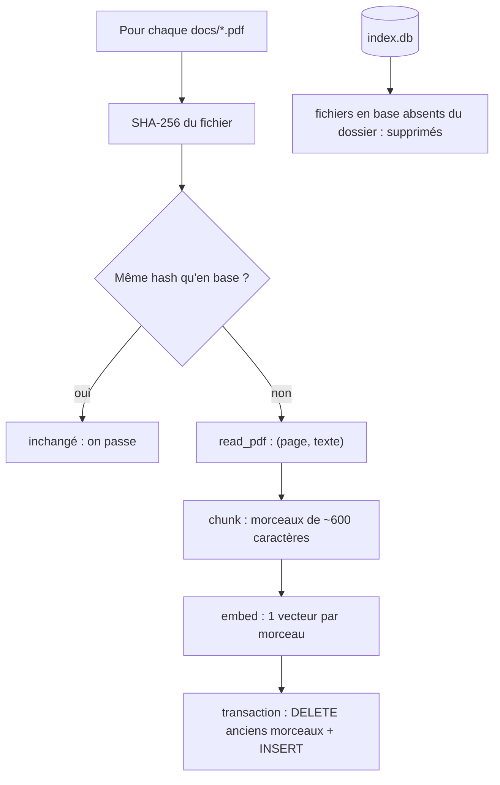

# Extraire, découper, indexer

> [!NOTE]
> Dans cette leçon, vous allez écrire la moitié « ingestion » de `rag.py` : extraire le texte page par page, le découper, calculer les embeddings et les ranger dans SQLite, en ne retraitant que les fichiers modifiés.



## 1. Extraire par page

```python title="files/rag.py"
def read_pdf(path: Path) -> list[tuple[int, str]]:
    """[(numéro de page à partir de 1, texte)] ; les pages vides sont ignorées."""
    pages = []
    for i, page in enumerate(PdfReader(path).pages, start=1):
        text = " ".join((page.extract_text() or "").split())
        if text:
            pages.append((i, text))
    return pages
```

`" ".join(text.split())` remplace retours à la ligne et espaces multiples par un seul espace : les PDF coupent souvent les lignes au milieu des phrases.

> [!WARNING]
> `pypdf` lit le texte **présent** dans le PDF. Un document scanné (une image) renvoie une page vide : il faut alors un OCR (reconnaissance optique de caractères). Comptez les pages vides à l'indexation pour le détecter.

## 2. Découper

Un **morceau** (*chunk*) est l'unité que l'on retrouve et que l'on montre au modèle. Trop gros, il dilue l'information ; trop petit, il perd le contexte. Nous coupons vers 600 caractères, de préférence après un point, avec un **chevauchement** de 100 caractères pour qu'une phrase à cheval sur deux morceaux reste lisible dans l'un des deux.

```python title="files/rag.py"
def chunk(text: str, size: int = 600, overlap: int = 100) -> list[str]:
    if len(text) <= size:
        return [text]
    chunks, start = [], 0
    while start < len(text):
        end = min(start + size, len(text))
        if end < len(text):
            cut = text.rfind(". ", start + size // 2, end)
            end = cut + 1 if cut != -1 else end
        chunks.append(text[start:end].strip())
        if end == len(text):
            break
        start = max(end - overlap, start + 1)
    return chunks
```

| Taille de morceau | Avantage | Inconvénient |
| --- | --- | --- |
| 200 caractères | très précis | perd le contexte (« il », « ce plafond »…) |
| 600 caractères (ce lab) | une idée complète | convient à des pages courtes |
| 3 000 caractères | peu de morceaux | le passage utile est noyé, plus de jetons envoyés |

```quiz
question: "À quoi sert le chevauchement (overlap) entre deux morceaux ?"
options:
  - "À accélérer le calcul des embeddings"
  - "À éviter qu'une information coupée à la frontière soit incomplète dans les deux morceaux"
  - "À réduire la taille de la base"
answer: 1
explanation: "Sans chevauchement, une phrase coupée en deux n'est complète nulle part. Le chevauchement duplique un peu de texte (coût faible) pour la retrouver entière dans au moins un morceau."
```

## 3. Embeddings : la tâche dans le texte

Avec `gemini-embedding-2`, le paramètre `task_type` n'existe pas : la documentation demande d'**écrire la tâche dans le texte**. Les documents sont préfixés `title: … | text: …`, les questions `task: question answering | query: …`. Autre piège : passer une liste de chaînes renvoie **un seul** vecteur agrégé. Il faut un objet `Content` par texte.

```python title="files/rag.py"
def embed(texts, kind="doc", titles=None):
    from google.genai import types
    if kind == "query":
        texts = [f"task: question answering | query: {t}" for t in texts]
    else:
        titles = titles or ["none"] * len(texts)
        texts = [f"title: {ti} | text: {t}" for ti, t in zip(titles, texts)]
    out = []
    for i in range(0, len(texts), 100):  # 100 textes par requête au plus
        batch = [types.Content(parts=[types.Part(text=t)]) for t in texts[i:i + 100]]
        r = retry(lambda: client().models.embed_content(
            model=EMBED_MODEL, contents=batch,
            config=types.EmbedContentConfig(output_dimensionality=DIM)))
        out += [e.values for e in r.embeddings]
    v = np.array(out, dtype=np.float32)
    return v / np.linalg.norm(v, axis=1, keepdims=True)
```

`retry()` réessaie avec attente croissante sur les erreurs 429 (quota dépassé) et 503 (service surchargé). La normalisation finale rend chaque vecteur de longueur 1 : le produit scalaire devient alors la **similarité cosinus**.

## 4. SQLite et réindexation incrémentale

Deux tables : `files(path, sha256)` et `chunks(path, page, text, vec)`. Le vecteur est stocké en `BLOB` (les octets bruts du tableau numpy `float32`, soit 768 × 4 = 3 072 octets).

```python title="files/rag.py (extrait de index_folder)"
    for pdf in sorted(Path(folder).glob("*.pdf")):
        key, digest = pdf.name, sha256(pdf)
        seen.add(key)
        if known.get(key) == digest:
            stats["inchanges"] += 1
            continue
        stats["modifies" if key in known else "ajoutes"] += 1
        rows = [(page, c) for page, text in read_pdf(pdf) for c in chunk(text)]
        vecs = embed_fn([c for _, c in rows], kind="doc", titles=[key] * len(rows)) if rows else []
        with db:  # une transaction par fichier : jamais d'index à moitié écrit
            db.execute("DELETE FROM chunks WHERE path = ?", (key,))
            db.executemany("INSERT INTO chunks(path, page, text, vec) VALUES (?, ?, ?, ?)", ...)
            db.execute("INSERT OR REPLACE INTO files VALUES (?, ?)", (key, digest))
```

Les embeddings sont calculés **avant** la transaction : si l'API échoue, l'ancien index du fichier reste intact. Le `with db:` valide tout ou rien.

```quiz
question: "Un PDF a été supprimé du dossier docs/. Que fait index_folder ?"
options:
  - "Rien, ses morceaux restent dans l'index"
  - "Il supprime ses morceaux et sa ligne dans files, puis compte un fichier supprimé"
  - "Il lève une erreur FileNotFoundError"
answer: 1
explanation: "La boucle finale compare les fichiers connus en base à ceux vus dans le dossier : ceux qui ont disparu sont effacés. Sinon le RAG continuerait de citer un document qui n'existe plus."
```

## Exercice : détecter les PDF scannés

Modifiez `index_folder` pour ajouter un compteur `pages_vides` : le nombre de pages d'où pypdf n'a tiré aucun texte.

<details>
<summary>Voir la solution</summary>

`read_pdf` ignore les pages vides ; il suffit de comparer avec le nombre total de pages.

```python title="files/rag.py (dans la boucle, après le calcul de rows)"
        total = len(PdfReader(pdf).pages)
        stats["pages_vides"] = stats.get("pages_vides", 0) + total - len(read_pdf(pdf))
```

Pour éviter de lire le PDF deux fois, faites renvoyer `(pages, total)` par `read_pdf`. Un fichier dont toutes les pages sont vides est presque sûrement un scan.

</details>

## Résultat obtenu

Exécution réelle du 2026-10-15 (index, puis réindexation immédiate, puis après avoir modifié la politique de télétravail et supprimé le guide d'accueil) :

```text
$ python rag.py index docs
{'ajoutes': 3, 'modifies': 0, 'inchanges': 0, 'supprimes': 0, 'morceaux': 8}
$ python rag.py index docs
{'ajoutes': 0, 'modifies': 0, 'inchanges': 3, 'supprimes': 0, 'morceaux': 0}
$ python rag.py index docs      # après modification + suppression
{'ajoutes': 0, 'modifies': 1, 'inchanges': 1, 'supprimes': 1, 'morceaux': 2}
```

La deuxième exécution n'a fait **aucun** appel d'API : tout était à jour.

## Je sais faire

- [ ] Extraire un PDF page par page avec pypdf
- [ ] Découper un texte avec chevauchement et expliquer le choix de la taille
- [ ] Préfixer textes et questions pour gemini-embedding-2 et obtenir un vecteur par texte
- [ ] Réindexer seulement ce qui a changé grâce au SHA-256
