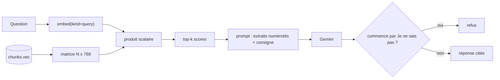

# Rechercher et répondre avec citations

> [!NOTE]
> Dans cette leçon, vous allez écrire la recherche par similarité cosinus en numpy et le prompt qui oblige Gemini à citer `[fichier.pdf p. N]` ou à répondre « Je ne sais pas ».



## 1. La recherche

```python title="files/rag.py"
def search(db, question: str, k: int = 4, embed_fn=embed) -> list[dict]:
    # Limite connue : parcours complet en numpy, suffisant jusqu'à ~100 000 morceaux ;
    # au-delà, index ANN (sqlite-vec, FAISS).
    rows = db.execute("SELECT path, page, text, vec FROM chunks").fetchall()
    if not rows:
        return []
    mat = np.stack([np.frombuffer(r[3], dtype=np.float32) for r in rows])
    scores = mat @ embed_fn([question], kind="query")[0]
    best = np.argsort(-scores)[:k]
    return [{"path": rows[i][0], "page": rows[i][1], "text": rows[i][2],
             "score": float(scores[i])} for i in best]
```

Les vecteurs étant normés, `mat @ q` donne d'un coup les similarités cosinus de tous les morceaux (entre -1 et 1). Pas besoin de base vectorielle pour quelques milliers de morceaux : c'est une multiplication de matrice. Un index **ANN** (*approximate nearest neighbours*, plus proches voisins approchés) ne devient utile que sur de gros volumes.

> [!TIP]
> Le paramètre `embed_fn` permet de passer un **faux** embedder dans les tests : on teste toute la logique sans clé ni réseau (leçon suivante).

## 2. Le prompt de réponse

```python title="files/rag.py"
PROMPT = """Tu es l'assistant documentaire d'Atelier Nova. Réponds en français, en 1 à 3 phrases,
UNIQUEMENT à partir des extraits ci-dessous. Après chaque affirmation, cite la source au format
[fichier.pdf p. N]. Si les extraits ne contiennent pas la réponse, réponds exactement : "{refus}".

Extraits :
{context}

Question : {question}"""


def answer(db, question, k=4, embed_fn=embed, generate_fn=generate) -> dict:
    hits = search(db, question, k, embed_fn)
    context = "\n\n".join(f"[{h['path']} p. {h['page']}] {h['text']}" for h in hits)
    text = generate_fn(PROMPT.format(refus=REFUS, context=context, question=question))
    return {"question": question, "answer": text, "hits": hits, "refus": text.startswith(REFUS)}
```

Trois consignes font le travail :

| Consigne | Ce qu'elle empêche |
| --- | --- |
| « UNIQUEMENT à partir des extraits » | que le modèle complète avec ses connaissances générales |
| « cite la source au format [fichier.pdf p. N] » | une réponse invérifiable ; le format est copié de l'en-tête des extraits |
| « réponds exactement : Je ne sais pas » | une réponse inventée quand rien ne correspond ; la chaîne exacte se détecte en code |

```quiz
question: "Pourquoi chaque extrait du contexte commence-t-il par [fichier.pdf p. N] ?"
options:
  - "Pour que le modèle puisse recopier exactement l'étiquette comme citation"
  - "Parce que l'API Gemini l'exige"
  - "Pour améliorer le score de similarité"
answer: 0
explanation: "Le modèle cite ce qu'il voit. En lui donnant l'étiquette dans le format attendu, on obtient des citations exactes au lieu de références approximatives."
```

```quiz
question: "Toutes les questions passent par le modèle, même hors sujet. Qu'est-ce qui produit le refus dans ce lab ?"
options:
  - "Un seuil sur le score de similarité"
  - "La consigne du prompt : le modèle constate que les extraits ne répondent pas"
  - "Un filtre de mots interdits"
answer: 1
explanation: "Ici le refus vient uniquement du prompt. Le lab 2 ajoute un seuil de pertinence en amont, qui évite même l'appel au modèle quand aucun extrait n'est assez proche."
```

## 3. Essayer

```bash title="terminal"
python rag.py ask "Combien de jours par semaine peut-on télétravailler ?"
python rag.py ask "Quel est le salaire de la directrice ?"
```

## Exercice : afficher l'extrait cité

Ajoutez à la commande `ask` l'affichage des 80 premiers caractères de chaque extrait sous sa source, pour que l'utilisateur voie d'où vient la réponse.

<details>
<summary>Voir la solution</summary>

```python title="files/rag.py (bloc __main__)"
    elif cmd == "ask":
        r = answer(db, arg)
        print(r["answer"])
        for h in r["hits"]:
            print(f"  - {h['path']} p. {h['page']} (score {h['score']:.3f})")
            print(f"      « {h['text'][:80]}… »")
```

En interface web, on ferait de chaque citation un lien vers le PDF à la bonne page : `docs/notes-de-frais.pdf#page=2` fonctionne dans la plupart des lecteurs PDF des navigateurs.

</details>

## Résultat obtenu

Exécution réelle du 2026-10-15 avec `gemini-3.5-flash` :

```text
$ python rag.py ask "Combien de jours par semaine peut-on télétravailler ?"
Il est possible de télétravailler jusqu'à 2 jours par semaine [politique-teletravail.pdf p. 1].
  - politique-teletravail.pdf p. 1 (score 0.774)
  - politique-teletravail.pdf p. 2 (score 0.695)
  - guide-accueil.pdf p. 3 (score 0.593)
  - guide-accueil.pdf p. 1 (score 0.583)
$ python rag.py ask "Quel est le salaire de la directrice ?"
Je ne sais pas
  - guide-accueil.pdf p. 3 (score 0.628)
  - politique-teletravail.pdf p. 2 (score 0.612)
  - notes-de-frais.pdf p. 2 (score 0.605)
  - notes-de-frais.pdf p. 3 (score 0.594)
```

Remarquez les scores : 0,77 pour le bon passage, autour de 0,60 pour des passages sans rapport. L'écart existe, mais il est faible ; c'est pour cela qu'un seuil se **calibre** sur des questions de référence (lab 2) au lieu d'être choisi au hasard.

> [!WARNING]
> Après une modification du PDF (le vendredi devient jour de présence), la même chaîne a répondu « le mardi […] De plus, à partir de janvier, le vendredi […] [politique-teletravail.pdf p. 1] » : la réindexation incrémentale suffit pour que la réponse suive le document, sans rien redémarrer.

## Je sais faire

- [ ] Calculer des similarités cosinus pour tout l'index en une multiplication de matrice
- [ ] Écrire un prompt qui impose des citations au format voulu
- [ ] Détecter un refus en code grâce à une chaîne exacte
