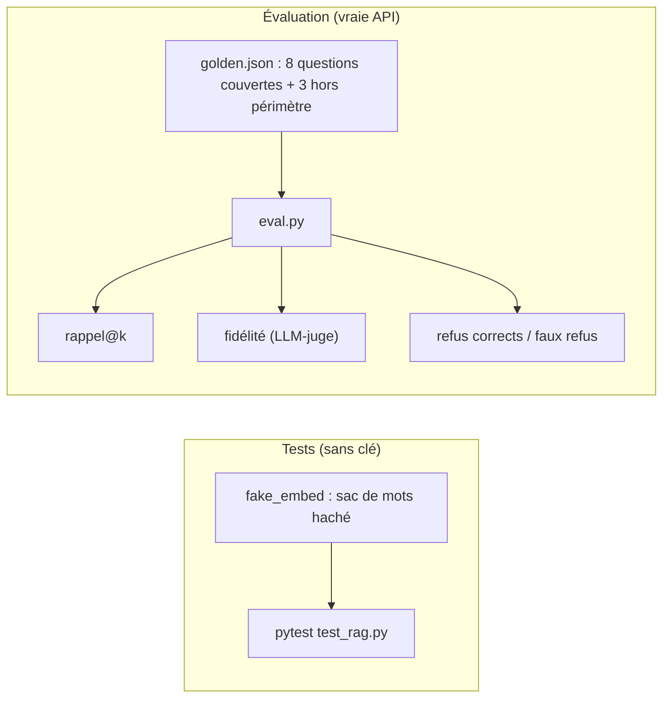

# Tester, évaluer, exploiter

> [!NOTE]
> Dans cette leçon, vous allez tester le RAG sans clé d'API, puis le **mesurer** sur 11 questions de référence : rappel@k, fidélité et taux de refus correct. Vous finirez par les règles pour l'exploiter au quotidien.



## 1. Tester sans clé

Les fonctions `index_folder`, `search` et `answer` reçoivent `embed_fn` et `generate_fn` en paramètres. Dans les tests, on leur donne un faux embedder déterministe : chaque mot est haché vers une des 256 cases d'un vecteur. Deux textes qui partagent des mots ont des vecteurs proches : c'est grossier, mais suffisant pour vérifier la **logique**.

```python title="files/test_rag.py (extrait)"
def fake_embed(texts, kind="doc", titles=None):
    v = np.zeros((len(texts), 256), dtype=np.float32)
    for i, t in enumerate(texts):
        for w in t.lower().replace("?", " ").replace(".", " ").split():
            v[i, int(hashlib.md5(w.encode()).hexdigest(), 16) % 256] += 1
    return v / np.maximum(np.linalg.norm(v, axis=1, keepdims=True), 1e-9)


def test_reindexation_incrementale(setup):
    db, docs = setup
    s1 = rag.index_folder(db, docs, fake_embed)
    assert s1["ajoutes"] == 3 and s1["morceaux"] > 0
    s2 = rag.index_folder(db, docs, fake_embed)
    assert s2 == {"ajoutes": 0, "modifies": 0, "inchanges": 3, "supprimes": 0, "morceaux": 0}
    ...
```

Fichier complet : [test_rag.py](../files/test_rag.py).

## 2. Les trois métriques

Le jeu de référence [golden.json](../files/golden.json) associe chaque question au passage attendu (`fichier#page`), ou à une liste vide si la question est **hors périmètre** (la réponse n'est dans aucun document).

| Métrique | Question posée | Calcul |
| --- | --- | --- |
| rappel@k | le bon passage est-il dans les k extraits récupérés ? | passages attendus trouvés / passages attendus |
| fidélité | la réponse ne dit-elle que ce que disent les extraits ? | un LLM-juge répond OUI ou NON, moyenne des OUI |
| refus corrects | refuse-t-on les questions hors périmètre ? | refus / questions hors périmètre |
| faux refus | refuse-t-on à tort des questions couvertes ? | refus / questions couvertes |

```python title="files/eval.py (extrait)"
def recall_at_k(hits, attendu):
    found = {f"{h['path']}#{h['page']}" for h in hits}
    return sum(a in found for a in attendu) / len(attendu)


JUDGE = """Tu es un évaluateur strict. Voici des extraits de documents puis une réponse.
Réponds OUI si TOUTES les affirmations de la réponse sont soutenues par les extraits, sinon NON.
Réponds par un seul mot. ..."""
```

Le juge utilise un modèle différent et moins cher (`JUDGE_MODEL`, par défaut `gemini-3.5-flash-lite`). Un **LLM-juge** est un modèle qui note la sortie d'un autre ; il se trompe parfois, donc relisez à la main les réponses jugées NON.

```quiz
question: "Le rappel@4 vaut 1,0 mais la fidélité vaut 0,6. Où chercher le problème ?"
options:
  - "Dans la recherche : les bons passages ne sont pas trouvés"
  - "Dans la génération : le modèle ajoute des informations absentes des extraits"
  - "Dans l'extraction PDF"
answer: 1
explanation: "Un rappel parfait dit que les bons passages sont bien fournis. Si la fidélité est basse, c'est le modèle qui brode : renforcez le prompt, baissez la longueur de réponse, ou changez de modèle."
```

```quiz
question: "Pourquoi mesurer aussi les faux refus, et pas seulement les refus corrects ?"
options:
  - "Parce qu'un assistant qui répond toujours Je ne sais pas aurait 100 % de refus corrects"
  - "Parce que l'API facture les refus"
  - "Ce n'est pas utile"
answer: 0
explanation: "Refuser tout est la façon la plus simple de ne jamais halluciner. Les deux taux ensemble mesurent l'équilibre : refuser ce qui n'est pas couvert, répondre à ce qui l'est."
```

## 3. Lancer l'évaluation

```bash title="terminal"
python -m pytest -q          # sans clé
python rag.py index docs
python eval.py 4             # k = 4 ; une trentaine d'appels : 11 embeddings, 11 réponses, 8 jugements
```

## Résultat obtenu

Exécution réelle du 2026-10-15 :

```text
$ python -m pytest -v
test_rag.py::test_chunk_respecte_la_taille_et_couvre_le_texte PASSED     [ 20%]
test_rag.py::test_extraction_garde_les_numeros_de_page PASSED            [ 40%]
test_rag.py::test_reindexation_incrementale PASSED                       [ 60%]
test_rag.py::test_recherche_et_reponse_citee PASSED                      [ 80%]
test_rag.py::test_metriques PASSED                                       [100%]
5 passed in 0.64s

$ python eval.py 4
[ok   ] rappel=1.0 fidele=True  Combien de jours par semaine peut-on télétravailler ?
[ok   ] rappel=1.0 fidele=True  Quel est le montant de l'indemnité de télétravail ?
...
[ok   ] rappel=1.0 fidele=True  Où récupérer son badge d'accès le premier jour ?
[REFUS] rappel=- fidele=-  Quel est le salaire de la directrice générale ?
[REFUS] rappel=- fidele=-  Combien de jours de congés payés a-t-on par an ?
[REFUS] rappel=- fidele=-  Quelle est la capitale de l'Australie ?
{"k": 4, "rappel@k": 1.0, "fidelite": 1.0, "refus_corrects": 1.0, "faux_refus": 0.0}

$ python eval.py 2
{"k": 2, "rappel@1": 1.0, "rappel@k": 1.0, "fidelite": 1.0, "refus_corrects": 1.0, "faux_refus": 0.0}
```

> [!WARNING]
> Des scores parfaits sur 11 questions et 8 morceaux ne prouvent pas grand-chose : avec k = 4 on renvoie la moitié du corpus ! Ces chiffres valident la chaîne, pas sa qualité à grande échelle. Sur un vrai corpus, visez au moins 30 à 50 questions écrites par les futurs utilisateurs, et regardez **rappel@1** : il devient vite discriminant.

## 4. Exploiter au quotidien

| Situation | Que faire |
| --- | --- |
| un PDF est ajouté ou modifié | `python rag.py index docs` (seuls les fichiers changés coûtent des appels) |
| vous changez `EMBED_DIM` ou `EMBED_MODEL` | supprimez `index.db` et réindexez tout : des vecteurs de modèles différents ne se comparent pas |
| erreurs 429 | `retry()` attend et réessaie ; pour un gros import, découpez en plusieurs passes |
| un utilisateur conteste une réponse | la citation donne la page : vérifiez, puis ajoutez la question à `golden.json` |

> [!TIP]
> Relancez `eval.py` après **chaque** changement (taille des morceaux, prompt, modèle). Sans mesure, on ne sait pas si l'on a amélioré ou cassé quelque chose.

## Exercice : enregistrer le modèle d'embedding dans l'index

Changer de modèle d'embedding sans réindexer donne des résultats absurdes, sans erreur. Faites en sorte que `connect()` refuse d'ouvrir un index créé avec un autre `EMBED_MODEL` ou une autre `EMBED_DIM`.

<details>
<summary>Voir la solution</summary>

```python title="files/rag.py (dans connect, après executescript)"
    db.execute("CREATE TABLE IF NOT EXISTS meta (key TEXT PRIMARY KEY, value TEXT)")
    want = f"{EMBED_MODEL}/{DIM}"
    row = db.execute("SELECT value FROM meta WHERE key = 'embedding'").fetchone()
    if row is None:
        with db:
            db.execute("INSERT INTO meta VALUES ('embedding', ?)", (want,))
    elif row[0] != want:
        raise SystemExit(f"Index créé avec {row[0]}, configuration actuelle {want} : "
                         "supprimez index.db et réindexez.")
```

Une erreur claire au démarrage vaut mieux que des réponses fausses en silence.

</details>

## Je sais faire

- [ ] Tester un RAG sans clé grâce à des fonctions injectées
- [ ] Construire un petit jeu de questions de référence avec des questions hors périmètre
- [ ] Calculer rappel@k, fidélité, refus corrects et faux refus, et les interpréter
- [ ] Savoir quand réindexer tout ou seulement une partie
