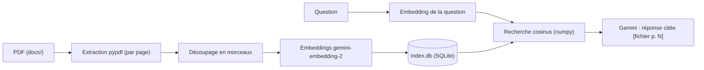

Vous avez une pile de PDF internes (guide d'accueil, politique de télétravail, procédure des notes de frais) et des collègues qui posent toujours les mêmes questions. Ce lab construit un **RAG** (*Retrieval-Augmented Generation*, génération augmentée par la recherche) : on retrouve d'abord les passages utiles dans vos documents, puis on demande au modèle de répondre **uniquement** avec eux, en citant le fichier et la page.

Tout tourne sur votre poste : les PDF et l'index restent chez vous, seuls les morceaux de texte envoyés pour le calcul des embeddings et la question partent vers l'API Gemini.

## Pour qui ?

- Vous savez lancer un script Python et installer des paquets avec `pip`.
- Vous n'avez jamais construit de RAG, ou vous en avez utilisé un sans savoir ce qu'il y a dedans.
- Aucune base de données vectorielle à installer : SQLite est fourni avec Python.

## Ce que vous allez construire

Un **embedding** est une liste de nombres (ici 768) qui représente le sens d'un texte : deux textes proches en sens ont des vecteurs proches. La recherche consiste donc à trouver les morceaux dont le vecteur ressemble le plus à celui de la question.

## Prérequis

- Python 3.10 ou plus récent.
- Une clé d'API Gemini créée dans Google AI Studio, placée dans un fichier `.env` (modèle : [.env.example](./files/.env.example)).
- Les dépendances : `pip install -r requirements.txt` ([requirements.txt](./files/requirements.txt)).

## Programme

| Module | Leçon | Ce que vous faites | Fichiers |
| --- | --- | --- | --- |
| 1. Le cas d'usage | Le cas et l'architecture | générer les PDF fictifs, comprendre chaque brique | `make_pdfs.py` |
| 2. Construire | Extraire, découper, indexer | pypdf, découpage, SQLite, réindexation par hash | `rag.py` |
| 2. Construire | Rechercher et répondre avec citations | recherche cosinus, prompt cité, refus | `rag.py` |
| 3. Évaluer | Tester, évaluer, exploiter | tests sans clé, rappel@k, fidélité, refus corrects | `test_rag.py`, `eval.py`, `golden.json` |

## En local ou sur GCP ?

| | Ce lab (en local) | Équivalent sur Google Cloud |
| --- | --- | --- |
| Stockage des PDF | dossier `docs/` | bucket Cloud Storage |
| Index | fichier `index.db` | Vertex AI RAG Engine ou Vector Search |
| Clé | clé d'API AI Studio | identifiants du projet (IAM), Vertex AI |
| Idéal pour | prototyper, quelques centaines de documents | partage en équipe, gros volumes, contrôle d'accès |

Le code complet est dans le dossier [files](./files/rag.py) : `make_pdfs.py`, `rag.py`, `eval.py`, `golden.json`, `test_rag.py`.
