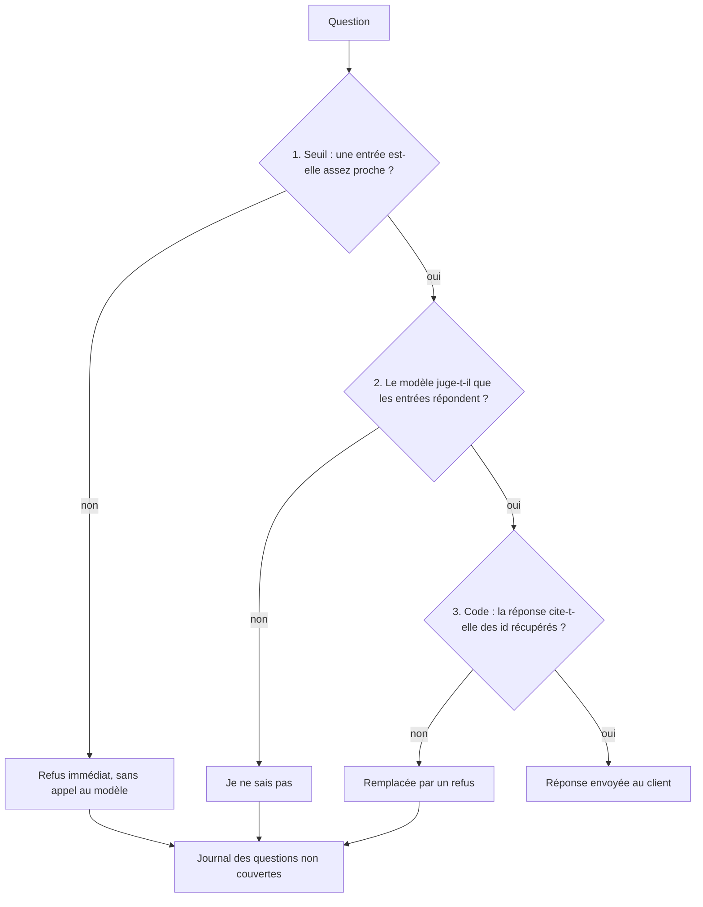

# Le SAV et ses garde-fous

> [!NOTE]
> Dans cette leçon, vous allez découvrir la FAQ fictive de la boutique Roue Libre, comprendre pourquoi un assistant de SAV doit savoir refuser, et repérer les trois niveaux de refus que le lab met en place.

## Le cas d'usage

Roue Libre (boutique **fictive**) reçoit chaque jour les mêmes questions : délais, frais de livraison, retours, garantie de la batterie. Sa FAQ tient en 16 entrées ([faq.json](../files/faq.json)) :

```json title="files/faq.json (extrait)"
{"id": "FAQ-07", "categorie": "retours", "question": "Quand serai-je remboursé ?",
 "reponse": "Le remboursement est effectué sur le moyen de paiement d'origine sous 10 jours après réception et contrôle du retour à l'entrepôt."}
```

Chaque entrée a un **identifiant stable** (`FAQ-07`). C'est lui que l'assistant citera, et c'est lui que le code vérifiera.

## Pourquoi refuser est une fonctionnalité

Un client demande « Proposez-vous une assurance contre le vol ? ». La FAQ n'en parle pas. Un modèle sans garde-fou répondra souvent quelque chose de plausible (« oui, en partenariat avec… ») : c'est une **hallucination**, et dans un SAV elle engage la boutique. La bonne réponse est : « Je ne sais pas, un conseiller peut vous répondre. »

| Réponse | Coût pour la boutique |
| --- | --- |
| juste et citée | aucun : le client est servi |
| « Je ne sais pas » + contact | un ticket pour un humain |
| inventée | promesse non tenue, litige, perte de confiance |

## Les trois niveaux de refus



1. **Le seuil** est déterministe et gratuit : on compare le meilleur score de similarité à une valeur calibrée. Il élimine les questions franchement hors sujet.
2. **Le modèle** élimine les cas subtils : l'entrée la plus proche parle de livraison, mais pas de livraison **en Suisse**.
3. **Le code** ne fait confiance à personne : une réponse sans `[FAQ-xx]` ou avec un identifiant qui n'a pas été récupéré est rejetée.

```quiz
question: "Pourquoi le premier niveau de refus (le seuil) est-il placé avant l'appel au modèle ?"
options:
  - "Parce que le modèle ne sait pas refuser"
  - "Parce qu'il est gratuit, rapide et déterministe : une question hors sujet ne coûte aucun appel de génération"
  - "Parce que l'API l'impose"
answer: 1
explanation: "Un test de score coûte une multiplication de vecteurs. Il ne remplace pas le jugement du modèle, mais il filtre à coût nul les cas évidents et ne dépend pas de l'humeur du modèle."
```

```quiz
question: "Quels refus doivent alimenter le journal des questions non couvertes ?"
options:
  - "Seulement ceux du seuil"
  - "Tous : seuil, modèle et citation invalide"
  - "Aucun : on ne garde que les réponses réussies"
answer: 1
explanation: "Chaque refus signale une question que la FAQ ne couvre pas (ou mal). Les regrouper montre quelles entrées écrire en priorité."
```

## Chaîne simple ou agent ?

Le lab propose deux versions qui partagent le même cœur (`faq_rag.rechercher`) :

| | Chaîne simple (`faq_rag.repondre`) | Agent ADK (`agent.py`) |
| --- | --- | --- |
| Appels de génération par question | 0 ou 1 | 2 en général (décider l'outil, puis répondre) |
| Reformulation de la question | non | oui, l'agent choisit le texte envoyé à l'outil |
| Conversation sur plusieurs tours | à coder | gérée par la session ADK |
| Quand la choisir | FAQ, une question = une réponse | dialogue, plusieurs outils (suivi de commande…) |

> [!TIP]
> Commencez toujours par la chaîne simple. Passez à l'agent quand il faut **plusieurs outils** ou **plusieurs tours** ; le garde-fou des citations reste le même.

## Exercice : trouver les questions pièges

Sans lancer de code, classez ces questions : couverte par la FAQ, hors périmètre évident, ou piège (proche d'une entrée mais non couverte). « Livrez-vous à Bruxelles ? », « Livrez-vous à Genève ? », « Puis-je louer un vélo ? », « Quel temps fera-t-il demain ? ».

<details>
<summary>Voir la solution</summary>

| Question | Classement | Pourquoi |
| --- | --- | --- |
| Livrez-vous à Bruxelles ? | couverte | FAQ-03 : Belgique, 7 à 10 jours |
| Livrez-vous à Genève ? | couverte | FAQ-03 dit explicitement « pas en Suisse » : la bonne réponse est « non », citée |
| Puis-je louer un vélo ? | piège | proche de FAQ-16 (essais), mais la location n'est pas mentionnée |
| Quel temps fera-t-il demain ? | hors périmètre évident | aucun lien avec la FAQ |

Les pièges sont ceux qui mettent le seuil en difficulté : leur score est plus haut que celui d'une question absurde. C'est pour eux que le niveau 2 existe.

</details>

## Résultat obtenu

Exécution réelle du 2026-10-15, chaîne simple :

```text
$ python faq_rag.py ask "Combien coûte la livraison d'un vélo ?"
La livraison d'un vélo coûte 39 euros, montage compris [FAQ-02].
  (sources : ['FAQ-02', 'FAQ-01'], raison du refus : None)
$ python faq_rag.py ask "Vendez-vous des trottinettes ?"
Je ne sais pas : cette question n'est pas couverte par notre FAQ. Un conseiller peut vous répondre via le formulaire de contact.
  (sources : [], raison du refus : seuil)
```

La seconde question a été refusée au niveau 1 : aucun appel de génération.

## Je sais faire

- [ ] Expliquer pourquoi un refus vaut mieux qu'une réponse inventée dans un SAV
- [ ] Décrire les trois niveaux de refus et leur coût
- [ ] Choisir entre chaîne simple et agent
