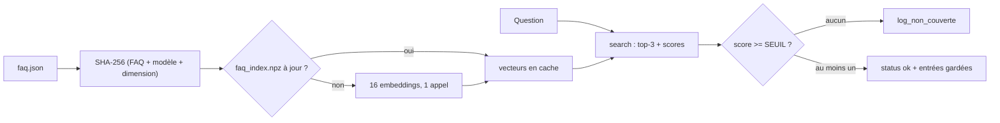

# Index, seuil et journal

> [!NOTE]
> Dans cette leçon, vous allez écrire le cœur de `faq_rag.py` : un index de FAQ mis en cache, la fonction `rechercher` avec son seuil, le journal des questions non couvertes, et la calibration du seuil sur des questions de référence.



## 1. Un index qui tient dans un fichier

Une entrée de FAQ est courte : inutile de la découper. **Un morceau = une entrée**, question et réponse ensemble (la question aide à retrouver, la réponse apporte les mots du client).

```python title="files/faq_rag.py"
class FAQIndex:
    def __init__(self, faq_path=FAQ_PATH, index_path=INDEX_PATH, embed_fn=embed):
        self.embed_fn = embed_fn
        raw = Path(faq_path).read_bytes()
        self.entries = json.loads(raw)
        self.by_id = {e["id"]: e for e in self.entries}
        digest = hashlib.sha256(raw + f"{EMBED_MODEL}/{DIM}".encode()).hexdigest()
        cache = Path(index_path) if index_path else None
        if cache and cache.exists() and str(np.load(cache)["digest"]) == digest:
            self.vecs = np.load(cache)["vecs"]
        else:  # FAQ modifiée (ou modèle changé) : on recalcule tout, c'est petit
            self.vecs = embed_fn([f"{e['question']}\n{e['reponse']}" for e in self.entries])
            if cache:
                np.savez(cache, vecs=self.vecs, digest=digest)
```

L'empreinte inclut le **nom du modèle et la dimension** : changer `EMBED_DIM` invalide le cache automatiquement, au lieu de comparer des vecteurs incompatibles.

> [!TIP]
> 16 entrées = un seul appel d'embedding. Pour une FAQ de quelques centaines d'entrées, tout recalculer à chaque modification reste raisonnable ; l'incrémental du lab 1 ne vaut le coup qu'au-delà.

## 2. Rechercher avec un seuil

```python title="files/faq_rag.py"
def rechercher(index, question, seuil=None, k=K, log_path=None):
    """Le cœur partagé par la chaîne simple et l'outil de l'agent."""
    seuil = SEUIL if seuil is None else seuil
    hits = index.search(question, k)
    gardes = [h for h in hits if h["score"] >= seuil]
    if not gardes:
        log_non_couverte(question, hits[0]["score"] if hits else None, log_path)
        return {"status": "hors_perimetre", "meilleur_score": hits[0]["score"] if hits else None}
    return {"status": "ok", "resultats": [
        {"id": h["id"], "question": h["question"], "reponse": h["reponse"], "score": h["score"]}
        for h in gardes]}
```

Le seuil ne garde pas seulement « oui ou non » : il **filtre aussi les entrées** faiblement liées, pour ne pas distraire le modèle. Le journal est un fichier JSONL (une ligne JSON par événement), facile à relire ou à charger dans un tableur :

```python title="files/faq_rag.py"
def log_non_couverte(question, meilleur_score, path=None):
    with open(path or LOG_PATH, "a", encoding="utf-8") as f:
        f.write(json.dumps({"date": datetime.now(timezone.utc).isoformat(timespec="seconds"),
                            "question": question, "meilleur_score": meilleur_score},
                           ensure_ascii=False) + "\n")
```

```quiz
question: "Pourquoi les paramètres seuil et log_path valent None par défaut au lieu de SEUIL et LOG_PATH ?"
options:
  - "Pour que la valeur du module soit lue au moment de l'appel (et puisse être changée dans un test ou par configuration)"
  - "Parce que Python interdit une constante comme valeur par défaut"
  - "Pour économiser de la mémoire"
answer: 0
explanation: "Une valeur par défaut est évaluée une seule fois, à la définition de la fonction. Avec None puis SEUIL au moment de l'appel, modifier faq_rag.SEUIL (test, réglage) est pris en compte partout, y compris dans l'outil de l'agent."
```

## 3. Calibrer le seuil

Un seuil choisi « au feeling » est soit trop haut (faux refus), soit trop bas (hallucinations). On le **calibre** : on prend des questions de référence dont on sait si elles sont couvertes, on regarde leur meilleur score, et on cherche la valeur qui les sépare le mieux.

```python title="files/eval.py"
def calibrer(golden, all_hits):
    best = [(h[0]["score"], bool(g["attendu"])) for g, h in zip(golden, all_hits)]
    scores = sorted({s for s, _ in best})
    candidats = [round((a + b) / 2, 3) for a, b in zip(scores, scores[1:])] or scores
    acc = lambda t: sum((s >= t) == couverte for s, couverte in best) / len(best)
    seuil = max(candidats, key=lambda t: (acc(t), -t))
    return seuil, acc(seuil), sorted(best, reverse=True)
```

Les candidats sont les **milieux** entre deux scores voisins : le seuil retenu laisse une marge des deux côtés au lieu de coller au score le plus bas d'une question couverte. À précision égale, on garde le plus bas, qui produit moins de faux refus. Le calcul des embeddings des 13 questions se fait en **un seul appel**.

```quiz
question: "La calibration donne 100 % de questions bien triées sur 13 questions. Que faut-il en conclure ?"
options:
  - "Le seuil est parfait pour toujours"
  - "Le seuil sépare bien CE jeu ; il faut le revérifier quand la FAQ ou les questions réelles évoluent"
  - "Le modèle de génération est inutile"
answer: 1
explanation: "On calibre et on mesure ici sur les mêmes 13 questions : c'est optimiste. Gardez un second jeu de questions pour vérifier, et recalibrez à chaque changement de FAQ ou de modèle d'embedding."
```

## Exercice : séparer calibration et test

Modifiez `eval.py --calibrer` pour calibrer sur les questions d'indice pair de `golden.json` et afficher la précision obtenue sur les questions d'indice impair.

<details>
<summary>Voir la solution</summary>

```python title="files/eval.py (dans main, branche --calibrer)"
    if mode == "--calibrer":
        cal, test = golden[0::2], golden[1::2]
        seuil, acc_cal, _ = calibrer(cal, all_hits[0::2])
        bons = sum((h[0]["score"] >= seuil) == bool(g["attendu"])
                   for g, h in zip(test, all_hits[1::2]))
        print(f"seuil {seuil:.3f} : calibration {acc_cal:.0%}, test {bons / len(test):.0%}")
        return
```

Avec si peu de questions, l'écart entre les deux pourcentages est surtout du bruit ; l'habitude, elle, est la bonne. Sur un vrai SAV, tirez les questions de test des vrais tickets.

</details>

## Résultat obtenu

Calibration réelle du 2026-10-15 (`gemini-embedding-2`, 768 dimensions) :

```text
$ python eval.py --calibrer
  0.792  couverte
  0.784  couverte
  0.768  couverte
  0.762  couverte
  0.762  couverte
  0.761  couverte
  0.756  couverte
  0.752  couverte
  0.733  couverte
  0.696  HORS PÉRIMÈTRE
  0.690  HORS PÉRIMÈTRE
  0.654  HORS PÉRIMÈTRE
  0.559  HORS PÉRIMÈTRE
seuil conseillé : 0.714 (questions bien triées : 100%)
```

> [!WARNING]
> L'écart entre la question couverte la plus faible (0,733) et la question hors périmètre la plus forte (0,696, « location de vélos au mois ») ne fait que 0,04. Ces valeurs dépendent du modèle, de la dimension et des préfixes : ne recopiez pas 0,71 dans un autre projet, recalibrez. Le seuil par défaut de `faq_rag.py` (variable `SEUIL`) vient de cette exécution.

## Je sais faire

- [ ] Construire un index de FAQ avec un cache invalidé par empreinte
- [ ] Filtrer les résultats par un seuil et journaliser les refus en JSONL
- [ ] Calibrer un seuil sur des questions de référence et en connaître les limites
