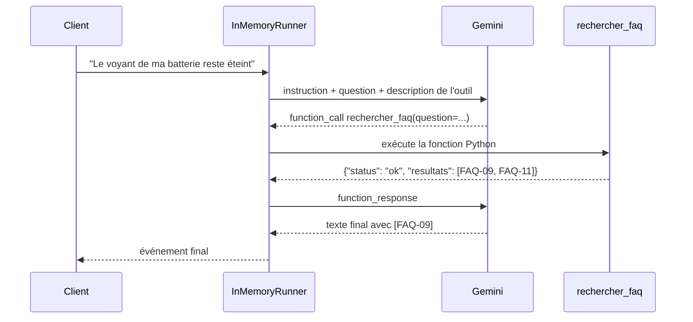

# L'agent ADK et la vérification des citations

> [!NOTE]
> Dans cette leçon, vous allez transformer la recherche en **outil** pour un agent Google ADK, écrire son instruction, l'exécuter avec un runner, puis vérifier en code que chaque réponse cite des entrées réellement récupérées.

## Rappel : ce qu'est un agent ADK

Un **agent** est un modèle à qui l'on donne des **outils** (des fonctions Python) et qui décide lui-même de les appeler. ADK (*Agent Development Kit*) fournit la classe `Agent`, transforme une fonction Python en outil à partir de sa signature et de sa docstring, et un **runner** qui exécute la boucle « le modèle demande l'outil → on l'exécute → on renvoie le résultat → le modèle répond ».



## 1. L'outil : une fonction avec une bonne docstring

```python title="files/agent.py"
def rechercher_faq(question: str) -> dict:
    """Cherche dans la FAQ officielle de la boutique Roue Libre les entrées qui répondent à la question.

    Args:
        question: la question du client, reformulée en une phrase claire.

    Returns:
        {"status": "ok", "resultats": [{"id", "question", "reponse", "score"}]} ou
        {"status": "hors_perimetre"} si aucune entrée n'est assez proche.
    """
    return faq_rag.rechercher(index(), question)
```

Le modèle ne lit pas le code, seulement le **nom**, les **types** et la **docstring** : c'est elle qui lui dit quand appeler l'outil et comment lire `hors_perimetre`. L'outil réutilise exactement `faq_rag.rechercher` : seuil et journal sont donc identiques dans les deux versions.

## 2. L'instruction et l'agent

```python title="files/agent.py"
INSTRUCTION = f"""Tu es l'assistant du service client de la boutique de vélos électriques Roue Libre.
Règles strictes :
1. Pour toute question du client, appelle d'abord l'outil rechercher_faq.
2. Réponds en français, en 1 à 3 phrases, UNIQUEMENT avec le contenu des résultats, et cite chaque
   identifiant utilisé entre crochets, par exemple [FAQ-02].
3. Si le statut est hors_perimetre, ou si les résultats ne répondent pas vraiment à la question,
   commence ta réponse exactement par "{faq_rag.REFUS}" et propose le formulaire de contact.
4. N'invente jamais un délai, un prix ou une politique qui n'est pas dans les résultats.
5. Pas de déduction, de conseil ni de formule de politesse qui ajoute une information : si le client
   demande « est-ce normal ? », rappelle la règle de la FAQ et laisse-le conclure.
6. N'utilise que les résultats qui répondent à la question ; ignore les autres."""

agent = Agent(name="sav_roue_libre", model=os.environ.get("MODEL", faq_rag.MODEL),
              instruction=INSTRUCTION, tools=[rechercher_faq])
```

Les règles 5 et 6 ont été ajoutées **après** une première évaluation (leçon suivante) : elles font passer la fidélité de 0,778 à 0,889.

## 3. Exécuter et vérifier

```python title="files/agent.py (extrait de ask)"
    async for ev in runner.run_async(user_id="client", session_id=s.id, new_message=msg):
        for p in (ev.content.parts if ev.content else []):
            if p.function_call:
                appels += 1
            if p.function_response and p.function_response.response:
                ids += [r["id"] for r in p.function_response.response.get("resultats", [])]
            if p.text and ev.is_final_response():
                final += p.text
    final = final.strip()
    if not faq_rag.verifier_citations(final, ids):  # le modèle a cité un id non récupéré, ou rien
        faq_rag.log_non_couverte(question, None)
        return {"answer": faq_rag.MESSAGE_REFUS, "refus": True, ...}
```

On récupère les identifiants **réellement renvoyés par l'outil** dans les événements `function_response`, puis on contrôle la réponse :

```python title="files/faq_rag.py"
def verifier_citations(texte, ids_autorises):
    """Une réponse (non refusée) doit citer au moins un id, et uniquement des id récupérés."""
    if texte.startswith(REFUS):
        return True
    cites = set(re.findall(r"FAQ-\d+", texte))
    return bool(cites) and cites <= set(ids_autorises)
```

| Réponse du modèle | `verifier_citations` | Ce que reçoit le client |
| --- | --- | --- |
| « … sous 10 jours [FAQ-07]. » avec FAQ-07 récupéré | vrai | la réponse |
| « … sous 10 jours. » (aucune citation) | faux | le refus + contact |
| « … gratuit [FAQ-99]. » (id inventé) | faux | le refus + contact |
| « Je ne sais pas… » | vrai | le refus du modèle |

```quiz
question: "Le modèle répond « Remboursement sous 10 jours [FAQ-07] » mais l'outil n'a renvoyé que FAQ-06. Que fait le code ?"
options:
  - "Il envoie la réponse, car FAQ-07 existe dans la FAQ"
  - "Il la remplace par le message de refus et journalise la question"
  - "Il relance l'agent jusqu'à obtenir une bonne citation"
answer: 1
explanation: "Ce qui compte n'est pas que l'id existe, mais qu'il ait été récupéré pour CETTE question : sinon le modèle cite de mémoire, sans preuve. On refuse et on garde une trace."
```

```quiz
question: "Qu'est-ce qui décrit l'outil rechercher_faq au modèle ?"
options:
  - "Le corps de la fonction Python"
  - "Son nom, ses paramètres typés et sa docstring, convertis par ADK en déclaration de fonction"
  - "Le fichier faq.json"
answer: 1
explanation: "ADK construit la déclaration de l'outil à partir de la signature et de la docstring. Une docstring vague donne un outil mal utilisé."
```

## Exercice : un second outil

Ajoutez un outil `ouvrir_ticket(email: str, resume: str) -> dict` qui renvoie `{"status": "ok", "ticket": "T-0001"}` (simulé), et une règle d'instruction : après un refus, proposer d'ouvrir un ticket, et ne l'ouvrir que si le client donne son e-mail.

<details>
<summary>Voir la solution</summary>

```python title="files/agent.py (ajout)"
import itertools
_compteur = itertools.count(1)

def ouvrir_ticket(email: str, resume: str) -> dict:
    """Ouvre un ticket pour un conseiller humain. N'appeler que si le client a donné son e-mail.

    Args:
        email: l'adresse e-mail fournie par le client.
        resume: la question du client en une phrase.
    """
    if "@" not in email:
        return {"status": "erreur", "message": "e-mail invalide"}
    return {"status": "ok", "ticket": f"T-{next(_compteur):04d}"}

INSTRUCTION += "\n7. Après un refus, propose d'ouvrir un ticket ; appelle ouvrir_ticket seulement avec l'e-mail donné par le client."
agent = Agent(name="sav_roue_libre", model=..., instruction=INSTRUCTION,
              tools=[rechercher_faq, ouvrir_ticket])
```

Le contrôle de l'e-mail est **dans le code** : l'instruction guide, le code garantit. Pour un échange sur plusieurs tours, réutilisez la même `session_id` au lieu d'en créer une à chaque question.

</details>

## Résultat obtenu

Exécution réelle du 2026-10-15 avec `gemini-3.5-flash` (instruction à 4 règles, avant l'ajout des règles 5 et 6) :

```text
$ python agent.py "Ma batterie ne charge plus, le voyant reste éteint"
Veuillez vérifier votre chargeur sur une autre prise ainsi que le voyant de la batterie [FAQ-09].
Si le voyant reste éteint, nous vous invitons à ouvrir une demande de garantie en fournissant le
numéro de série gravé sous la batterie [FAQ-09].
  (outil appelé 1 fois, id récupérés : ['FAQ-09', 'FAQ-11'])
```

> [!TIP]
> ADK 2.10 affiche au premier appel `UserWarning: [EXPERIMENTAL] feature JSON_SCHEMA_FOR_FUNC_DECL is enabled.` : c'est un avertissement d'information sur la façon dont il génère la déclaration de l'outil, pas une erreur.

## Je sais faire

- [ ] Exposer une fonction Python comme outil ADK avec une docstring utile
- [ ] Exécuter un agent avec `InMemoryRunner` et lire les événements
- [ ] Vérifier en code que les citations correspondent aux résultats de l'outil
