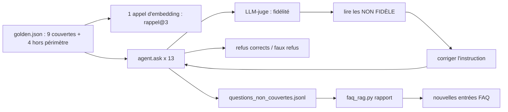

# Évaluer et enrichir la FAQ

> [!NOTE]
> Dans cette leçon, vous allez tester l'assistant sans clé, mesurer l'agent sur 13 questions de référence (rappel@k, fidélité, refus corrects, faux refus), améliorer l'instruction en lisant les échecs, puis exploiter le journal des questions non couvertes.



## 1. Les tests sans clé

[test_faq.py](../files/test_faq.py) remplace les embeddings par un sac de mots haché et le modèle par des fonctions `lambda`. Il vérifie les garde-fous un par un :

```python title="files/test_faq.py (extrait)"
def test_repondre_garde_fous(idx, tmp_path):
    log = tmp_path / "log.jsonl"
    q = "Combien coûte la livraison ?"
    bon = faq_rag.repondre(idx, q, lambda p: "4,90 euros, gratuit dès 60 euros [FAQ-02].", 0.3, log)
    assert not bon["refus"] and "FAQ-02" in bon["ids"]
    invente = faq_rag.repondre(idx, q, lambda p: "Gratuit pour tous [FAQ-99].", 0.3, log)
    assert invente["refus"] and invente["raison"] == "citation invalide"
    hors = faq_rag.repondre(idx, "tarte tatin pommes caramel", lambda p: 1 / 0, 0.5, log)
    assert hors["raison"] == "seuil"  # le modèle n'a même pas été appelé
```

Le faux modèle `lambda p: 1 / 0` lèverait une erreur s'il était appelé : le test **prouve** que le seuil coupe avant la génération.

## 2. Les quatre métriques

| Métrique | Calcul | Ce qu'elle protège |
| --- | --- | --- |
| rappel@3 | entrée attendue dans les 3 premiers résultats (avant seuil) | la recherche trouve la bonne entrée |
| fidélité | juge `gemini-3.5-flash-lite` : OUI si tout est soutenu par les entrées citées | pas d'invention dans les réponses données |
| refus corrects | refus / questions hors périmètre | pas de réponse inventée hors FAQ |
| faux refus | refus / questions couvertes | l'assistant reste utile |

```quiz
question: "Un réglage donne refus corrects = 1,0 et faux refus = 0,6. Que s'est-il probablement passé ?"
options:
  - "Le seuil est trop haut : il refuse aussi beaucoup de questions couvertes"
  - "Le seuil est trop bas"
  - "Le juge est trop sévère"
answer: 0
explanation: "Un seuil trop haut refuse tout ce qui n'est pas quasi identique à une entrée : les hors périmètre sont tous refusés, mais 60 % des questions légitimes aussi. Les deux taux se lisent toujours ensemble."
```

## 3. Mesurer, lire, corriger

```bash title="terminal"
python -m pytest -q
python eval.py --calibrer     # 1 appel
python eval.py                # agent : environ 45 appels (13 x 2 pour l'agent, 9 jugements, embeddings)
python eval.py --chaine       # chaîne simple, moitié moins d'appels (non mesurée dans ce lab)
```

La première exécution réelle (instruction à 4 règles) a donné :

```text
{"mode": "agent", "seuil": 0.71, "rappel@k": 1.0, "fidelite": 0.778, "refus_corrects": 1.0, "faux_refus": 0.0}
```

Deux réponses sur neuf ajoutaient une **déduction** absente de la FAQ, par exemple : « Les vélos sont livrés en 5 à 8 jours ouvrés […] [FAQ-01]. Il est donc tout à fait normal… ». Plausible, mais la FAQ ne le dit pas. D'où les règles 5 et 6 de l'instruction (pas de déduction, ignorer les résultats hors sujet).

```quiz
question: "La fidélité passe de 0,778 à 0,889 après modification de l'instruction. Que peut-on affirmer honnêtement ?"
options:
  - "L'instruction est 14 % meilleure"
  - "Sur ces 9 questions, une réponse non fidèle de moins ; il faut plus de questions pour conclure à une amélioration générale"
  - "Le modèle ne fera plus jamais d'erreur"
answer: 1
explanation: "Passer de 7/9 à 8/9, c'est une réponse. Un modèle génératif varie d'une exécution à l'autre : sur si peu de questions, l'écart peut être du hasard. Agrandissez le jeu et relancez plusieurs fois avant de conclure."
```

## Résultat obtenu

Deuxième exécution réelle du 2026-10-15 (instruction à 6 règles, `gemini-3.5-flash`, seuil 0,71) :

```text
$ python -m pytest -v   →   7 passed in 0.66s

$ python eval.py
[ok] Je n'ai toujours pas reçu mon vélo, c'est normal au bout de 6 jours ?
        -> Les vélos sont livrés en 5 à 8 jours ouvrés en France métropolitaine [FAQ-01].
[NON FIDÈLE] Vous expédiez à Genève ?
        -> Nous ne livrons pas en Suisse pour le moment [FAQ-03]. Nous livrons uniquement en Belgique
           et au Luxembourg [FAQ-03].
[ok] Le voyant de ma batterie reste éteint quand je la branche
        -> Vérifiez le chargeur sur une autre prise. Si le voyant reste éteint, ouvrez une demande de
           garantie avec le numéro de série gravé sous la batterie [FAQ-09].
...
[REFUS] Proposez-vous une assurance contre le vol ?
        -> Je ne sais pas. Je vous invite à poser votre question via notre formulaire de contact.
{"mode": "agent", "seuil": 0.71, "rappel@k": 1.0, "fidelite": 0.889, "refus_corrects": 1.0, "faux_refus": 0.0}

$ python faq_rag.py rapport
  1 x vendez vous des trottinettes électriques
  1 x proposez vous la location de vélos au mois
  1 x proposez vous une assurance contre le vol
  1 x quelle est la recette de la tarte tatin
```

Le juge a eu raison sur Genève : « uniquement en Belgique et au Luxembourg » est faux (la boutique livre aussi en France). La citation était valide, l'affirmation non : **la vérification des citations ne remplace pas la mesure de fidélité**.

> [!WARNING]
> Ces 4 refus corrects viennent tous du **seuil** (meilleurs scores entre 0,56 et 0,70, sous 0,714). Le niveau 2 (refus par le modèle) n'a pas été sollicité par ce jeu : ajoutez des questions pièges dont le score dépasse le seuil pour le tester.

## 4. Enrichir la FAQ

Le rapport regroupe les questions par texte normalisé (minuscules, ponctuation retirée) et les trie par fréquence. Chaque semaine :

1. lire le haut du rapport, écarter le hors-sujet (tarte tatin) ;
2. écrire une entrée pour les vraies demandes (`FAQ-17` : « Proposez-vous la location ? ») ;
3. relancer `eval.py --calibrer` : les questions passent de « hors périmètre » à « couverte » dans `golden.json`, et le seuil peut bouger.

> [!TIP]
> Le regroupement par texte exact est volontairement simple. Quand le journal grossit, regroupez par **similarité** : embeddez les questions journalisées et fusionnez celles dont le cosinus dépasse 0,9.

## Exercice : corriger le cas Genève

Proposez une modification de la **FAQ** (pas du code) qui rend la mauvaise réponse sur Genève moins probable, et dites comment vérifier que ça marche.

<details>
<summary>Voir la solution</summary>

Le mot « uniquement » vient d'une lecture trop rapide de FAQ-03, qui ne parle que de l'étranger. Rendez l'entrée explicite :

```json title="files/faq.json (FAQ-03 réécrite)"
{"id": "FAQ-03", "categorie": "livraison", "question": "Livrez-vous à l'étranger (Belgique, Suisse) ?",
 "reponse": "En plus de la France métropolitaine, nous livrons en Belgique et au Luxembourg (7 à 10 jours ouvrés). Nous ne livrons pas en Suisse pour le moment."}
```

Vérification : `FAQIndex` voit que `faq.json` a changé (empreinte) et recalcule l'index ; relancez `python eval.py --calibrer` puis `python eval.py`, et lisez la ligne de Genève. Lancez-le deux ou trois fois : une seule exécution réussie ne prouve pas que le problème a disparu.

</details>

## Je sais faire

- [ ] Prouver par un test qu'un garde-fou coupe avant l'appel au modèle
- [ ] Lire ensemble refus corrects et faux refus
- [ ] Améliorer une instruction à partir des réponses jugées non fidèles, et rester prudent sur l'interprétation
- [ ] Transformer le journal des questions non couvertes en nouvelles entrées de FAQ
