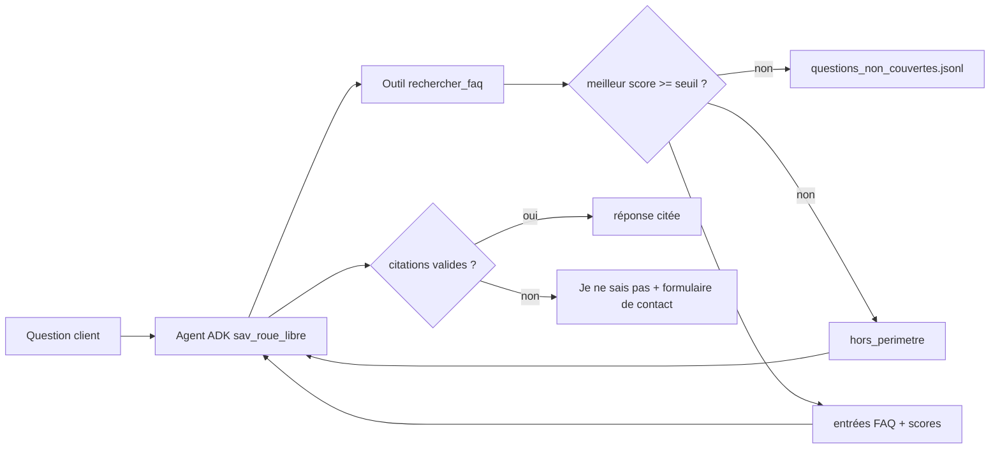

Un assistant de service après-vente (SAV) qui invente un délai de remboursement coûte plus cher qu'un assistant qui n'existe pas. Ce lab construit un assistant pour **Roue Libre**, une boutique **fictive** de vélos électriques, avec trois garde-fous mesurés :

1. un **seuil de pertinence** : si aucune entrée de FAQ n'est assez proche de la question, on refuse **sans appeler le modèle** ;
2. des **citations obligatoires** `[FAQ-xx]`, vérifiées par du code : une réponse sans citation, ou qui cite une entrée non récupérée, est remplacée par un refus ;
3. un **journal des questions non couvertes**, pour savoir quelles entrées ajouter à la FAQ.

## Ce que vous allez construire

## Pour qui ?

- Vous avez fait le [lab 1](../01-rag-pdf-local-sqlite/index.md) ou vous savez ce que sont un embedding et une similarité cosinus.
- Vous voulez comprendre comment rendre un RAG **prudent** et le prouver par des chiffres.
- Première rencontre avec ADK (*Agent Development Kit*, le framework d'agents de Google) : tout est expliqué.

## Prérequis

- Python 3.10+, une clé d'API Gemini dans `.env` (voir [.env.example](./files/.env.example)).
- `pip install -r requirements.txt` ([requirements.txt](./files/requirements.txt)) : google-genai, google-adk, numpy.

## Programme

| Module | Leçon | Ce que vous faites | Fichiers |
| --- | --- | --- | --- |
| 1. Le cas d'usage | Le SAV et ses garde-fous | les 3 façons de refuser, la FAQ fictive | `faq.json` |
| 2. Construire | Index, seuil et journal | index en cache, recherche, calibration du seuil | `faq_rag.py`, `eval.py --calibrer` |
| 2. Construire | L'agent ADK et la vérification des citations | outil, instruction, runner, garde-fou | `agent.py` |
| 3. Évaluer | Évaluer et enrichir la FAQ | tests sans clé, 4 métriques, itération sur l'instruction, rapport | `test_faq.py`, `eval.py`, `golden.json` |

## En local ou sur GCP ?

| | Ce lab | Sur Google Cloud |
| --- | --- | --- |
| FAQ | `faq.json` | document dans Cloud Storage ou base de connaissances |
| Index | `faq_index.npz` (16 vecteurs) | Vertex AI RAG Engine |
| Agent | `InMemoryRunner` en local | Agent Engine ou Cloud Run |
| Journal | fichier JSONL | BigQuery ou Cloud Logging |

Le code complet : [faq_rag.py](./files/faq_rag.py), [agent.py](./files/agent.py), [eval.py](./files/eval.py), [test_faq.py](./files/test_faq.py).
